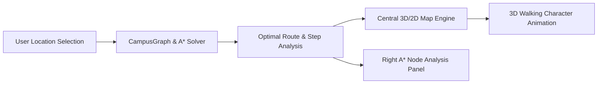

# CampusXplore — Complete Codebase Documentation

> **Project**: CampusXplore: Smart College Campus Navigation Using A* Algorithm  
> **Architecture**: React 18, TypeScript, Vite, Three.js (@react-three/fiber), Tailwind CSS  
> **Deployment**: Vercel Production (`https://campusxplore-zeta.vercel.app`)  
> **Repository**: `https://github.com/FqSyd/CampusXplore.git`  
> **Date**: November 2026  

---

## Table of Contents

- [1. Project Build & Toolchain Configuration](#1-project-build--toolchain-configuration)
  - [`package.json`](#packagejson)
  - [`tsconfig.json`](#tsconfigjson)
  - [`tsconfig.app.json`](#tsconfigappjson)
  - [`tsconfig.node.json`](#tsconfignodejson)
  - [`vite.config.ts`](#viteconfigts)
  - [`tailwind.config.js`](#tailwindconfigjs)
  - [`postcss.config.js`](#postcssconfigjs)
  - [`index.html`](#indexhtml)
  - [`vercel.json`](#verceljson)
- [2. Application Root & Core Styling](#2-application-root--core-styling)
  - [`src/main.tsx`](#srcmaintsx)
  - [`src/App.tsx`](#srcapptsx)
  - [`src/app/App.tsx`](#srcappapptsx)
  - [`src/app/main.tsx`](#srcappmaintsx)
  - [`src/index.css`](#srcindexcss)
  - [`src/styles/globals.css`](#srcstylesglobalscss)
- [3. A* Pathfinding Algorithm & Graph Models](#3-a*-pathfinding-algorithm--graph-models)
  - [`src/algorithms/astar/astar.ts`](#srcalgorithmsastarastarts)
  - [`src/algorithms/astar/astarSteps.ts`](#srcalgorithmsastarastarstepsts)
  - [`src/algorithms/astar/astarTypes.ts`](#srcalgorithmsastarastartypests)
  - [`src/algorithms/astar/heuristic.ts`](#srcalgorithmsastarheuristicts)
  - [`src/algorithms/astar/index.ts`](#srcalgorithmsastarindexts)
  - [`src/algorithms/graph/graph.ts`](#srcalgorithmsgraphgraphts)
  - [`src/algorithms/graph/graphBuilder.ts`](#srcalgorithmsgraphgraphbuilderts)
  - [`src/algorithms/graph/graphTypes.ts`](#srcalgorithmsgraphgraphtypests)
  - [`src/algorithms/graph/index.ts`](#srcalgorithmsgraphindexts)
  - [`src/algorithms/astar.ts`](#srcalgorithmsastarts)
  - [`src/algorithms/graph.ts`](#srcalgorithmsgraphts)
  - [`src/algorithms/heuristic.ts`](#srcalgorithmsheuristicts)
  - [`src/algorithms/index.ts`](#srcalgorithmsindexts)
- [4. Campus Spatial Data, Obstacles & Waypoint Networks](#4-campus-spatial-data,-obstacles--waypoint-networks)
  - [`src/data/campus/buildings.ts`](#srcdatacampusbuildingsts)
  - [`src/data/campus/nodes.ts`](#srcdatacampusnodests)
  - [`src/data/campus/edges.ts`](#srcdatacampusedgests)
  - [`src/data/campus/obstacles.ts`](#srcdatacampusobstaclests)
  - [`src/data/campus/campusConfig.ts`](#srcdatacampuscampusconfigts)
  - [`src/data/campus/pathways.ts`](#srcdatacampuspathwaysts)
  - [`src/data/campus/index.ts`](#srcdatacampusindexts)
  - [`src/data/presets/demoRoutes.ts`](#srcdatapresetsdemoroutests)
  - [`src/data/presets/index.ts`](#srcdatapresetsindexts)
  - [`src/data/buildings.json`](#srcdatabuildingsjson)
  - [`src/data/paths.json`](#srcdatapathsjson)
  - [`src/data/campus.json`](#srcdatacampusjson)
  - [`src/data/obstacles.json`](#srcdataobstaclesjson)
  - [`src/data/buildings.ts`](#srcdatabuildingsts)
  - [`src/data/campus.ts`](#srcdatacampusts)
  - [`src/data/campusUpdates.ts`](#srcdatacampusupdatests)
  - [`src/data/pathways.ts`](#srcdatapathwaysts)
  - [`src/data/index.ts`](#srcdataindexts)
- [5. Interactive 3D Campus Simulation Engine](#5-interactive-3d-campus-simulation-engine)
  - [`src/components/campus3d/Campus3D.tsx`](#srccomponentscampus3dcampus3dtsx)
  - [`src/components/campus3d/Building.tsx`](#srccomponentscampus3dbuildingtsx)
  - [`src/components/campus3d/Pathways.tsx`](#srccomponentscampus3dpathwaystsx)
  - [`src/components/campus3d/Obstacles.tsx`](#srccomponentscampus3dobstaclestsx)
  - [`src/components/campus3d/NavigationMarker.tsx`](#srccomponentscampus3dnavigationmarkertsx)
  - [`src/components/campus3d/NavigationRoute.tsx`](#srccomponentscampus3dnavigationroutetsx)
  - [`src/components/campus3d/WalkingCharacter.tsx`](#srccomponentscampus3dwalkingcharactertsx)
  - [`src/components/campus3d/StaticCharacters.tsx`](#srccomponentscampus3dstaticcharacterstsx)
  - [`src/components/campus3d/CampusLabels.tsx`](#srccomponentscampus3dcampuslabelstsx)
  - [`src/components/campus3d/CameraController.tsx`](#srccomponentscampus3dcameracontrollertsx)
  - [`src/components/campus3d/CampusEnvironment.tsx`](#srccomponentscampus3dcampusenvironmenttsx)
  - [`src/components/campus3d/index.ts`](#srccomponentscampus3dindexts)
  - [`src/components/campus/Campus3D.tsx`](#srccomponentscampuscampus3dtsx)
  - [`src/components/campus/index.ts`](#srccomponentscampusindexts)
  - [`src/components/walker/WalkingCharacter.tsx`](#srccomponentswalkerwalkingcharactertsx)
  - [`src/components/walker/index.ts`](#srccomponentswalkerindexts)
- [6. 2D Topographic Campus Map](#6-2d-topographic-campus-map)
  - [`src/components/campus2d/Campus2D.tsx`](#srccomponentscampus2dcampus2dtsx)
  - [`src/components/campus2d/MapBuildings.tsx`](#srccomponentscampus2dmapbuildingstsx)
  - [`src/components/campus2d/MapNodes.tsx`](#srccomponentscampus2dmapnodestsx)
  - [`src/components/campus2d/MapPaths.tsx`](#srccomponentscampus2dmappathstsx)
  - [`src/components/campus2d/MapRoute.tsx`](#srccomponentscampus2dmaproutetsx)
  - [`src/components/campus2d/index.ts`](#srccomponentscampus2dindexts)
  - [`src/components/map/Campus2D.tsx`](#srccomponentsmapcampus2dtsx)
  - [`src/components/map/index.ts`](#srccomponentsmapindexts)
- [7. Map Controls, Camera Toolbar & View Selection](#7-map-controls,-camera-toolbar--view-selection)
  - [`src/components/map/MapToolbar.tsx`](#srccomponentsmapmaptoolbartsx)
  - [`src/components/camera/CameraControls.tsx`](#srccomponentscameracameracontrolstsx)
  - [`src/components/camera/index.ts`](#srccomponentscameraindexts)
- [8. Campus Navigation Sidebar & Route Controls](#8-campus-navigation-sidebar--route-controls)
  - [`src/components/navigation/NavigationPanel.tsx`](#srccomponentsnavigationnavigationpaneltsx)
  - [`src/components/navigation/LocationSelector.tsx`](#srccomponentsnavigationlocationselectortsx)
  - [`src/components/navigation/RouteButton.tsx`](#srccomponentsnavigationroutebuttontsx)
  - [`src/components/navigation/PresetRoutes.tsx`](#srccomponentsnavigationpresetroutestsx)
  - [`src/components/navigation/ObstacleControlPanel.tsx`](#srccomponentsnavigationobstaclecontrolpaneltsx)
  - [`src/components/navigation/index.ts`](#srccomponentsnavigationindexts)
  - [`src/components/route/NavigationRoute.tsx`](#srccomponentsroutenavigationroutetsx)
  - [`src/components/route/RouteInfo.tsx`](#srccomponentsrouterouteinfotsx)
  - [`src/components/route/RouteStatus.tsx`](#srccomponentsrouteroutestatustsx)
  - [`src/components/route/index.ts`](#srccomponentsrouteindexts)
  - [`src/components/layout/Header.tsx`](#srccomponentslayoutheadertsx)
  - [`src/components/layout/index.ts`](#srccomponentslayoutindexts)
  - [`src/components/common/Button.tsx`](#srccomponentscommonbuttontsx)
  - [`src/components/common/Header.tsx`](#srccomponentscommonheadertsx)
  - [`src/components/common/Modal.tsx`](#srccomponentscommonmodaltsx)
  - [`src/components/common/Panel.tsx`](#srccomponentscommonpaneltsx)
  - [`src/components/common/index.ts`](#srccomponentscommonindexts)
  - [`src/components/ui/Button.tsx`](#srccomponentsuibuttontsx)
  - [`src/components/ui/CameraControls.tsx`](#srccomponentsuicameracontrolstsx)
  - [`src/components/ui/Modal.tsx`](#srccomponentsuimodaltsx)
  - [`src/components/ui/Panel.tsx`](#srccomponentsuipaneltsx)
  - [`src/components/ui/index.ts`](#srccomponentsuiindexts)
  - [`src/components/index.ts`](#srccomponentsindexts)
- [9. A* Algorithm Node Analysis & Visualization Components](#9-a*-algorithm-node-analysis--visualization-components)
  - [`src/components/algorithm/NodeAnalysisCard.tsx`](#srccomponentsalgorithmnodeanalysiscardtsx)
  - [`src/components/algorithm/AlgorithmVisualizer.tsx`](#srccomponentsalgorithmalgorithmvisualizertsx)
  - [`src/components/algorithm/AlgorithmCode.tsx`](#srccomponentsalgorithmalgorithmcodetsx)
  - [`src/components/algorithm/NodeInspector.tsx`](#srccomponentsalgorithmnodeinspectortsx)
  - [`src/components/algorithm/ScoreDisplay.tsx`](#srccomponentsalgorithmscoredisplaytsx)
  - [`src/components/algorithm/AlgorithmControls.tsx`](#srccomponentsalgorithmalgorithmcontrolstsx)
  - [`src/components/algorithm/index.ts`](#srccomponentsalgorithmindexts)
- [10. TypeScript Type Definitions, State & Utilities](#10-typescript-type-definitions,-state--utilities)
  - [`src/types/campus.ts`](#srctypescampusts)
  - [`src/types/navigation.ts`](#srctypesnavigationts)
  - [`src/types/algorithm.ts`](#srctypesalgorithmts)
  - [`src/types/index.ts`](#srctypesindexts)
  - [`src/hooks/useCampus.ts`](#srchooksusecampusts)
  - [`src/hooks/usePathfinding.ts`](#srchooksusepathfindingts)
  - [`src/hooks/index.ts`](#srchooksindexts)
  - [`src/services/navigationService.ts`](#srcservicesnavigationservicets)
  - [`src/services/index.ts`](#srcservicesindexts)
  - [`src/state/navigationStore.ts`](#srcstatenavigationstorets)
  - [`src/state/viewStore.ts`](#srcstateviewstorets)
  - [`src/state/index.ts`](#srcstateindexts)
  - [`src/utils/distance.ts`](#srcutilsdistancets)
  - [`src/utils/collision.ts`](#srcutilscollisionts)
  - [`src/utils/coordinates.ts`](#srcutilscoordinatests)
  - [`src/utils/graph.ts`](#srcutilsgraphts)
  - [`src/utils/routeUtils.ts`](#srcutilsrouteutilsts)
  - [`src/utils/index.ts`](#srcutilsindexts)
- [11. Verification & Automated Unit/Integration Test Suites](#11-verification--automated-unitintegration-test-suites)
  - [`tests/algorithms/astar.test.ts`](#testsalgorithmsastartestts)
  - [`tests/algorithms/graph.test.ts`](#testsalgorithmsgraphtestts)
  - [`tests/navigation/routes.test.ts`](#testsnavigationroutestestts)
  - [`tests/navigation/layout.test.ts`](#testsnavigationlayouttestts)

---

## Architectural Overview

CampusXplore is built as an interactive 3D/2D digital twin of a university campus. It demonstrates real-world application of the **A* (A-Star) Pathfinding Algorithm** with:

1. **Heuristic Evaluation**: $f(n) = g(n) + h(n)$ balancing accumulated path cost ($g$) with Euclidean distance ($h$).
2. **Walkable Navigation Graph**: 55+ bidirectional path edges and 36 waypoints designed with 100% collision clearance around physical campus buildings.
3. **Dynamic Re-routing**: Simulated campus maintenance and construction barricades trigger instantaneous recalculation of alternative detours.
4. **3D Walking Character**: Interactive animated student model that traverses the calculated A* route with smooth heading interpolation and speed tracking.
5. **Clean 3-Section Layout**: Left navigation sidebar, dynamic central 3D/2D map with compact toolbar, and dedicated right-side A* Node Analysis panel.



---

## 1. Project Build & Toolchain Configuration

*Configuration files governing TypeScript compiler, Vite bundler, Tailwind CSS design system, and deployment environments.*

<a id="packagejson"></a>
### File: `package.json`

- **Path**: `file:///D:/VIT TE SEM-5/Mini-Projects/AI/CampusXplore/package.json`
- **Lines**: 40 | **Size**: 1,287 bytes | **Language**: `json`

```json
{
  "name": "campusxplore",
  "private": true,
  "version": "1.0.0",
  "type": "module",
  "scripts": {
    "dev": "vite",
    "build": "tsc -b && vite build",
    "preview": "vite preview",
    "test": "npx tsx tests/algorithms/astar.test.ts && npx tsx tests/algorithms/graph.test.ts && npx tsx tests/navigation/routes.test.ts && npx tsx tests/navigation/layout.test.ts",
    "test:astar": "npx tsx tests/algorithms/astar.test.ts",
    "test:graph": "npx tsx tests/algorithms/graph.test.ts",
    "test:routes": "npx tsx tests/navigation/routes.test.ts",
    "test:layout": "npx tsx tests/navigation/layout.test.ts"
  },
  "dependencies": {
    "@react-three/drei": "^9.102.6",
    "@react-three/fiber": "^8.16.1",
    "canvas-confetti": "^1.9.2",
    "clsx": "^2.1.0",
    "lucide-react": "^0.359.0",
    "react": "^18.3.1",
    "react-dom": "^18.3.1",
    "tailwind-merge": "^2.2.2",
    "three": "^0.162.0"
  },
  "devDependencies": {
    "@types/canvas-confetti": "^1.9.0",
    "@types/node": "^20.11.24",
    "@types/react": "^18.3.1",
    "@types/react-dom": "^18.3.1",
    "@types/three": "^0.162.0",
    "@vitejs/plugin-react": "^4.2.1",
    "autoprefixer": "^10.4.18",
    "postcss": "^8.4.35",
    "tailwindcss": "^3.4.1",
    "typescript": "^5.4.2",
    "vite": "^5.1.6"
  }
}
```

---

<a id="tsconfigjson"></a>
### File: `tsconfig.json`

- **Path**: `file:///D:/VIT TE SEM-5/Mini-Projects/AI/CampusXplore/tsconfig.json`
- **Lines**: 7 | **Size**: 119 bytes | **Language**: `json`

```json
{
  "files": [],
  "references": [
    { "path": "./tsconfig.app.json" },
    { "path": "./tsconfig.node.json" }
  ]
}
```

---

<a id="tsconfigappjson"></a>
### File: `tsconfig.app.json`

- **Path**: `file:///D:/VIT TE SEM-5/Mini-Projects/AI/CampusXplore/tsconfig.app.json`
- **Lines**: 23 | **Size**: 513 bytes | **Language**: `json`

```json
{
  "compilerOptions": {
    "target": "ES2020",
    "useDefineForClassFields": true,
    "lib": ["ES2020", "DOM", "DOM.Iterable"],
    "module": "ESNext",
    "skipLibCheck": true,

    /* Bundler mode */
    "moduleResolution": "bundler",
    "resolveJsonModule": true,
    "isolatedModules": true,
    "noEmit": true,
    "jsx": "react-jsx",

    /* Linting */
    "strict": true,
    "noUnusedLocals": false,
    "noUnusedParameters": false,
    "noFallthroughCasesInSwitch": true
  },
  "include": ["src"]
}
```

---

<a id="tsconfignodejson"></a>
### File: `tsconfig.node.json`

- **Path**: `file:///D:/VIT TE SEM-5/Mini-Projects/AI/CampusXplore/tsconfig.node.json`
- **Lines**: 23 | **Size**: 558 bytes | **Language**: `json`

```json
{
  "compilerOptions": {
    "tsBuildInfoFile": "./node_modules/.tmp/tsconfig.node.tsbuildinfo",
    "target": "es2023",
    "lib": ["ES2023"],
    "types": ["node"],
    "skipLibCheck": true,

    /* Bundler mode */
    "module": "nodenext",
    "allowImportingTsExtensions": true,
    "verbatimModuleSyntax": true,
    "moduleDetection": "force",
    "noEmit": true,

    /* Linting */
    "noUnusedLocals": true,
    "noUnusedParameters": true,
    "erasableSyntaxOnly": true,
    "noFallthroughCasesInSwitch": true
  },
  "include": ["vite.config.ts"]
}
```

---

<a id="viteconfigts"></a>
### File: `vite.config.ts`

- **Path**: `file:///D:/VIT TE SEM-5/Mini-Projects/AI/CampusXplore/vite.config.ts`
- **Lines**: 7 | **Size**: 161 bytes | **Language**: `typescript`

```typescript
import react from '@vitejs/plugin-react'
import { defineConfig } from 'vite'

// https://vite.dev/config/
export default defineConfig({
  plugins: [react()],
})
```

---

<a id="tailwindconfigjs"></a>
### File: `tailwind.config.js`

- **Path**: `file:///D:/VIT TE SEM-5/Mini-Projects/AI/CampusXplore/tailwind.config.js`
- **Lines**: 33 | **Size**: 856 bytes | **Language**: `javascript`

```javascript
/** @type {import('tailwindcss').Config} */
export default {
  content: [
    "./index.html",
    "./src/**/*.{js,ts,jsx,tsx}",
  ],
  theme: {
    extend: {
      colors: {
        campus: {
          dark: '#0B0F17',
          card: '#121824',
          cardBorder: '#1E293B',
          accent: '#3B82F6',
          accentHover: '#2563EB',
          emerald: '#10B981',
          rose: '#F43F5E',
          amber: '#F59E0B',
          cyan: '#06B6D4',
        }
      },
      fontFamily: {
        sans: ['Inter', 'system-ui', '-apple-system', 'BlinkMacSystemFont', 'Segoe UI', 'Roboto', 'sans-serif'],
      },
      boxShadow: {
        'glow-blue': '0 0 25px -5px rgba(59, 130, 246, 0.4)',
        'glow-green': '0 0 25px -5px rgba(16, 185, 129, 0.4)',
        'glow-red': '0 0 25px -5px rgba(244, 63, 94, 0.4)',
      }
    },
  },
  plugins: [],
}
```

---

<a id="postcssconfigjs"></a>
### File: `postcss.config.js`

- **Path**: `file:///D:/VIT TE SEM-5/Mini-Projects/AI/CampusXplore/postcss.config.js`
- **Lines**: 6 | **Size**: 80 bytes | **Language**: `javascript`

```javascript
export default {
  plugins: {
    tailwindcss: {},
    autoprefixer: {},
  },
}
```

---

<a id="indexhtml"></a>
### File: `index.html`

- **Path**: `file:///D:/VIT TE SEM-5/Mini-Projects/AI/CampusXplore/index.html`
- **Lines**: 18 | **Size**: 1,098 bytes | **Language**: `html`

```html
<!doctype html>
<html lang="en">
  <head>
    <meta charset="UTF-8" />
    <link rel="icon" type="image/svg+xml" href="data:image/svg+xml,<svg xmlns=%22http://www.w3.org/2000/svg%22 viewBox=%220 0 100 100%22><text y=%22.9em%22 font-size=%2290%22>🏛️</text></svg>" />
    <meta name="viewport" content="width=device-width, initial-scale=1.0" />
    <title>Smart Campus Navigation Using A* | Interactive 3D Simulation</title>
    <meta name="description" content="Interactive 3D College Campus Simulation demonstrating A* (A-Star) Pathfinding Algorithm for campus navigation." />
    <!-- Google Fonts: Inter -->
    <link rel="preconnect" href="https://fonts.googleapis.com">
    <link rel="preconnect" href="https://fonts.gstatic.com" crossorigin>
    <link href="https://fonts.googleapis.com/css2?family=Inter:wght@300;400;500;600;700;800&family=JetBrains+Mono:wght@400;500;600&display=swap" rel="stylesheet">
  </head>
  <body class="bg-[#0B0F17] text-slate-100 overflow-hidden select-none">
    <div id="root"></div>
    <script type="module" src="/src/main.tsx"></script>
  </body>
</html>
```

---

<a id="verceljson"></a>
### File: `vercel.json`

- **Path**: `file:///D:/VIT TE SEM-5/Mini-Projects/AI/CampusXplore/vercel.json`
- **Lines**: 5 | **Size**: 90 bytes | **Language**: `json`

```json
{
  "framework": "vite",
  "buildCommand": "npm run build",
  "outputDirectory": "dist"
}
```

---

## 2. Application Root & Core Styling

*Application entry points, master App component, providers, and global CSS styling.*

<a id="srcmaintsx"></a>
### File: `src/main.tsx`

- **Path**: `file:///D:/VIT TE SEM-5/Mini-Projects/AI/CampusXplore/src/main.tsx`
- **Lines**: 10 | **Size**: 226 bytes | **Language**: `tsx`

```tsx
import { StrictMode } from 'react'
import { createRoot } from 'react-dom/client'
import './index.css'
import App from './App'

createRoot(document.getElementById('root')!).render(
  <StrictMode>
    <App />
  </StrictMode>,
)
```

---

<a id="srcapptsx"></a>
### File: `src/App.tsx`

- **Path**: `file:///D:/VIT TE SEM-5/Mini-Projects/AI/CampusXplore/src/App.tsx`
- **Lines**: 2 | **Size**: 64 bytes | **Language**: `tsx`

```tsx
export * from './app/App';
export { default } from './app/App';
```

---

<a id="srcappapptsx"></a>
### File: `src/app/App.tsx`

- **Path**: `file:///D:/VIT TE SEM-5/Mini-Projects/AI/CampusXplore/src/app/App.tsx`
- **Lines**: 505 | **Size**: 17,894 bytes | **Language**: `tsx`

```tsx
import React, { useState, useMemo, useRef, useCallback, useEffect } from 'react';
import {
  buildings,
  nodes,
  edges,
  obstacles,
  campusConfig,
} from '../data';
import { CampusGraph, findPathAStar } from '../algorithms';
import {
  CampusBuilding,
  NavigationStatus,
  Position3D,
  CameraViewMode,
  DemoRoute,
  AStarResult,
  WalkerProgress,
} from '../types';
import { Campus3D } from '../components/campus';
import { Campus2D, MapToolbar } from '../components/map';
import { Header } from '../components/layout';
import { NavigationPanel } from '../components/navigation';
import { AlgorithmCode, NodeAnalysisCard } from '../components/algorithm';

export const App: React.FC = () => {
  // 1. Initialize Navigation Graph from decoupled campus data
  const graph = useMemo(
    () => new CampusGraph(nodes, edges, buildings, campusConfig.scaleFactor),
    []
  );

  // 2. Application State
  const [startBuildingId, setStartBuildingId] = useState<string>('main_gate');
  const [destBuildingId, setDestBuildingId] = useState<string>('library');
  const [status, setStatus] = useState<NavigationStatus>('ready');
  const [errorMessage, setErrorMessage] = useState<string>('');
  const [result, setResult] = useState<AStarResult | null>(null);

  // Active obstacle tracking (static + toggleable dynamic)
  const [activeObstacleIds, setActiveObstacleIds] = useState<Set<string>>(() => {
    const set = new Set<string>();
    for (const obs of obstacles) {
      if (!obs.isDynamic || obs.isActive) {
        set.add(obs.id);
      }
    }
    return set;
  });

  // Visualization mode toggles (3D vs 2D full switch, NO floating overlay)
  const [viewType, setViewType] = useState<'3d' | '2d'>('3d');
  const [showRoute, setShowRoute] = useState<boolean>(false);
  const [showLabels, setShowLabels] = useState<boolean>(true);
  const [viewMode, setViewMode] = useState<CameraViewMode>('default');
  const [focusTarget, setFocusTarget] = useState<Position3D | null>(null);

  // Search animation state
  const [animateSearch, setAnimateSearch] = useState<boolean>(true);
  const [isSearching, setIsSearching] = useState<boolean>(false);
  const [currentStepIndex, setCurrentStepIndex] = useState<number>(0);
  const animationTimerRef = useRef<NodeJS.Timeout | null>(null);

  // Walker state
  const [walkerProgress, setWalkerProgress] = useState<WalkerProgress | null>(null);
  const [walkerPosition, setWalkerPosition] = useState<Position3D | null>(null);
  const [rerouteNotice, setRerouteNotice] = useState<string>('');

  // A* Node-level analysis state
  const [selectedNodeId, setSelectedNodeId] = useState<string | null>(null);
  const [isAnalysisCardOpen, setIsAnalysisCardOpen] = useState<boolean>(true);

  // Modals and scenario active tracking
  const [isAlgorithmModalOpen, setIsAlgorithmModalOpen] = useState<boolean>(false);
  const [activeScenarioId, setActiveScenarioId] = useState<string | undefined>('s1');

  // Derived building objects
  const startBuilding = useMemo(
    () => buildings.find((b: CampusBuilding) => b.id === startBuildingId) || null,
    [startBuildingId]
  );
  const destBuilding = useMemo(
    () => buildings.find((b: CampusBuilding) => b.id === destBuildingId) || null,
    [destBuildingId]
  );

  // Derived entrance nodes
  const startNode = useMemo(() => {
    if (!startBuilding) return null;
    const nodeId = graph.getNodeForBuilding(startBuilding.id);
    return nodeId ? graph.getNode(nodeId) || null : null;
  }, [startBuilding, graph]);

  const destNode = useMemo(() => {
    if (!destBuilding) return null;
    const nodeId = graph.getNodeForBuilding(destBuilding.id);
    return nodeId ? graph.getNode(nodeId) || null : null;
  }, [destBuilding, graph]);

  // Derived selected waypoint analysis data
  const selectedNodeAnalysis = useMemo(() => {
    if (!result?.routeNodesAnalysis || result.routeNodesAnalysis.length === 0) return null;
    if (selectedNodeId) {
      const match = result.routeNodesAnalysis.find((n) => n.nodeId === selectedNodeId);
      if (match) return match;
    }
    return result.routeNodesAnalysis[0] || null;
  }, [result, selectedNodeId]);

  // Clean up any search animation timer on unmount
  useEffect(() => {
    return () => {
      if (animationTimerRef.current) {
        clearInterval(animationTimerRef.current);
      }
    };
  }, []);

  // Handler: Run A* Pathfinding
  const handleFindRoute = useCallback(() => {
    // Edge case: Same start and destination
    if (startBuildingId === destBuildingId) {
      setStatus('same_location');
      setResult(null);
      setShowRoute(false);
      setWalkerProgress(null);
      setRerouteNotice('');
      return;
    }

    if (!startNode || !destNode) {
      setStatus('not_found');
      setErrorMessage('Selected locations do not have valid entrance waypoints.');
      setResult(null);
      setShowRoute(false);
      setWalkerProgress(null);
      return;
    }

    // Notice for campus pathway updates
    if (activeObstacleIds.size > 0) {
      setRerouteNotice('Pathway unavailable. A* recalculated an alternative walking route.');
    } else {
      setRerouteNotice('');
    }

    // Execute A*
    const aStarResult = findPathAStar(
      graph,
      startNode.id,
      destNode.id,
      campusConfig.walkingSpeedMetersPerSec
    );

    if (!aStarResult.found) {
      setStatus('not_found');
      setErrorMessage(
        aStarResult.errorMessage ||
          'No walkable route could be found. All connecting paths may be blocked by temporary closures.'
      );
      setResult(aStarResult);
      setShowRoute(false);
      setWalkerProgress(null);
      return;
    }

    // Reset walker progress on fresh calculation
    setWalkerProgress(null);

    // Store result immediately so explorationSteps and routeNodes are available
    setResult(aStarResult);
    setIsAnalysisCardOpen(true);
    if (aStarResult.path && aStarResult.path.length > 0) {
      setSelectedNodeId(aStarResult.path[0]);
    }

    // Route found successfully
    if (animateSearch && aStarResult.steps.length > 1) {
      setIsSearching(true);
      setStatus('searching');
      setShowRoute(false);
      setCurrentStepIndex(0);

      if (animationTimerRef.current) {
        clearInterval(animationTimerRef.current);
      }

      let step = 0;
      const totalSteps = aStarResult.steps.length;
      const intervalMs = Math.max(25, Math.min(100, Math.floor(1200 / totalSteps)));

      animationTimerRef.current = setInterval(() => {
        step++;
        setCurrentStepIndex(step);

        if (step >= totalSteps - 1) {
          if (animationTimerRef.current) {
            clearInterval(animationTimerRef.current);
          }
          setIsSearching(false);
          setStatus('found');
          setShowRoute(true);
          if (aStarResult.path && aStarResult.path.length > 0) {
            setSelectedNodeId(aStarResult.path[0]);
          }
        }
      }, intervalMs);
    } else {
      // Immediate execution
      setStatus('found');
      setShowRoute(true);
      setCurrentStepIndex(aStarResult.steps.length - 1);
    }
  }, [startBuildingId, destBuildingId, startNode, destNode, graph, animateSearch, activeObstacleIds]);

  // Handler: Dynamic Obstacle Toggle (Maintenance / Blocked paths)
  const handleToggleObstacle = useCallback(
    (obstacleId: string) => {
      const willBeActive = !activeObstacleIds.has(obstacleId);

      setActiveObstacleIds((prev) => {
        const next = new Set(prev);
        if (willBeActive) {
          next.add(obstacleId);
        } else {
          next.delete(obstacleId);
        }
        return next;
      });

      // Apply physical edge blockages in graph
      if (obstacleId === 'dyn_admin_east_closure') {
        graph.setEdgeBlocked('node_admin_se_turn', 'node_admin_east_mid', willBeActive);
        graph.setEdgeBlocked('node_admin_east_mid', 'node_admin_ne_corner', willBeActive);
      } else if (obstacleId === 'dyn_canteen_plaza_closure') {
        graph.setEdgeBlocked('node_canteen_south', 'node_canteen_se_corner', willBeActive);
        graph.setEdgeBlocked('node_canteen_se_corner', 'node_canteen_east_walk', willBeActive);
      }

      // If a route was already displayed, recompute path dynamically around the new obstacle!
      if (showRoute) {
        if (willBeActive) {
          setRerouteNotice('Pathway unavailable. A* recalculated an alternative walking route.');
        } else {
          setRerouteNotice(activeObstacleIds.size > 1 ? 'Pathway unavailable. A* recalculated an alternative walking route.' : '');
        }
        setTimeout(() => {
          handleFindRoute();
        }, 50);
      }
    },
    [activeObstacleIds, graph, showRoute, handleFindRoute]
  );

  // Handler: Reset Route and state
  const handleResetRoute = useCallback(() => {
    if (animationTimerRef.current) {
      clearInterval(animationTimerRef.current);
    }
    setIsSearching(false);
    setShowRoute(false);
    setResult(null);
    setStatus('ready');
    setErrorMessage('');
    setCurrentStepIndex(0);
    setActiveScenarioId(undefined);
    setWalkerProgress(null);
    setWalkerPosition(null);
    setRerouteNotice('');
    setSelectedNodeId(null);
  }, []);

  // Handler: Select specific waypoint node on route
  const handleSelectNode = useCallback((nodeId: string) => {
    setSelectedNodeId(nodeId);
    setIsAnalysisCardOpen(true);
  }, []);

  // Handler: Select waypoint by index on route
  const handleSelectWaypointIndex = useCallback(
    (index: number) => {
      if (result?.routeNodesAnalysis && result.routeNodesAnalysis[index]) {
        setSelectedNodeId(result.routeNodesAnalysis[index].nodeId);
        setIsAnalysisCardOpen(true);
      }
    },
    [result]
  );

  // Handler: Walker arrival
  const handleWalkerArrived = useCallback(() => {
    setStatus('found');
  }, []);

  // Handler: Reset Camera
  const handleResetCamera = useCallback(() => {
    setViewMode('default');
    setFocusTarget(null);
  }, []);

  // Handler: Swap Start and Destination
  const handleSwapLocations = useCallback(() => {
    setStartBuildingId(destBuildingId);
    setDestBuildingId(startBuildingId);
    handleResetRoute();
  }, [startBuildingId, destBuildingId, handleResetRoute]);

  // Handler: Preset Demo Scenarios
  const handleSelectScenario = useCallback(
    (scenario: DemoRoute) => {
      handleResetRoute();
      setStartBuildingId(scenario.fromId);
      setDestBuildingId(scenario.toId);
      setActiveScenarioId(scenario.id);
      setStatus('ready');
    },
    [handleResetRoute]
  );

  // Handler: Interactive 2D or 3D building click selection
  const handleSelectBuilding = useCallback(
    (building: CampusBuilding) => {
      if (building.id === startBuildingId) {
        return;
      }
      if (building.id === destBuildingId) {
        return;
      }
      setDestBuildingId(building.id);
      handleResetRoute();
    },
    [startBuildingId, destBuildingId, handleResetRoute]
  );

  // Handler: Camera focus targets
  const handleFocusStart = useCallback(() => {
    if (startBuilding) {
      setFocusTarget(startBuilding.position);
      setViewMode('focus');
    }
  }, [startBuilding]);

  const handleFocusDest = useCallback(() => {
    if (destBuilding) {
      setFocusTarget(destBuilding.position);
      setViewMode('focus');
    }
  }, [destBuilding]);

  const hasActiveRoute = showRoute && (result?.pathCoordinates?.length || 0) >= 2;

  return (
    <div className="w-full h-full flex flex-col bg-[#0B0F17] select-none text-slate-100 overflow-hidden">
      {/* Top Header */}
      <Header
        onOpenAlgorithmModal={() => setIsAlgorithmModalOpen(true)}
        campusName={campusConfig.campusName}
      />

      {/* Main Workspace: Navigation Panel + Interactive Simulation (3D OR 2D) */}
      <div className="flex-1 flex flex-col md:flex-row relative overflow-hidden">
        {/* Left Navigation, Obstacles & Wayfinding Sidebar */}
        <NavigationPanel
          buildings={buildings}
          startBuildingId={startBuildingId}
          destBuildingId={destBuildingId}
          onStartChange={(id) => {
            setStartBuildingId(id);
            handleResetRoute();
          }}
          onDestChange={(id) => {
            setDestBuildingId(id);
            handleResetRoute();
          }}
          onSwapLocations={handleSwapLocations}
          onFindRoute={handleFindRoute}
          onResetRoute={handleResetRoute}
          isSearching={isSearching}
          animateSearch={animateSearch}
          onToggleAnimateSearch={() => setAnimateSearch(!animateSearch)}
          status={status}
          errorMessage={errorMessage}
          result={result}
          graph={graph}
          onSelectScenario={handleSelectScenario}
          activeScenarioId={activeScenarioId}
          obstacles={obstacles}
          activeObstacleIds={activeObstacleIds}
          onToggleObstacle={handleToggleObstacle}
          walkerProgress={walkerProgress}
          rerouteNotice={rerouteNotice}
          selectedNodeId={selectedNodeId}
          onSelectNode={handleSelectNode}
        />

        {/* Center Section: Main 3D/2D Campus Map + Dedicated Compact Toolbar */}
        <main className="flex-1 relative h-full flex flex-col min-w-0 overflow-hidden bg-[#090D14]">
          {/* Dedicated Compact Toolbar at top of Central Map */}
          <MapToolbar
            viewType={viewType}
            onToggleViewType={(newType) => setViewType(newType)}
            viewMode={viewMode}
            onSetViewMode={setViewMode}
            showLabels={showLabels}
            onToggleLabels={() => setShowLabels(!showLabels)}
            onResetCamera={handleResetCamera}
            onFocusStart={handleFocusStart}
            onFocusDest={handleFocusDest}
            hasStart={!!startBuilding}
            hasDest={!!destBuilding}
            hasActiveRoute={hasActiveRoute}
            isAnalysisOpen={isAnalysisCardOpen}
            onToggleAnalysis={() => setIsAnalysisCardOpen((prev) => !prev)}
          />

          {/* Central Map Canvas: Expands into full available space */}
          <div className="flex-1 relative w-full h-full min-h-0 overflow-hidden">
            {viewType === '3d' ? (
              /* Full 3D Campus Simulation with 3D Walking Character */
              <Campus3D
                buildings={buildings}
                graph={graph}
                obstacles={obstacles}
                activeObstacleIds={activeObstacleIds}
                startBuilding={startBuilding}
                destBuilding={destBuilding}
                startNode={startNode}
                destNode={destNode}
                routeCoordinates={result?.pathCoordinates || []}
                showRoute={showRoute}
                showLabels={showLabels}
                viewMode={viewMode}
                focusTarget={focusTarget}
                explorationSteps={result?.steps || []}
                currentStepIndex={currentStepIndex}
                isSearching={isSearching}
                showSearchAnimation={animateSearch && isSearching}
                onSelectBuilding={handleSelectBuilding}
                onWalkerProgress={setWalkerProgress}
                onWalkerPositionChange={setWalkerPosition}
                onWalkerArrived={handleWalkerArrived}
                routeNodesAnalysis={result?.routeNodesAnalysis || []}
                selectedNodeId={selectedNodeId}
                onSelectNode={handleSelectNode}
                isAnalysisPanelOpen={isAnalysisCardOpen}
              />
            ) : (
              /* Full 2D Topographic Campus Map (Replaces main area cleanly, no floating overlay) */
              <Campus2D
                buildings={buildings}
                nodes={nodes}
                edges={edges}
                obstacles={obstacles}
                activeObstacleIds={activeObstacleIds}
                startBuildingId={startBuildingId}
                destBuildingId={destBuildingId}
                startNodeId={startNode?.id || null}
                destNodeId={destNode?.id || null}
                routeNodeIds={result?.path || []}
                routeCoordinates={result?.pathCoordinates || []}
                onSelectBuilding={handleSelectBuilding}
                isMinimap={false}
                selectedNodeId={selectedNodeId}
                onSelectNode={handleSelectNode}
              />
            )}
          </div>
        </main>

        {/* Right Section: A* Node Analysis Panel (Fixed width on desktop, drawer on mobile) */}
        {isAnalysisCardOpen && (
          <>
            {/* Backdrop for mobile drawer */}
            <div
              className="md:hidden fixed inset-0 bg-black/60 backdrop-blur-sm z-30 transition-opacity"
              onClick={() => setIsAnalysisCardOpen(false)}
              aria-hidden="true"
            />

            <aside
              id="astar-analysis-dock"
              className="w-full md:w-84 lg:w-96 shrink-0 h-full border-l border-slate-800/80 bg-slate-950/95 flex flex-col z-40 max-md:fixed max-md:inset-y-0 max-md:right-0 max-md:max-w-md max-md:shadow-2xl overflow-hidden transition-all duration-300"
            >
              <NodeAnalysisCard
                selectedNode={selectedNodeAnalysis}
                currentStep={isSearching && result?.steps ? result.steps[currentStepIndex] : null}
                isSearching={isSearching}
                onSelectWaypointIndex={handleSelectWaypointIndex}
                onClose={() => setIsAnalysisCardOpen(false)}
                isDocked={true}
              />
            </aside>
          </>
        )}
      </div>

      {/* A* Algorithm Explanation Modal */}
      <AlgorithmCode
        isOpen={isAlgorithmModalOpen}
        onClose={() => setIsAlgorithmModalOpen(false)}
      />
    </div>
  );
};

export default App;
```

---

<a id="srcappmaintsx"></a>
### File: `src/app/main.tsx`

- **Path**: `file:///D:/VIT TE SEM-5/Mini-Projects/AI/CampusXplore/src/app/main.tsx`
- **Lines**: 13 | **Size**: 316 bytes | **Language**: `tsx`

```tsx
import { StrictMode } from 'react';
import { createRoot } from 'react-dom/client';
import '../index.css';
import App from './App';
import { AppProviders } from './providers';

createRoot(document.getElementById('root')!).render(
  <StrictMode>
    <AppProviders>
      <App />
    </AppProviders>
  </StrictMode>
);
```

---

<a id="srcindexcss"></a>
### File: `src/index.css`

- **Path**: `file:///D:/VIT TE SEM-5/Mini-Projects/AI/CampusXplore/src/index.css`
- **Lines**: 1 | **Size**: 32 bytes | **Language**: `css`

```css
@import './styles/globals.css';
```

---

<a id="srcstylesglobalscss"></a>
### File: `src/styles/globals.css`

- **Path**: `file:///D:/VIT TE SEM-5/Mini-Projects/AI/CampusXplore/src/styles/globals.css`
- **Lines**: 69 | **Size**: 1,326 bytes | **Language**: `css`

```css
@tailwind base;
@tailwind components;
@tailwind utilities;

@layer base {
  * {
    box-sizing: border-box;
  }
  html, body, #root {
    width: 100%;
    height: 100%;
    margin: 0;
    padding: 0;
    overflow: hidden;
    background-color: #0B0F17;
    font-family: 'Inter', system-ui, -apple-system, sans-serif;
  }
}

/* Custom Scrollbar */
::-webkit-scrollbar {
  width: 6px;
  height: 6px;
}

::-webkit-scrollbar-track {
  background: rgba(15, 23, 42, 0.6);
}

::-webkit-scrollbar-thumb {
  background: rgba(100, 116, 139, 0.4);
  border-radius: 3px;
}

::-webkit-scrollbar-thumb:hover {
  background: rgba(148, 163, 184, 0.6);
}

/* Glassmorphism utility classes */
.glass-panel {
  background: rgba(15, 23, 42, 0.82);
  backdrop-filter: blur(16px);
  -webkit-backdrop-filter: blur(16px);
  border: 1px solid rgba(255, 255, 255, 0.08);
  box-shadow: 0 20px 40px -15px rgba(0, 0, 0, 0.7);
}

.glass-panel-subtle {
  background: rgba(30, 41, 59, 0.65);
  backdrop-filter: blur(10px);
  -webkit-backdrop-filter: blur(10px);
  border: 1px solid rgba(255, 255, 255, 0.06);
}

/* Subtle glow animations */
@keyframes pulse-slow {
  0%, 100% {
    opacity: 1;
    transform: scale(1);
  }
  50% {
    opacity: 0.85;
    transform: scale(1.04);
  }
}

.animate-pulse-slow {
  animation: pulse-slow 3s infinite ease-in-out;
}
```

---

## 3. A* Pathfinding Algorithm & Graph Models

*Core pathfinding engine: Priority queue, Euclidean heuristics, node exploration stepping, cost evaluation (f=g+h), and adjacency graph representation.*

<a id="srcalgorithmsastarastarts"></a>
### File: `src/algorithms/astar/astar.ts`

- **Path**: `file:///D:/VIT TE SEM-5/Mini-Projects/AI/CampusXplore/src/algorithms/astar/astar.ts`
- **Lines**: 322 | **Size**: 10,487 bytes | **Language**: `typescript`

```typescript
import { Position3D, AStarResult, AStarStep, RouteNodeAnalysis, CandidateNode } from '../../types';
import { CampusGraph } from '../graph/graph';
import { calculateWalkingTime } from '../../utils/distance';
import { calculateEuclideanHeuristic } from './heuristic';
import { MinHeap, reconstructPath, extractPathCoordinates } from './astarSteps';
import { AStarOptions } from './astarTypes';

/**
 * Executes the A* Pathfinding Algorithm across the Walkable Campus Navigation Graph.
 *
 * Mathematical Formula:
 * f(n) = g(n) + h(n)
 *
 * - g(n): Exact walking cost accumulated from origin to node n along the path recorded by A*
 * - h(n): Admissible 3D Euclidean distance heuristic from node n to destination
 * - f(n): Estimated total cost of path passing through node n
 *
 * Guarantees:
 * - Follows only walkable edges.
 * - Avoids blocked paths, closed promenades, and physical obstacles.
 * - Mathematically optimal (shortest physical walking distance in meters).
 */
export function findPathAStar(
  graph: CampusGraph,
  startNodeId: string,
  targetNodeId: string,
  walkingSpeedMetersPerSec: number = 1.4,
  options?: AStarOptions
): AStarResult {
  // 1. Validation checks
  const startNode = graph.getNode(startNodeId);
  const targetNode = graph.getNode(targetNodeId);

  if (!startNode || !targetNode) {
    return {
      found: false,
      path: [],
      pathCoordinates: [],
      totalDistance: 0,
      estimatedWalkingTimeMinutes: 0,
      nodesExplored: 0,
      explorationOrder: [],
      steps: [],
      gScores: {},
      hScores: {},
      fScores: {},
      routeNodesAnalysis: [],
      errorMessage: !startNode
        ? `Start node '${startNodeId}' does not exist in campus graph.`
        : `Destination node '${targetNodeId}' does not exist in campus graph.`,
    };
  }

  // Same start and destination
  if (startNodeId === targetNodeId) {
    const analysis: RouteNodeAnalysis = {
      nodeId: startNodeId,
      nodeName: startNode.name,
      position: startNode.position,
      g: 0,
      h: 0,
      f: 0,
      isStart: true,
      isDestination: true,
      waypointIndex: 1,
      totalWaypoints: 1,
      expansionOrder: 1,
      explanation: `Origin and destination are the same location (${startNode.name}). Accumulated cost g(n) is 0 m and estimated remaining cost h(n) is 0 m.`,
    };

    return {
      found: true,
      path: [startNodeId],
      pathCoordinates: [startNode.position],
      totalDistance: 0,
      estimatedWalkingTimeMinutes: 0,
      nodesExplored: 1,
      explorationOrder: [startNodeId],
      steps: [
        {
          stepNumber: 1,
          nodeId: startNodeId,
          nodeName: startNode.name,
          position: startNode.position,
          g: 0,
          h: 0,
          f: 0,
          selectionReason: 'Start node is already at destination.',
        },
      ],
      gScores: { [startNodeId]: 0 },
      hScores: { [startNodeId]: 0 },
      fScores: { [startNodeId]: 0 },
      routeNodesAnalysis: [analysis],
    };
  }

  // Check if start or target is blocked
  if (graph.isNodeBlocked(startNodeId) || graph.isNodeBlocked(targetNodeId)) {
    return {
      found: false,
      path: [],
      pathCoordinates: [],
      totalDistance: 0,
      estimatedWalkingTimeMinutes: 0,
      nodesExplored: 0,
      explorationOrder: [],
      steps: [],
      gScores: {},
      hScores: {},
      fScores: {},
      routeNodesAnalysis: [],
      errorMessage: 'Start or destination location is currently inaccessible due to a temporary pathway closure.',
    };
  }

  // 2. Data structures initialization
  const openSet = new MinHeap();
  const closedSet = new Set<string>();
  const cameFrom = new Map<string, string>();

  const gScores = new Map<string, number>();
  const hScores = new Map<string, number>();
  const fScores = new Map<string, number>();

  const explorationOrder: string[] = [];
  const steps: AStarStep[] = [];

  const initialH = calculateEuclideanHeuristic(
    startNode.position,
    targetNode.position,
    graph.getScaleFactor()
  );

  gScores.set(startNodeId, 0);
  hScores.set(startNodeId, initialH);
  fScores.set(startNodeId, initialH);

  openSet.push({ id: startNodeId, f: initialH });

  let found = false;

  // 3. Search Loop
  while (!openSet.isEmpty()) {
    // Snapshot of candidate nodes in Open Set before pop
    const openSetSnapshot = openSet.getAll();
    const current = openSet.pop()!;
    const currentId = current.id;
    const currentNode = graph.getNode(currentId);
    const parentId = cameFrom.get(currentId);
    const parentNode = parentId ? graph.getNode(parentId) : undefined;

    const currentG = gScores.get(currentId) || 0;
    const currentH = hScores.get(currentId) || 0;

    // Build candidate list for visualization
    const openSetCandidates: CandidateNode[] = openSetSnapshot.map((c) => {
      const cNode = graph.getNode(c.id);
      return {
        nodeId: c.id,
        nodeName: cNode?.name || c.id,
        g: Math.round(gScores.get(c.id) || 0),
        h: Math.round(hScores.get(c.id) || 0),
        f: Math.round(c.f),
      };
    });

    if (currentId === targetNodeId) {
      found = true;
      explorationOrder.push(currentId);
      steps.push({
        stepNumber: steps.length + 1,
        nodeId: currentId,
        nodeName: currentNode?.name || currentId,
        position: currentNode?.position || [0, 0, 0],
        g: Math.round(currentG),
        h: 0,
        f: Math.round(currentG),
        parent: parentId,
        parentName: parentNode?.name,
        openSetCandidates,
        selectionReason: `Target destination reached! Selected with minimum f(n) = ${Math.round(currentG)} m.`,
      });
      break;
    }

    if (closedSet.has(currentId)) {
      continue;
    }

    closedSet.add(currentId);
    explorationOrder.push(currentId);

    steps.push({
      stepNumber: steps.length + 1,
      nodeId: currentId,
      nodeName: currentNode?.name || currentId,
      position: currentNode?.position || [0, 0, 0],
      g: Math.round(currentG),
      h: Math.round(currentH),
      f: Math.round(current.f),
      parent: parentId,
      parentName: parentNode?.name,
      openSetCandidates,
      selectionReason: `Selected from Open Set because it has the lowest f(n) = ${Math.round(current.f)} m (${Math.round(currentG)} m actual + ${Math.round(currentH)} m estimated) among all eligible candidates.`,
    });

    // Graph automatically filters out blocked edges & nodes
    const neighbors = graph.getNeighbors(currentId);

    for (const neighbor of neighbors) {
      const neighborId = neighbor.nodeId;

      if (closedSet.has(neighborId)) {
        continue;
      }

      const tentativeG = currentG + neighbor.distance;
      const existingG = gScores.has(neighborId) ? gScores.get(neighborId)! : Infinity;

      if (tentativeG < existingG) {
        cameFrom.set(neighborId, currentId);
        gScores.set(neighborId, tentativeG);

        const neighborNode = graph.getNode(neighborId);
        const h = neighborNode
          ? calculateEuclideanHeuristic(neighborNode.position, targetNode.position, graph.getScaleFactor())
          : 0;

        hScores.set(neighborId, h);

        const f = tentativeG + h;
        fScores.set(neighborId, f);

        openSet.push({ id: neighborId, f });
      }
    }
  }

  // 4. Path reconstruction or failure handling
  if (!found) {
    return {
      found: false,
      path: [],
      pathCoordinates: [],
      totalDistance: 0,
      estimatedWalkingTimeMinutes: 0,
      nodesExplored: closedSet.size,
      explorationOrder,
      steps,
      gScores: Object.fromEntries(gScores),
      hScores: Object.fromEntries(hScores),
      fScores: Object.fromEntries(fScores),
      routeNodesAnalysis: [],
      errorMessage: `No walkable route exists between '${startNode.name}' and '${targetNode.name}'. Connecting paths may be blocked by temporary pathway closures.`,
    };
  }

  const path = reconstructPath(cameFrom, targetNodeId);
  const pathCoordinates = extractPathCoordinates(graph, path);

  const totalDistance = gScores.get(targetNodeId) || 0;
  const timeCalc = calculateWalkingTime(totalDistance, walkingSpeedMetersPerSec);

  // Construct detailed node analysis for every waypoint on the optimal route
  const routeNodesAnalysis: RouteNodeAnalysis[] = path.map((nodeId, idx) => {
    const node = graph.getNode(nodeId);
    const g = Math.round(gScores.get(nodeId) || 0);
    const h = Math.round(hScores.get(nodeId) || 0);
    const f = Math.round(g + h);
    const parentId = cameFrom.get(nodeId);
    const parentNode = parentId ? graph.getNode(parentId) : undefined;
    const isStart = idx === 0;
    const isDest = idx === path.length - 1;
    const expIdx = explorationOrder.indexOf(nodeId);
    const expansionOrder = expIdx !== -1 ? expIdx + 1 : undefined;

    let explanation = '';
    if (isStart) {
      explanation = `Origin waypoint at ${node?.name || nodeId}. Initial accumulated cost g(n) is 0 m. The estimated remaining straight-line cost to ${targetNode.name} is ${h} m, yielding initial estimated route cost f(n) = 0 + ${h} = ${f} m.`;
    } else if (isDest) {
      explanation = `Final destination reached at ${node?.name || nodeId}. Total walking distance accumulated from ${startNode.name} is ${g} m. The estimated remaining cost h(n) is 0 m, giving final verified route distance f(n) = ${g} + 0 = ${f} m.`;
    } else {
      explanation = `The route cost accumulated from ${startNode.name} to this node is ${g} m. The estimated remaining cost to ${targetNode.name} is ${h} m. The estimated total cost through this node is ${f} m.`;
    }

    return {
      nodeId,
      nodeName: node?.name || nodeId,
      position: node?.position || [0, 0, 0],
      g,
      h,
      f,
      parent: parentId,
      parentName: parentNode?.name,
      isStart,
      isDestination: isDest,
      waypointIndex: idx + 1,
      totalWaypoints: path.length,
      expansionOrder,
      explanation,
    };
  });

  return {
    found: true,
    path,
    pathCoordinates,
    totalDistance: Math.round(totalDistance),
    estimatedWalkingTimeMinutes: timeCalc.minutes,
    nodesExplored: closedSet.size,
    explorationOrder,
    steps,
    gScores: Object.fromEntries(gScores),
    hScores: Object.fromEntries(hScores),
    fScores: Object.fromEntries(fScores),
    routeNodesAnalysis,
    avoidedObstaclesCount: graph.getBlockedEdgesCount(),
  };
}

export default findPathAStar;
```

---

<a id="srcalgorithmsastarastarstepsts"></a>
### File: `src/algorithms/astar/astarSteps.ts`

- **Path**: `file:///D:/VIT TE SEM-5/Mini-Projects/AI/CampusXplore/src/algorithms/astar/astarSteps.ts`
- **Lines**: 109 | **Size**: 2,791 bytes | **Language**: `typescript`

```typescript
import { OpenSetNode, AStarStep, Position3D } from '../../types';
import { CampusGraph } from '../graph/graph';

/**
 * Min-Heap Priority Queue for optimal O(log N) open-set extraction in A*.
 */
export class MinHeap {
  private heap: OpenSetNode[] = [];

  public get size(): number {
    return this.heap.length;
  }

  public isEmpty(): boolean {
    return this.heap.length === 0;
  }

  public push(node: OpenSetNode) {
    this.heap.push(node);
    this.bubbleUp(this.heap.length - 1);
  }

  public pop(): OpenSetNode | undefined {
    if (this.heap.length === 0) return undefined;
    const min = this.heap[0];
    const end = this.heap.pop()!;
    if (this.heap.length > 0) {
      this.heap[0] = end;
      this.sinkDown(0);
    }
    return min;
  }

  public contains(id: string): boolean {
    return this.heap.some((item) => item.id === id);
  }

  public getAll(): OpenSetNode[] {
    return [...this.heap];
  }

  private bubbleUp(index: number) {
    const element = this.heap[index];
    while (index > 0) {
      const parentIndex = Math.floor((index - 1) / 2);
      const parent = this.heap[parentIndex];
      if (element.f >= parent.f) break;
      this.heap[index] = parent;
      this.heap[parentIndex] = element;
      index = parentIndex;
    }
  }

  private sinkDown(index: number) {
    const length = this.heap.length;
    const element = this.heap[index];

    while (true) {
      let leftChildIndex = 2 * index + 1;
      let rightChildIndex = 2 * index + 2;
      let swapIndex: number | null = null;

      if (leftChildIndex < length) {
        if (this.heap[leftChildIndex].f < element.f) {
          swapIndex = leftChildIndex;
        }
      }

      if (rightChildIndex < length) {
        if (
          (swapIndex === null && this.heap[rightChildIndex].f < element.f) ||
          (swapIndex !== null && this.heap[rightChildIndex].f < this.heap[swapIndex].f)
        ) {
          swapIndex = rightChildIndex;
        }
      }

      if (swapIndex === null) break;

      this.heap[index] = this.heap[swapIndex];
      this.heap[swapIndex] = element;
      index = swapIndex;
    }
  }
}

/**
 * Reconstructs the optimal sequence of node IDs from target back to start.
 */
export function reconstructPath(cameFrom: Map<string, string>, targetNodeId: string): string[] {
  const path: string[] = [];
  let curr: string | undefined = targetNodeId;

  while (curr !== undefined) {
    path.push(curr);
    curr = cameFrom.get(curr);
  }

  return path.reverse();
}

/**
 * Extracts 3D coordinates from a sequence of node IDs.
 */
export function extractPathCoordinates(graph: CampusGraph, path: string[]): Position3D[] {
  return path
    .map((nodeId) => graph.getNodePosition(nodeId))
    .filter((pos): pos is Position3D => pos !== undefined);
}
```

---

<a id="srcalgorithmsastarastartypests"></a>
### File: `src/algorithms/astar/astarTypes.ts`

- **Path**: `file:///D:/VIT TE SEM-5/Mini-Projects/AI/CampusXplore/src/algorithms/astar/astarTypes.ts`
- **Lines**: 8 | **Size**: 245 bytes | **Language**: `typescript`

```typescript
import { Position3D, OpenSetNode, AStarStep, AStarResult } from '../../types';

export type { Position3D, OpenSetNode, AStarStep, AStarResult };

export interface AStarOptions {
  walkingSpeedMetersPerSec?: number;
  avoidObstacles?: boolean;
}
```

---

<a id="srcalgorithmsastarheuristicts"></a>
### File: `src/algorithms/astar/heuristic.ts`

- **Path**: `file:///D:/VIT TE SEM-5/Mini-Projects/AI/CampusXplore/src/algorithms/astar/heuristic.ts`
- **Lines**: 19 | **Size**: 676 bytes | **Language**: `typescript`

```typescript
import { Position3D } from '../../types';
import { calculateEuclideanDistance } from '../../utils/distance';

/**
 * Admissible Heuristic Function for Campus Navigation:
 * Calculates straight-line 3D Euclidean distance from node n to the target destination.
 * Multiplied by the scale factor so it is in simulated meters.
 *
 * Mathematical Property:
 * h(n) <= true distance d(n, target)
 * Guaranteeing that A* remains admissible and optimal.
 */
export function calculateEuclideanHeuristic(
  fromPosition: Position3D,
  targetPosition: Position3D,
  scaleFactor: number = 6.0
): number {
  return calculateEuclideanDistance(fromPosition, targetPosition) * scaleFactor;
}
```

---

<a id="srcalgorithmsastarindexts"></a>
### File: `src/algorithms/astar/index.ts`

- **Path**: `file:///D:/VIT TE SEM-5/Mini-Projects/AI/CampusXplore/src/algorithms/astar/index.ts`
- **Lines**: 4 | **Size**: 114 bytes | **Language**: `typescript`

```typescript
export * from './astar';
export * from './astarTypes';
export * from './heuristic';
export * from './astarSteps';
```

---

<a id="srcalgorithmsgraphgraphts"></a>
### File: `src/algorithms/graph/graph.ts`

- **Path**: `file:///D:/VIT TE SEM-5/Mini-Projects/AI/CampusXplore/src/algorithms/graph/graph.ts`
- **Lines**: 169 | **Size**: 5,024 bytes | **Language**: `typescript`

```typescript
import { NavigationNode, NavigationEdge, CampusBuilding, Position3D } from '../../types';
import { calculateEuclideanDistance } from '../../utils/distance';
import { GraphNeighbor, GraphStats } from './graphTypes';

export class CampusGraph {
  private nodesMap: Map<string, NavigationNode> = new Map();
  private buildingToNodeMap: Map<string, string> = new Map();
  private nodeToBuildingMap: Map<string, string> = new Map();
  private adjacencyList: Map<string, GraphNeighbor[]> = new Map();
  private edgesList: NavigationEdge[] = [];
  private blockedEdges: Set<string> = new Set();
  private blockedNodes: Set<string> = new Set();
  private scaleFactor: number;

  constructor(
    nodes: NavigationNode[],
    edges: NavigationEdge[],
    buildings: CampusBuilding[],
    scaleFactor: number = 6.0
  ) {
    this.scaleFactor = scaleFactor;
    this.edgesList = edges;
    this.initNodes(nodes);
    this.initBuildings(buildings);
    this.initEdges(edges);
  }

  private initNodes(nodes: NavigationNode[]) {
    for (const node of nodes) {
      this.nodesMap.set(node.id, node);
      this.adjacencyList.set(node.id, []);
      if (node.buildingId) {
        this.buildingToNodeMap.set(node.buildingId, node.id);
        this.nodeToBuildingMap.set(node.id, node.buildingId);
      }
    }
  }

  private initBuildings(buildings: CampusBuilding[]) {
    for (const building of buildings) {
      if (building.nodeId) {
        this.buildingToNodeMap.set(building.id, building.nodeId);
        this.nodeToBuildingMap.set(building.nodeId, building.id);
      }
    }
  }

  private initEdges(edges: NavigationEdge[]) {
    for (const edge of edges) {
      const fromNode = this.nodesMap.get(edge.from);
      const toNode = this.nodesMap.get(edge.to);

      if (!fromNode || !toNode) {
        console.warn(`[CampusGraph] Invalid edge between '${edge.from}' and '${edge.to}'`);
        continue;
      }

      const distance =
        typeof edge.distance === 'number' && edge.distance > 0
          ? edge.distance
          : calculateEuclideanDistance(fromNode.position, toNode.position) * this.scaleFactor;

      const isBidirectional = edge.bidirectional !== false;

      this.addDirectEdge(edge.from, edge.to, distance, edge.type);
      if (isBidirectional) {
        this.addDirectEdge(edge.to, edge.from, distance, edge.type);
      }

      if (edge.isBlocked) {
        this.setEdgeBlocked(edge.from, edge.to, true);
      }
    }
  }

  private addDirectEdge(from: string, to: string, distance: number, type?: string) {
    const neighbors = this.adjacencyList.get(from) || [];
    if (!neighbors.some((n) => n.nodeId === to)) {
      neighbors.push({ nodeId: to, distance, type });
      this.adjacencyList.set(from, neighbors);
    }
  }

  private getEdgeKey(nodeA: string, nodeB: string): string {
    return nodeA < nodeB ? `${nodeA}__${nodeB}` : `${nodeB}__${nodeA}`;
  }

  public setEdgeBlocked(nodeA: string, nodeB: string, blocked: boolean) {
    const key = this.getEdgeKey(nodeA, nodeB);
    if (blocked) {
      this.blockedEdges.add(key);
    } else {
      this.blockedEdges.delete(key);
    }
  }

  public isEdgeBlocked(nodeA: string, nodeB: string): boolean {
    return this.blockedEdges.has(this.getEdgeKey(nodeA, nodeB));
  }

  public setNodeBlocked(nodeId: string, blocked: boolean) {
    if (blocked) {
      this.blockedNodes.add(nodeId);
    } else {
      this.blockedNodes.delete(nodeId);
    }
  }

  public isNodeBlocked(nodeId: string): boolean {
    return this.blockedNodes.has(nodeId);
  }

  public getBlockedEdgesCount(): number {
    return this.blockedEdges.size;
  }

  public getNode(nodeId: string): NavigationNode | undefined {
    return this.nodesMap.get(nodeId);
  }

  public getAllNodes(): NavigationNode[] {
    return Array.from(this.nodesMap.values());
  }

  public getAllEdges(): NavigationEdge[] {
    return this.edgesList;
  }

  /**
   * Returns valid walkable neighbors, filtering out blocked paths or restricted nodes.
   */
  public getNeighbors(nodeId: string): GraphNeighbor[] {
    if (this.isNodeBlocked(nodeId)) {
      return [];
    }

    const allNeighbors = this.adjacencyList.get(nodeId) || [];
    return allNeighbors.filter(
      (neighbor) =>
        !this.isNodeBlocked(neighbor.nodeId) &&
        !this.isEdgeBlocked(nodeId, neighbor.nodeId)
    );
  }

  public getNodePosition(nodeId: string): Position3D | undefined {
    return this.nodesMap.get(nodeId)?.position;
  }

  public getNodeForBuilding(buildingId: string): string | undefined {
    return this.buildingToNodeMap.get(buildingId);
  }

  public getBuildingForNode(nodeId: string): string | undefined {
    return this.nodeToBuildingMap.get(nodeId);
  }

  public getScaleFactor(): number {
    return this.scaleFactor;
  }

  public getStats(): GraphStats {
    return {
      totalNodes: this.nodesMap.size,
      totalEdges: this.edgesList.length,
      blockedEdgesCount: this.blockedEdges.size,
      blockedNodesCount: this.blockedNodes.size,
    };
  }
}
```

---

<a id="srcalgorithmsgraphgraphbuilderts"></a>
### File: `src/algorithms/graph/graphBuilder.ts`

- **Path**: `file:///D:/VIT TE SEM-5/Mini-Projects/AI/CampusXplore/src/algorithms/graph/graphBuilder.ts`
- **Lines**: 11 | **Size**: 348 bytes | **Language**: `typescript`

```typescript
import { CampusBuilding, NavigationNode, NavigationEdge } from '../../types';
import { CampusGraph } from './graph';

export function buildCampusGraph(
  nodes: NavigationNode[],
  edges: NavigationEdge[],
  buildings: CampusBuilding[],
  scaleFactor: number = 6.0
): CampusGraph {
  return new CampusGraph(nodes, edges, buildings, scaleFactor);
}
```

---

<a id="srcalgorithmsgraphgraphtypests"></a>
### File: `src/algorithms/graph/graphTypes.ts`

- **Path**: `file:///D:/VIT TE SEM-5/Mini-Projects/AI/CampusXplore/src/algorithms/graph/graphTypes.ts`
- **Lines**: 14 | **Size**: 316 bytes | **Language**: `typescript`

```typescript
import { NavigationNode, NavigationEdge, CampusBuilding, Position3D } from '../../types';

export interface GraphNeighbor {
  nodeId: string;
  distance: number;
  type?: string;
}

export interface GraphStats {
  totalNodes: number;
  totalEdges: number;
  blockedEdgesCount: number;
  blockedNodesCount: number;
}
```

---

<a id="srcalgorithmsgraphindexts"></a>
### File: `src/algorithms/graph/index.ts`

- **Path**: `file:///D:/VIT TE SEM-5/Mini-Projects/AI/CampusXplore/src/algorithms/graph/index.ts`
- **Lines**: 3 | **Size**: 87 bytes | **Language**: `typescript`

```typescript
export * from './graph';
export * from './graphTypes';
export * from './graphBuilder';
```

---

<a id="srcalgorithmsastarts"></a>
### File: `src/algorithms/astar.ts`

- **Path**: `file:///D:/VIT TE SEM-5/Mini-Projects/AI/CampusXplore/src/algorithms/astar.ts`
- **Lines**: 2 | **Size**: 105 bytes | **Language**: `typescript`

```typescript
// Backward-compatible re-export for imports referencing algorithms/astar
export * from './astar/index';
```

---

<a id="srcalgorithmsgraphts"></a>
### File: `src/algorithms/graph.ts`

- **Path**: `file:///D:/VIT TE SEM-5/Mini-Projects/AI/CampusXplore/src/algorithms/graph.ts`
- **Lines**: 5 | **Size**: 153 bytes | **Language**: `typescript`

```typescript
/**
 * Spatial Navigation Graph and Graph Builder
 * Re-exports graph structures, path calculation, and edge blocking
 */
export * from './graph/index';
```

---

<a id="srcalgorithmsheuristicts"></a>
### File: `src/algorithms/heuristic.ts`

- **Path**: `file:///D:/VIT TE SEM-5/Mini-Projects/AI/CampusXplore/src/algorithms/heuristic.ts`
- **Lines**: 5 | **Size**: 144 bytes | **Language**: `typescript`

```typescript
/**
 * Heuristic calculations for A* algorithm
 * Re-exports Euclidean and Manhattan distance estimators
 */
export * from './astar/heuristic';
```

---

<a id="srcalgorithmsindexts"></a>
### File: `src/algorithms/index.ts`

- **Path**: `file:///D:/VIT TE SEM-5/Mini-Projects/AI/CampusXplore/src/algorithms/index.ts`
- **Lines**: 2 | **Size**: 50 bytes | **Language**: `typescript`

```typescript
export * from './astar';
export * from './graph';
```

---

## 4. Campus Spatial Data, Obstacles & Waypoint Networks

*Geospatial node coordinates, physical building footprints, walkable pathways, dynamic maintenance obstacles, and demo route scenarios.*

<a id="srcdatacampusbuildingsts"></a>
### File: `src/data/campus/buildings.ts`

- **Path**: `file:///D:/VIT TE SEM-5/Mini-Projects/AI/CampusXplore/src/data/campus/buildings.ts`
- **Lines**: 7 | **Size**: 256 bytes | **Language**: `typescript`

```typescript
import { CampusBuilding } from '../../types';
import buildingsJson from '../buildings.json';

export const CAMPUS_BUILDINGS: CampusBuilding[] = buildingsJson as CampusBuilding[];
export const buildings = CAMPUS_BUILDINGS;

export default CAMPUS_BUILDINGS;
```

---

<a id="srcdatacampusnodests"></a>
### File: `src/data/campus/nodes.ts`

- **Path**: `file:///D:/VIT TE SEM-5/Mini-Projects/AI/CampusXplore/src/data/campus/nodes.ts`
- **Lines**: 7 | **Size**: 234 bytes | **Language**: `typescript`

```typescript
import { NavigationNode } from '../../types';
import pathsJson from '../paths.json';

export const CAMPUS_NODES: NavigationNode[] = pathsJson.nodes as NavigationNode[];
export const nodes = CAMPUS_NODES;

export default CAMPUS_NODES;
```

---

<a id="srcdatacampusedgests"></a>
### File: `src/data/campus/edges.ts`

- **Path**: `file:///D:/VIT TE SEM-5/Mini-Projects/AI/CampusXplore/src/data/campus/edges.ts`
- **Lines**: 7 | **Size**: 234 bytes | **Language**: `typescript`

```typescript
import { NavigationEdge } from '../../types';
import pathsJson from '../paths.json';

export const CAMPUS_EDGES: NavigationEdge[] = pathsJson.edges as NavigationEdge[];
export const edges = CAMPUS_EDGES;

export default CAMPUS_EDGES;
```

---

<a id="srcdatacampusobstaclests"></a>
### File: `src/data/campus/obstacles.ts`

- **Path**: `file:///D:/VIT TE SEM-5/Mini-Projects/AI/CampusXplore/src/data/campus/obstacles.ts`
- **Lines**: 7 | **Size**: 256 bytes | **Language**: `typescript`

```typescript
import { CampusObstacle } from '../../types';
import obstaclesJson from '../obstacles.json';

export const CAMPUS_OBSTACLES: CampusObstacle[] = obstaclesJson as CampusObstacle[];
export const obstacles = CAMPUS_OBSTACLES;

export default CAMPUS_OBSTACLES;
```

---

<a id="srcdatacampuscampusconfigts"></a>
### File: `src/data/campus/campusConfig.ts`

- **Path**: `file:///D:/VIT TE SEM-5/Mini-Projects/AI/CampusXplore/src/data/campus/campusConfig.ts`
- **Lines**: 6 | **Size**: 157 bytes | **Language**: `typescript`

```typescript
import campusJson from '../campus.json';

export const CAMPUS_CONFIG = campusJson;
export const campusConfig = CAMPUS_CONFIG;

export default CAMPUS_CONFIG;
```

---

<a id="srcdatacampuspathwaysts"></a>
### File: `src/data/campus/pathways.ts`

- **Path**: `file:///D:/VIT TE SEM-5/Mini-Projects/AI/CampusXplore/src/data/campus/pathways.ts`
- **Lines**: 9 | **Size**: 196 bytes | **Language**: `typescript`

```typescript
import { CAMPUS_NODES } from './nodes';
import { CAMPUS_EDGES } from './edges';

export const CAMPUS_PATHWAYS = {
  nodes: CAMPUS_NODES,
  edges: CAMPUS_EDGES,
};

export default CAMPUS_PATHWAYS;
```

---

<a id="srcdatacampusindexts"></a>
### File: `src/data/campus/index.ts`

- **Path**: `file:///D:/VIT TE SEM-5/Mini-Projects/AI/CampusXplore/src/data/campus/index.ts`
- **Lines**: 6 | **Size**: 168 bytes | **Language**: `typescript`

```typescript
export * from './buildings';
export * from './nodes';
export * from './edges';
export * from './pathways';
export * from './obstacles';
export * from './campusConfig';
```

---

<a id="srcdatapresetsdemoroutests"></a>
### File: `src/data/presets/demoRoutes.ts`

- **Path**: `file:///D:/VIT TE SEM-5/Mini-Projects/AI/CampusXplore/src/data/presets/demoRoutes.ts`
- **Lines**: 34 | **Size**: 811 bytes | **Language**: `typescript`

```typescript
import { DemoRoute } from '../../types';

export const DEMO_ROUTES: DemoRoute[] = [
  {
    id: 's1',
    name: 'Gate → Library',
    fromId: 'main_gate',
    toId: 'library',
    description: 'Main Gate to Central Library via East Promenade',
  },
  {
    id: 's2',
    name: 'Parking → Canteen',
    fromId: 'parking_area',
    toId: 'canteen',
    description: 'Parking Area to Main Canteen via West Promenade',
  },
  {
    id: 's3',
    name: 'Hostel → CS Block',
    fromId: 'hostel',
    toId: 'cs_block',
    description: 'Hostel to Computer Science Block via SAC Boulevard',
  },
  {
    id: 's4',
    name: 'Auditorium → Medical',
    fromId: 'auditorium',
    toId: 'medical_center',
    description: 'Auditorium to Medical Center via East Ring Walkway',
  },
];

export default DEMO_ROUTES;
```

---

<a id="srcdatapresetsindexts"></a>
### File: `src/data/presets/index.ts`

- **Path**: `file:///D:/VIT TE SEM-5/Mini-Projects/AI/CampusXplore/src/data/presets/index.ts`
- **Lines**: 1 | **Size**: 30 bytes | **Language**: `typescript`

```typescript
export * from './demoRoutes';
```

---

<a id="srcdatabuildingsjson"></a>
### File: `src/data/buildings.json`

- **Path**: `file:///D:/VIT TE SEM-5/Mini-Projects/AI/CampusXplore/src/data/buildings.json`
- **Lines**: 227 | **Size**: 6,537 bytes | **Language**: `json`

```json
[
  {
    "id": "main_gate",
    "name": "Main Gate",
    "shortName": "Main Gate",
    "category": "gate",
    "position": [0, 0, 68],
    "size": [16, 6, 4],
    "rotationY": 0,
    "color": "#1E293B",
    "accentColor": "#3B82F6",
    "roofType": "flat",
    "floors": 1,
    "description": "Primary campus entrance featuring security checkpost and vehicle barrier gates.",
    "nodeId": "node_main_gate"
  },
  {
    "id": "north_gate",
    "name": "North Gate",
    "shortName": "North Gate",
    "category": "gate",
    "position": [0, 0, -68],
    "size": [14, 5, 4],
    "rotationY": 0,
    "color": "#1E293B",
    "accentColor": "#64748B",
    "roofType": "flat",
    "floors": 1,
    "description": "Secondary campus entrance with direct access to sports complex and hostel zone.",
    "nodeId": "node_north_gate"
  },
  {
    "id": "admin_block",
    "name": "Administration Block",
    "shortName": "Administration",
    "category": "administrative",
    "position": [0, 0, 28],
    "size": [22, 10, 14],
    "rotationY": 0,
    "color": "#334155",
    "accentColor": "#F59E0B",
    "roofType": "flat",
    "floors": 3,
    "description": "Principal's office, registrar, admissions department, and central student council desks.",
    "nodeId": "node_admin_entrance"
  },
  {
    "id": "central_quad",
    "name": "Central Quad",
    "shortName": "Central Quad",
    "category": "outdoor",
    "position": [0, 0, 0],
    "size": [16, 1.2, 16],
    "rotationY": 0,
    "color": "#065F46",
    "accentColor": "#10B981",
    "roofType": "flat",
    "floors": 1,
    "description": "The green landscaped heart of campus connecting all major academic and social avenues.",
    "nodeId": "node_quad_center"
  },
  {
    "id": "cs_block",
    "name": "Computer Science Block",
    "shortName": "CS Block",
    "category": "academic",
    "position": [-36, 0, 10],
    "size": [18, 12, 16],
    "rotationY": 0,
    "color": "#1E3A8A",
    "accentColor": "#60A5FA",
    "roofType": "flat",
    "floors": 4,
    "description": "Advanced AI/ML labs, cloud computing suites, data centers, and lecture theaters.",
    "nodeId": "node_cs_entrance"
  },
  {
    "id": "it_block",
    "name": "Information Technology Block",
    "shortName": "IT Block",
    "category": "academic",
    "position": [-36, 0, -18],
    "size": [18, 11, 15],
    "rotationY": 0,
    "color": "#1E293B",
    "accentColor": "#38BDF8",
    "roofType": "flat",
    "floors": 4,
    "description": "Cybersecurity research labs, software development hubs, and project design centers.",
    "nodeId": "node_it_entrance"
  },
  {
    "id": "library",
    "name": "Central Library",
    "shortName": "Library",
    "category": "academic",
    "position": [36, 0, 8],
    "size": [20, 11, 18],
    "rotationY": 0,
    "color": "#1F2937",
    "accentColor": "#FBBF24",
    "roofType": "dome",
    "floors": 3,
    "description": "Three floors of printed volumes, digital archives, silent study zones, and meeting pods.",
    "nodeId": "node_library_entrance"
  },
  {
    "id": "auditorium",
    "name": "Main Auditorium",
    "shortName": "Auditorium",
    "category": "amenity",
    "position": [36, 0, 36],
    "size": [22, 13, 20],
    "rotationY": 0,
    "color": "#374151",
    "accentColor": "#A855F7",
    "roofType": "sloped",
    "floors": 2,
    "description": "1,500-seat amphitheater for international conferences, convocations, and cultural fests.",
    "nodeId": "node_auditorium_entrance"
  },
  {
    "id": "canteen",
    "name": "Main Canteen",
    "shortName": "Canteen",
    "category": "amenity",
    "position": [-14, 0, -32],
    "size": [18, 6, 16],
    "rotationY": 0,
    "color": "#475569",
    "accentColor": "#F97316",
    "roofType": "flat",
    "floors": 1,
    "description": "Vibrant dining cafeteria with multi-cuisine food stalls, cafes, and open patio seating.",
    "nodeId": "node_canteen_entrance"
  },
  {
    "id": "lab_block",
    "name": "Laboratory Block",
    "shortName": "Lab Block",
    "category": "academic",
    "position": [-36, 0, 38],
    "size": [18, 10, 16],
    "rotationY": 0,
    "color": "#334155",
    "accentColor": "#14B8A6",
    "roofType": "flat",
    "floors": 3,
    "description": "Electronics, Physics, Robotics workshop, and Materials science testing laboratories.",
    "nodeId": "node_lab_entrance"
  },
  {
    "id": "sports_ground",
    "name": "Sports Ground",
    "shortName": "Sports Ground",
    "category": "sports",
    "position": [36, 0, -54],
    "size": [26, 2, 22],
    "rotationY": 0,
    "color": "#15803D",
    "accentColor": "#4ADE80",
    "roofType": "flat",
    "floors": 1,
    "description": "Outdoor athletic complex featuring 400m synthetic track, soccer pitch, and spectator pavilion.",
    "nodeId": "node_sports_entrance"
  },
  {
    "id": "parking_area",
    "name": "Parking Area",
    "shortName": "Parking Area",
    "category": "amenity",
    "position": [24, 0, 60],
    "size": [16, 1.2, 14],
    "rotationY": 0,
    "color": "#334155",
    "accentColor": "#94A3B8",
    "roofType": "flat",
    "floors": 1,
    "description": "Dedicated parking facility for campus faculty, commuter students, and campus buses.",
    "nodeId": "node_parking_entrance"
  },
  {
    "id": "medical_center",
    "name": "Medical Center",
    "shortName": "Medical Center",
    "category": "medical",
    "position": [36, 0, -22],
    "size": [16, 7, 14],
    "rotationY": 0,
    "color": "#F8FAFC",
    "accentColor": "#EF4444",
    "roofType": "flat",
    "floors": 2,
    "description": "24/7 campus infirmary with emergency trauma care, pharmacy, and physician consultations.",
    "nodeId": "node_medical_entrance"
  },
  {
    "id": "sac",
    "name": "Student Activity Center",
    "shortName": "SAC",
    "category": "amenity",
    "position": [-36, 0, -44],
    "size": [18, 9, 15],
    "rotationY": 0,
    "color": "#1E293B",
    "accentColor": "#EC4899",
    "roofType": "sloped",
    "floors": 2,
    "description": "Club headquarters, robotics workspace, music studio, gym, and recreational indoor games.",
    "nodeId": "node_sac_entrance"
  },
  {
    "id": "hostel",
    "name": "Hostel",
    "shortName": "Hostel",
    "category": "residential",
    "position": [-14, 0, -60],
    "size": [20, 14, 18],
    "rotationY": 0,
    "color": "#334155",
    "accentColor": "#8B5CF6",
    "roofType": "flat",
    "floors": 5,
    "description": "Multistory student residential dormitory with common room, study lounge, and laundry.",
    "nodeId": "node_hostel_entrance"
  }
]
```

---

<a id="srcdatapathsjson"></a>
### File: `src/data/paths.json`

- **Path**: `file:///D:/VIT TE SEM-5/Mini-Projects/AI/CampusXplore/src/data/paths.json`
- **Lines**: 398 | **Size**: 13,618 bytes | **Language**: `json`

```json
{
  "nodes": [
    {
      "id": "node_main_gate",
      "name": "Main Gate",
      "position": [0, 0, 68],
      "isBuildingEntrance": true,
      "buildingId": "main_gate",
      "type": "gate"
    },
    {
      "id": "node_main_ave_south",
      "name": "Main Avenue (South)",
      "position": [0, 0, 56],
      "type": "path"
    },
    {
      "id": "node_south_fork_cross",
      "name": "Main Gate Promenade Fork",
      "position": [0, 0, 46],
      "type": "intersection"
    },
    {
      "id": "node_parking_turn",
      "name": "Parking Access Path",
      "position": [14, 0, 56],
      "type": "crossing"
    },
    {
      "id": "node_parking_entrance",
      "name": "Parking Area",
      "position": [18, 0, 56],
      "isBuildingEntrance": true,
      "buildingId": "parking_area",
      "type": "building_entrance"
    },
    {
      "id": "node_admin_forecourt",
      "name": "Admin Forecourt Steps",
      "position": [0, 0, 39],
      "type": "path"
    },
    {
      "id": "node_admin_entrance",
      "name": "Administration Block",
      "position": [0, 0, 36],
      "isBuildingEntrance": true,
      "buildingId": "admin_block",
      "type": "building_entrance"
    },
    {
      "id": "node_admin_sw_turn",
      "name": "Admin West Promenade (South)",
      "position": [-18, 0, 46],
      "type": "intersection"
    },
    {
      "id": "node_admin_west_mid",
      "name": "Admin West Promenade (Central)",
      "position": [-18, 0, 28],
      "type": "path"
    },
    {
      "id": "node_admin_nw_corner",
      "name": "Admin West Promenade (North)",
      "position": [-18, 0, 10],
      "type": "intersection"
    },
    {
      "id": "node_admin_se_turn",
      "name": "Admin East Promenade (South)",
      "position": [18, 0, 46],
      "type": "intersection"
    },
    {
      "id": "node_admin_east_mid",
      "name": "Admin East Promenade (Central)",
      "position": [18, 0, 28],
      "type": "path"
    },
    {
      "id": "node_admin_ne_corner",
      "name": "Admin East Promenade (North)",
      "position": [18, 0, 10],
      "type": "intersection"
    },
    {
      "id": "node_quad_south",
      "name": "Central Quad (South)",
      "position": [0, 0, 10],
      "type": "intersection"
    },
    {
      "id": "node_quad_se",
      "name": "Quad South-East Promenade",
      "position": [7, 0, 7],
      "type": "path"
    },
    {
      "id": "node_quad_sw",
      "name": "Quad South-West Promenade",
      "position": [-7, 0, 7],
      "type": "path"
    },
    {
      "id": "node_quad_center",
      "name": "Central Quad",
      "position": [0, 0, 5],
      "isBuildingEntrance": true,
      "buildingId": "central_quad",
      "type": "destination"
    },
    {
      "id": "node_quad_east",
      "name": "Central Quad (East)",
      "position": [10, 0, 0],
      "type": "intersection"
    },
    {
      "id": "node_quad_west",
      "name": "Central Quad (West)",
      "position": [-10, 0, 0],
      "type": "intersection"
    },
    {
      "id": "node_quad_ne",
      "name": "Quad North-East Promenade",
      "position": [7, 0, -7],
      "type": "path"
    },
    {
      "id": "node_quad_nw",
      "name": "Quad North-West Promenade",
      "position": [-7, 0, -7],
      "type": "path"
    },
    {
      "id": "node_quad_north",
      "name": "Central Quad (North)",
      "position": [0, 0, -10],
      "type": "intersection"
    },
    {
      "id": "node_auditorium_turn",
      "name": "Auditorium Plaza Approach",
      "position": [20, 0, 46],
      "type": "crossing"
    },
    {
      "id": "node_auditorium_entrance",
      "name": "Main Auditorium",
      "position": [24, 0, 36],
      "isBuildingEntrance": true,
      "buildingId": "auditorium",
      "type": "building_entrance"
    },
    {
      "id": "node_library_turn",
      "name": "Library Promenade Walkway",
      "position": [20, 0, 8],
      "type": "intersection"
    },
    {
      "id": "node_library_entrance",
      "name": "Central Library",
      "position": [25, 0, 8],
      "isBuildingEntrance": true,
      "buildingId": "library",
      "type": "building_entrance"
    },
    {
      "id": "node_library_north_turn",
      "name": "East Ring Corridor",
      "position": [20, 0, -10],
      "type": "path"
    },
    {
      "id": "node_medical_turn",
      "name": "Medical Center Approach",
      "position": [20, 0, -22],
      "type": "intersection"
    },
    {
      "id": "node_medical_entrance",
      "name": "Medical Center",
      "position": [27, 0, -22],
      "isBuildingEntrance": true,
      "buildingId": "medical_center",
      "type": "building_entrance"
    },
    {
      "id": "node_east_north_cross",
      "name": "Sports & North-East Fork",
      "position": [18, 0, -38],
      "type": "intersection"
    },
    {
      "id": "node_sports_entrance",
      "name": "Sports Ground",
      "position": [20, 0, -52],
      "isBuildingEntrance": true,
      "buildingId": "sports_ground",
      "type": "building_entrance"
    },
    {
      "id": "node_lab_turn",
      "name": "Lab Block Approach",
      "position": [-22, 0, 46],
      "type": "crossing"
    },
    {
      "id": "node_lab_entrance",
      "name": "Laboratory Block",
      "position": [-26, 0, 38],
      "isBuildingEntrance": true,
      "buildingId": "lab_block",
      "type": "building_entrance"
    },
    {
      "id": "node_cs_turn",
      "name": "CS Walkway Intersection",
      "position": [-25, 0, 10],
      "type": "intersection"
    },
    {
      "id": "node_cs_entrance",
      "name": "Computer Science Block",
      "position": [-27, 0, 10],
      "isBuildingEntrance": true,
      "buildingId": "cs_block",
      "type": "building_entrance"
    },
    {
      "id": "node_cs_it_connector",
      "name": "Tech Quad Walkway",
      "position": [-25, 0, -4],
      "type": "path"
    },
    {
      "id": "node_it_turn",
      "name": "IT Block Walkway Intersection",
      "position": [-25, 0, -18],
      "type": "intersection"
    },
    {
      "id": "node_it_entrance",
      "name": "Information Technology Block",
      "position": [-27, 0, -18],
      "isBuildingEntrance": true,
      "buildingId": "it_block",
      "type": "building_entrance"
    },
    {
      "id": "node_sac_turn",
      "name": "SAC Boulevard",
      "position": [-25, 0, -44],
      "type": "intersection"
    },
    {
      "id": "node_sac_entrance",
      "name": "Student Activity Center",
      "position": [-27, 0, -44],
      "isBuildingEntrance": true,
      "buildingId": "sac",
      "type": "building_entrance"
    },
    {
      "id": "node_canteen_south",
      "name": "Canteen South Promenade",
      "position": [-14, 0, -18],
      "type": "intersection"
    },
    {
      "id": "node_canteen_entrance",
      "name": "Main Canteen",
      "position": [-14, 0, -23],
      "isBuildingEntrance": true,
      "buildingId": "canteen",
      "type": "building_entrance"
    },
    {
      "id": "node_canteen_se_corner",
      "name": "Canteen South-East Corner",
      "position": [-2, 0, -18],
      "type": "intersection"
    },
    {
      "id": "node_canteen_east_walk",
      "name": "Canteen East Pathway",
      "position": [-2, 0, -32],
      "type": "path"
    },
    {
      "id": "node_north_central_cross",
      "name": "North Central Avenue Fork",
      "position": [0, 0, -44],
      "type": "intersection"
    },
    {
      "id": "node_hostel_courtyard",
      "name": "Hostel Courtyard Walkway",
      "position": [-14, 0, -46],
      "type": "intersection"
    },
    {
      "id": "node_hostel_entrance",
      "name": "Hostel",
      "position": [-14, 0, -50],
      "isBuildingEntrance": true,
      "buildingId": "hostel",
      "type": "building_entrance"
    },
    {
      "id": "node_north_plaza",
      "name": "North Gate Forecourt",
      "position": [0, 0, -56],
      "type": "intersection"
    },
    {
      "id": "node_north_gate",
      "name": "North Gate",
      "position": [0, 0, -68],
      "isBuildingEntrance": true,
      "buildingId": "north_gate",
      "type": "gate"
    }
  ],
  "edges": [
    { "from": "node_main_gate", "to": "node_main_ave_south", "distance": 72, "type": "road" },
    { "from": "node_main_ave_south", "to": "node_south_fork_cross", "distance": 60, "type": "road" },
    { "from": "node_main_ave_south", "to": "node_parking_turn", "distance": 85, "type": "path" },
    { "from": "node_parking_turn", "to": "node_parking_entrance", "distance": 25, "type": "path" },

    { "from": "node_south_fork_cross", "to": "node_admin_forecourt", "distance": 42, "type": "walkway" },
    { "from": "node_admin_forecourt", "to": "node_admin_entrance", "distance": 18, "type": "walkway" },

    { "from": "node_south_fork_cross", "to": "node_admin_sw_turn", "distance": 108, "type": "road" },
    { "from": "node_admin_sw_turn", "to": "node_lab_turn", "distance": 25, "type": "walkway" },
    { "from": "node_lab_turn", "to": "node_lab_entrance", "distance": 50, "type": "walkway" },
    { "from": "node_admin_sw_turn", "to": "node_admin_west_mid", "distance": 108, "type": "walkway" },
    { "from": "node_admin_west_mid", "to": "node_admin_nw_corner", "distance": 108, "type": "walkway" },

    { "from": "node_south_fork_cross", "to": "node_admin_se_turn", "distance": 108, "type": "road" },
    { "from": "node_admin_se_turn", "to": "node_auditorium_turn", "distance": 25, "type": "walkway" },
    { "from": "node_auditorium_turn", "to": "node_auditorium_entrance", "distance": 62, "type": "walkway" },
    { "from": "node_admin_se_turn", "to": "node_admin_east_mid", "distance": 108, "type": "walkway" },
    { "from": "node_admin_east_mid", "to": "node_admin_ne_corner", "distance": 108, "type": "walkway" },

    { "from": "node_admin_nw_corner", "to": "node_quad_south", "distance": 108, "type": "walkway" },
    { "from": "node_admin_ne_corner", "to": "node_quad_south", "distance": 108, "type": "walkway" },

    { "from": "node_quad_south", "to": "node_quad_se", "distance": 45, "type": "walkway" },
    { "from": "node_quad_se", "to": "node_quad_east", "distance": 45, "type": "walkway" },
    { "from": "node_quad_east", "to": "node_quad_ne", "distance": 45, "type": "walkway" },
    { "from": "node_quad_ne", "to": "node_quad_north", "distance": 45, "type": "walkway" },

    { "from": "node_quad_south", "to": "node_quad_sw", "distance": 45, "type": "walkway" },
    { "from": "node_quad_sw", "to": "node_quad_west", "distance": 45, "type": "walkway" },
    { "from": "node_quad_west", "to": "node_quad_nw", "distance": 45, "type": "walkway" },
    { "from": "node_quad_nw", "to": "node_quad_north", "distance": 45, "type": "walkway" },

    { "from": "node_quad_south", "to": "node_quad_center", "distance": 30, "type": "walkway" },

    { "from": "node_admin_ne_corner", "to": "node_library_turn", "distance": 20, "type": "walkway" },
    { "from": "node_quad_east", "to": "node_library_turn", "distance": 75, "type": "walkway" },
    { "from": "node_library_turn", "to": "node_library_entrance", "distance": 30, "type": "walkway" },
    { "from": "node_library_turn", "to": "node_library_north_turn", "distance": 108, "type": "walkway" },

    { "from": "node_library_north_turn", "to": "node_medical_turn", "distance": 72, "type": "walkway" },
    { "from": "node_medical_turn", "to": "node_medical_entrance", "distance": 42, "type": "walkway" },
    { "from": "node_medical_turn", "to": "node_east_north_cross", "distance": 98, "type": "walkway" },
    { "from": "node_east_north_cross", "to": "node_sports_entrance", "distance": 85, "type": "walkway" },
    { "from": "node_east_north_cross", "to": "node_north_central_cross", "distance": 115, "type": "walkway" },

    { "from": "node_admin_nw_corner", "to": "node_cs_turn", "distance": 42, "type": "walkway" },
    { "from": "node_quad_west", "to": "node_cs_turn", "distance": 90, "type": "walkway" },
    { "from": "node_cs_turn", "to": "node_cs_entrance", "distance": 15, "type": "walkway" },
    { "from": "node_cs_turn", "to": "node_cs_it_connector", "distance": 84, "type": "walkway" },
    { "from": "node_cs_it_connector", "to": "node_it_turn", "distance": 84, "type": "walkway" },
    { "from": "node_it_turn", "to": "node_it_entrance", "distance": 15, "type": "walkway" },
    { "from": "node_it_turn", "to": "node_sac_turn", "distance": 156, "type": "walkway" },
    { "from": "node_sac_turn", "to": "node_sac_entrance", "distance": 15, "type": "walkway" },

    { "from": "node_it_turn", "to": "node_canteen_south", "distance": 66, "type": "walkway" },
    { "from": "node_quad_north", "to": "node_canteen_south", "distance": 96, "type": "walkway" },
    { "from": "node_canteen_south", "to": "node_canteen_entrance", "distance": 30, "type": "walkway" },
    { "from": "node_canteen_south", "to": "node_canteen_se_corner", "distance": 72, "type": "walkway" },
    { "from": "node_canteen_se_corner", "to": "node_canteen_east_walk", "distance": 84, "type": "walkway" },
    { "from": "node_canteen_east_walk", "to": "node_north_central_cross", "distance": 75, "type": "walkway" },

    { "from": "node_sac_turn", "to": "node_hostel_courtyard", "distance": 66, "type": "walkway" },
    { "from": "node_hostel_courtyard", "to": "node_hostel_entrance", "distance": 24, "type": "walkway" },
    { "from": "node_hostel_courtyard", "to": "node_north_central_cross", "distance": 85, "type": "walkway" },

    { "from": "node_north_central_cross", "to": "node_north_plaza", "distance": 72, "type": "road" },
    { "from": "node_north_plaza", "to": "node_north_gate", "distance": 72, "type": "road" }
  ]
}
```

---

<a id="srcdatacampusjson"></a>
### File: `src/data/campus.json`

- **Path**: `file:///D:/VIT TE SEM-5/Mini-Projects/AI/CampusXplore/src/data/campus.json`
- **Lines**: 35 | **Size**: 887 bytes | **Language**: `json`

```json
{
  "campusName": "Verdant University Main Campus",
  "version": "1.0.0",
  "description": "Fictional modern collegiate campus featuring academic, research, student living, and recreational facilities.",
  "scaleFactor": 6.0,
  "walkingSpeedMetersPerSec": 1.4,
  "ground": {
    "size": [180, 180],
    "grassColor": "#13231B",
    "pavementColor": "#243242",
    "walkwayColor": "#3B4D61"
  },
  "cameraPresets": {
    "default": {
      "name": "3D Isometric View",
      "position": [0, 95, 115],
      "target": [0, 0, 0]
    },
    "top": {
      "name": "Top-Down Map View",
      "position": [0, 140, 0.01],
      "target": [0, 0, 0]
    },
    "south": {
      "name": "South Entrance View",
      "position": [0, 45, 100],
      "target": [0, 5, 25]
    },
    "north": {
      "name": "North Quad View",
      "position": [0, 50, -100],
      "target": [0, 5, -20]
    }
  }
}
```

---

<a id="srcdataobstaclesjson"></a>
### File: `src/data/obstacles.json`

- **Path**: `file:///D:/VIT TE SEM-5/Mini-Projects/AI/CampusXplore/src/data/obstacles.json`
- **Lines**: 139 | **Size**: 5,102 bytes | **Language**: `json`

```json
[
  {
    "id": "obs_admin_block",
    "name": "Administration Building",
    "type": "building",
    "bounds": { "minX": -11.5, "maxX": 11.5, "minZ": 20.5, "maxZ": 35.5, "height": 10 },
    "description": "Solid multistory administrative block. Non-walkable physical obstacle."
  },
  {
    "id": "obs_cs_block",
    "name": "Computer Science Block",
    "type": "building",
    "bounds": { "minX": -45.5, "maxX": -26.5, "minZ": 1.5, "maxZ": 18.5, "height": 12 },
    "description": "Four-story academic computer science building."
  },
  {
    "id": "obs_it_block",
    "name": "Information Technology Block",
    "type": "building",
    "bounds": { "minX": -45.5, "maxX": -26.5, "minZ": -26.0, "maxZ": -10.0, "height": 11 },
    "description": "Academic IT engineering facility."
  },
  {
    "id": "obs_library",
    "name": "Central Library",
    "type": "building",
    "bounds": { "minX": 25.5, "maxX": 46.5, "minZ": -1.5, "maxZ": 17.5, "height": 11 },
    "description": "Three-story university library and archive."
  },
  {
    "id": "obs_auditorium",
    "name": "Main Auditorium",
    "type": "building",
    "bounds": { "minX": 24.5, "maxX": 47.5, "minZ": 25.5, "maxZ": 46.5, "height": 13 },
    "description": "Large event hall and auditorium."
  },
  {
    "id": "obs_canteen",
    "name": "Main Canteen",
    "type": "building",
    "bounds": { "minX": -23.5, "maxX": -4.5, "minZ": -40.5, "maxZ": -23.5, "height": 6 },
    "description": "Dining hall and kitchen facility."
  },
  {
    "id": "obs_lab_block",
    "name": "Laboratory Block",
    "type": "building",
    "bounds": { "minX": -45.5, "maxX": -26.5, "minZ": 29.5, "maxZ": 46.5, "height": 10 },
    "description": "Physical sciences and robotics research laboratory."
  },
  {
    "id": "obs_sports_ground",
    "name": "Sports Field (Turf Pitch)",
    "type": "sports_pitch",
    "bounds": { "minX": 24.5, "maxX": 48.5, "minZ": -64.5, "maxZ": -43.5, "height": 2 },
    "description": "Enclosed athletic field and stadium turf. Pedestrians must use outer perimeter walkway."
  },
  {
    "id": "obs_parking_area",
    "name": "Vehicle Parking Lot",
    "type": "restricted_zone",
    "bounds": { "minX": 15.5, "maxX": 32.5, "minZ": 52.5, "maxZ": 67.5, "height": 1 },
    "description": "Automobile parking zone. Pedestrians access via dedicated walkway."
  },
  {
    "id": "obs_medical_center",
    "name": "Medical Center",
    "type": "building",
    "bounds": { "minX": 27.5, "maxX": 44.5, "minZ": -29.5, "maxZ": -14.5, "height": 7 },
    "description": "Campus health clinic and hospital facility."
  },
  {
    "id": "obs_sac",
    "name": "Student Activity Center",
    "type": "building",
    "bounds": { "minX": -45.5, "maxX": -26.5, "minZ": -52.0, "maxZ": -36.0, "height": 9 },
    "description": "Recreation and student union complex."
  },
  {
    "id": "obs_hostel",
    "name": "Hostel Residence",
    "type": "building",
    "bounds": { "minX": -24.5, "maxX": -3.5, "minZ": -69.5, "maxZ": -50.5, "height": 14 },
    "description": "Multistory dormitory residence building."
  },
  {
    "id": "obs_quad_fountain",
    "name": "Central Quad Water Basin & Fountain",
    "type": "water_body",
    "bounds": { "minX": -3.8, "maxX": 3.8, "minZ": -3.8, "maxZ": 3.8, "height": 2 },
    "description": "Centerpiece fountain basin in the quad. Pedestrians walk around its circular promenade."
  },
  {
    "id": "obs_wall_south_left",
    "name": "South Perimeter Wall (West)",
    "type": "wall",
    "bounds": { "minX": -80, "maxX": -8.5, "minZ": 67.2, "maxZ": 68.8, "height": 3 },
    "description": "South perimeter security boundary."
  },
  {
    "id": "obs_wall_south_right",
    "name": "South Perimeter Wall (East)",
    "type": "wall",
    "bounds": { "minX": 8.5, "maxX": 80, "minZ": 67.2, "maxZ": 68.8, "height": 3 },
    "description": "South perimeter security boundary."
  },
  {
    "id": "obs_wall_north_left",
    "name": "North Perimeter Wall (West)",
    "type": "wall",
    "bounds": { "minX": -80, "maxX": -7.5, "minZ": -68.8, "maxZ": -67.2, "height": 3 },
    "description": "North perimeter security boundary."
  },
  {
    "id": "obs_wall_north_right",
    "name": "North Perimeter Wall (East)",
    "type": "wall",
    "bounds": { "minX": 7.5, "maxX": 80, "minZ": -68.8, "maxZ": -67.2, "height": 3 },
    "description": "North perimeter security boundary."
  },
  {
    "id": "dyn_admin_east_closure",
    "name": "Admin East Promenade (Maintenance Closure)",
    "type": "blocked_path",
    "bounds": { "minX": 16.0, "maxX": 20.0, "minZ": 22.0, "maxZ": 26.0, "height": 2 },
    "description": "Temporary pathway closure for paving maintenance. Toggle to test dynamic A* rerouting!",
    "isDynamic": true,
    "isActive": false
  },
  {
    "id": "dyn_canteen_plaza_closure",
    "name": "Canteen Forecourt (Event Closure)",
    "type": "blocked_path",
    "bounds": { "minX": -12.0, "maxX": -8.0, "minZ": -22.0, "maxZ": -18.0, "height": 2 },
    "description": "Festival tent closure. Forces pedestrians to detour via Tech Quad Walkway.",
    "isDynamic": true,
    "isActive": false
  }
]
```

---

<a id="srcdatabuildingsts"></a>
### File: `src/data/buildings.ts`

- **Path**: `file:///D:/VIT TE SEM-5/Mini-Projects/AI/CampusXplore/src/data/buildings.ts`
- **Lines**: 4 | **Size**: 94 bytes | **Language**: `typescript`

```typescript
/**
 * Campus buildings and facilities spatial models
 */
export * from './campus/buildings';
```

---

<a id="srcdatacampusts"></a>
### File: `src/data/campus.ts`

- **Path**: `file:///D:/VIT TE SEM-5/Mini-Projects/AI/CampusXplore/src/data/campus.ts`
- **Lines**: 4 | **Size**: 93 bytes | **Language**: `typescript`

```typescript
/**
 * Campus configuration and core graph nodes & edges
 */
export * from './campus/index';
```

---

<a id="srcdatacampusupdatests"></a>
### File: `src/data/campusUpdates.ts`

- **Path**: `file:///D:/VIT TE SEM-5/Mini-Projects/AI/CampusXplore/src/data/campusUpdates.ts`
- **Lines**: 4 | **Size**: 121 bytes | **Language**: `typescript`

```typescript
/**
 * Campus pathway updates, physical obstacles, and dynamic incident closures
 */
export * from './campus/obstacles';
```

---

<a id="srcdatapathwaysts"></a>
### File: `src/data/pathways.ts`

- **Path**: `file:///D:/VIT TE SEM-5/Mini-Projects/AI/CampusXplore/src/data/pathways.ts`
- **Lines**: 4 | **Size**: 95 bytes | **Language**: `typescript`

```typescript
/**
 * Campus walkable pathways and geometric corridors
 */
export * from './campus/pathways';
```

---

<a id="srcdataindexts"></a>
### File: `src/data/index.ts`

- **Path**: `file:///D:/VIT TE SEM-5/Mini-Projects/AI/CampusXplore/src/data/index.ts`
- **Lines**: 7 | **Size**: 237 bytes | **Language**: `typescript`

```typescript
export * from './campus/buildings';
export * from './campus/nodes';
export * from './campus/edges';
export * from './campus/pathways';
export * from './campus/obstacles';
export * from './campus/campusConfig';
export * from './presets';
```

---

## 5. Interactive 3D Campus Simulation Engine

*Three.js and React Three Fiber 3D scene architecture: procedurally rendered campus buildings, pathways, lighting, animated 3D walker, collision avoidance, and spatial camera controllers.*

<a id="srccomponentscampus3dcampus3dtsx"></a>
### File: `src/components/campus3d/Campus3D.tsx`

- **Path**: `file:///D:/VIT TE SEM-5/Mini-Projects/AI/CampusXplore/src/components/campus3d/Campus3D.tsx`
- **Lines**: 192 | **Size**: 6,235 bytes | **Language**: `tsx`

```tsx
import React, { Suspense, useRef, useCallback } from 'react';
import { Canvas } from '@react-three/fiber';
import {
  CampusBuilding,
  NavigationNode,
  Position3D,
  AStarStep,
  CampusObstacle,
  CameraViewMode,
  WalkerProgress,
  RouteNodeAnalysis,
} from '../../types';
import { CampusGraph } from '../../algorithms/graph';
import { Pathways } from './Pathways';
import { CampusEnvironment } from './CampusEnvironment';
import { Buildings } from './Building';
import { Obstacles } from './Obstacles';
import { StartMarker, DestinationMarker } from './NavigationMarker';
import { NavigationRoute } from './NavigationRoute';
import { CampusLabels } from './CampusLabels';
import { CameraController } from './CameraController';
import { WalkingCharacter } from './WalkingCharacter';
import { StaticCharacters } from './StaticCharacters';
import { AlgorithmVisualizer } from '../algorithm/AlgorithmVisualizer';

export interface Campus3DProps {
  buildings: CampusBuilding[];
  graph: CampusGraph;
  obstacles: CampusObstacle[];
  activeObstacleIds: Set<string>;
  startBuilding: CampusBuilding | null;
  destBuilding: CampusBuilding | null;
  startNode: NavigationNode | null;
  destNode: NavigationNode | null;
  routeCoordinates: Position3D[];
  showRoute: boolean;
  showLabels: boolean;
  viewMode: CameraViewMode;
  focusTarget: Position3D | null;
  explorationSteps: AStarStep[];
  currentStepIndex: number;
  isSearching: boolean;
  showSearchAnimation: boolean;
  onSelectBuilding: (building: CampusBuilding) => void;
  onWalkerProgress?: (progress: WalkerProgress) => void;
  onWalkerArrived?: () => void;
  onWalkerPositionChange?: (pos: Position3D) => void;
  routeNodesAnalysis?: RouteNodeAnalysis[];
  selectedNodeId?: string | null;
  onSelectNode?: (nodeId: string) => void;
  isAnalysisPanelOpen?: boolean;
}

export const Campus3D: React.FC<Campus3DProps> = ({
  buildings,
  graph,
  obstacles,
  activeObstacleIds,
  startBuilding,
  destBuilding,
  startNode,
  destNode,
  routeCoordinates,
  showRoute,
  showLabels,
  viewMode,
  focusTarget,
  explorationSteps,
  currentStepIndex,
  isSearching,
  showSearchAnimation,
  onSelectBuilding,
  onWalkerProgress,
  onWalkerArrived,
  onWalkerPositionChange,
  routeNodesAnalysis,
  selectedNodeId,
  onSelectNode,
  isAnalysisPanelOpen = false,
}) => {
  const walkerPosRef = useRef<Position3D | null>(null);

  const handleWalkerPosChange = useCallback((pos: Position3D) => {
    walkerPosRef.current = pos;
    if (onWalkerPositionChange) {
      onWalkerPositionChange(pos);
    }
  }, [onWalkerPositionChange]);

  return (
    <div className="w-full h-full relative cursor-grab active:cursor-grabbing bg-[#0B0F17]">
      <Canvas
        shadows
        camera={{ position: [0, 95, 115], fov: 45, near: 1, far: 500 }}
        gl={{ antialias: true, alpha: false, powerPreference: 'high-performance' }}
      >
        <color attach="background" args={['#0B0F17']} />
        {/* Atmospheric Distance Fog */}
        <fog attach="fog" args={['#0B0F17', 120, 240]} />

        <Suspense fallback={null}>
          {/* Camera Controller with Follow Walker support via stable ref */}
          <CameraController
            viewMode={viewMode}
            focusTarget={focusTarget}
            walkerPositionRef={walkerPosRef}
          />

          {/* Campus Environment (Sky, Sunlight, Shadows, Trees, Street Lamps) */}
          <CampusEnvironment />

          {/* Ground, Roads, Walkways, Parking Bays, Perimeter Walls */}
          <Pathways />

          {/* Static Background Student Figures for realism */}
          <StaticCharacters />

          {/* 3D Campus Buildings */}
          <Buildings
            buildings={buildings}
            selectedStartBuildingId={startBuilding?.id || null}
            selectedDestBuildingId={destBuilding?.id || null}
            onSelectBuilding={onSelectBuilding}
          />

          {/* Active Obstacles & Construction Barricades in 3D (Subtle & clean) */}
          <Obstacles
            obstacles={obstacles}
            activeObstacleIds={activeObstacleIds}
            showLabels={false}
          />

          {/* A* Search Exploration Visualizer */}
          <AlgorithmVisualizer
            graph={graph}
            explorationSteps={explorationSteps}
            currentStepIndex={currentStepIndex}
            isSearching={isSearching}
            showSearchAnimation={showSearchAnimation}
          />

          {/* Start Marker (Green beacon + START badge) */}
          {startNode && (
            <StartMarker
              position={startNode.position}
              label={startBuilding ? `START: ${startBuilding.shortName}` : 'START'}
            />
          )}

          {/* Destination Marker (Red beacon + DESTINATION badge) */}
          {destNode && (
            <DestinationMarker
              position={destNode.position}
              label={destBuilding ? `DEST: ${destBuilding.shortName}` : 'DESTINATION'}
            />
          )}

          {/* Calculated 3D Glowing Route Line with Interactive Waypoint Nodes */}
          <NavigationRoute
            coordinates={routeCoordinates}
            visible={showRoute && routeCoordinates.length >= 2}
            routeNodes={routeNodesAnalysis}
            selectedNodeId={selectedNodeId}
            onSelectNode={onSelectNode}
          />

          {/* 3D Walking Character following actual A* Path */}
          <WalkingCharacter
            routeCoordinates={routeCoordinates}
            isActive={showRoute && routeCoordinates.length >= 2 && !isSearching}
            onProgress={onWalkerProgress}
            onPositionChange={handleWalkerPosChange}
            onArrived={onWalkerArrived}
          />

          {/* Campus Floating Building Labels */}
          <CampusLabels
            buildings={buildings}
            showLabels={showLabels}
            selectedStartBuildingId={startBuilding?.id || null}
            selectedDestBuildingId={destBuilding?.id || null}
            onSelectBuilding={onSelectBuilding}
            isAnalysisPanelOpen={isAnalysisPanelOpen}
          />
        </Suspense>
      </Canvas>
    </div>
  );
};

export const CampusScene = Campus3D;
export default Campus3D;
```

---

<a id="srccomponentscampus3dbuildingtsx"></a>
### File: `src/components/campus3d/Building.tsx`

- **Path**: `file:///D:/VIT TE SEM-5/Mini-Projects/AI/CampusXplore/src/components/campus3d/Building.tsx`
- **Lines**: 350 | **Size**: 13,349 bytes | **Language**: `tsx`

```tsx
import React, { useState, useMemo } from 'react';
import * as THREE from 'three';
import { CampusBuilding } from '../../types';

interface BuildingModelProps {
  building: CampusBuilding;
  isSelectedStart: boolean;
  isSelectedDest: boolean;
  onSelect: (building: CampusBuilding) => void;
}

export const BuildingModel: React.FC<BuildingModelProps> = ({
  building,
  isSelectedStart,
  isSelectedDest,
  onSelect,
}) => {
  const [hovered, setHovered] = useState(false);
  const { position, size, color, accentColor, roofType, id } = building;
  const [w, h, d] = size;

  // Visual highlight colors if selected
  const baseMaterialColor = useMemo(() => {
    if (isSelectedStart) return '#10B981'; // Green for start
    if (isSelectedDest) return '#EF4444'; // Red for destination
    if (hovered) return '#475569';
    return color;
  }, [isSelectedStart, isSelectedDest, hovered, color]);

  const emissiveColor = useMemo(() => {
    if (isSelectedStart) return '#059669';
    if (isSelectedDest) return '#DC2626';
    if (hovered) return '#334155';
    return '#000000';
  }, [isSelectedStart, isSelectedDest, hovered]);

  const emissiveIntensity = isSelectedStart || isSelectedDest ? 0.35 : hovered ? 0.15 : 0;

  // Window grid computation
  const windowRows = Math.max(1, Math.floor(h / 3));
  const windowCols = Math.max(2, Math.floor(w / 3.5));

  return (
    <group
      position={[position[0], position[1], position[2]]}
      onClick={(e) => {
        e.stopPropagation();
        onSelect(building);
      }}
      onPointerOver={(e) => {
        e.stopPropagation();
        setHovered(true);
        document.body.style.cursor = 'pointer';
      }}
      onPointerOut={() => {
        setHovered(false);
        document.body.style.cursor = 'auto';
      }}
    >
      {/* Concrete Base Plinth */}
      <mesh position={[0, 0.4, 0]} receiveShadow castShadow>
        <boxGeometry args={[w + 1.2, 0.8, d + 1.2]} />
        <meshStandardMaterial color="#1E293B" roughness={0.9} />
      </mesh>

      {/* Main Building Body */}
      <mesh position={[0, h / 2 + 0.8, 0]} castShadow receiveShadow>
        <boxGeometry args={[w, h, d]} />
        <meshStandardMaterial
          color={baseMaterialColor}
          emissive={emissiveColor}
          emissiveIntensity={emissiveIntensity}
          roughness={0.7}
          metalness={0.15}
        />
      </mesh>

      {/* Accent Corner Trims or Accent Band */}
      <mesh position={[0, h + 0.75, 0]} castShadow>
        <boxGeometry args={[w + 0.2, 0.3, d + 0.2]} />
        <meshStandardMaterial color={accentColor} roughness={0.4} metalness={0.3} />
      </mesh>

      {/* Roof Styles */}
      {roofType === 'dome' && (
        <group position={[0, h + 0.8, 0]}>
          <mesh position={[0, Math.min(w, d) * 0.25, 0]} castShadow>
            <sphereGeometry
              args={[Math.min(w, d) * 0.32, 16, 12, 0, Math.PI * 2, 0, Math.PI / 2]}
            />
            <meshStandardMaterial color={accentColor} roughness={0.3} metalness={0.4} />
          </mesh>
          <mesh position={[0, 0.2, 0]}>
            <cylinderGeometry
              args={[Math.min(w, d) * 0.33, Math.min(w, d) * 0.35, 0.4, 16]}
            />
            <meshStandardMaterial color="#334155" roughness={0.6} />
          </mesh>
        </group>
      )}

      {roofType === 'sloped' && (
        <mesh position={[0, h + 1.6, 0]} rotation={[0, 0, 0]} castShadow>
          <coneGeometry args={[Math.max(w, d) * 0.55, 2.2, 4]} />
          <meshStandardMaterial color={accentColor} roughness={0.5} />
        </mesh>
      )}

      {roofType === 'flat' && (
        /* Roof Parapet & AC Utility Units */
        <group position={[0, h + 0.9, 0]}>
          <mesh position={[0, 0.2, 0]}>
            <boxGeometry args={[w - 0.4, 0.4, d - 0.4]} />
            <meshStandardMaterial color="#1E293B" roughness={0.9} />
          </mesh>
          {/* Small rooftop AC/hvac unit */}
          <mesh position={[w * 0.2, 0.6, -d * 0.2]} castShadow>
            <boxGeometry args={[2, 0.8, 1.8]} />
            <meshStandardMaterial color="#475569" roughness={0.5} />
          </mesh>
        </group>
      )}

      {/* Entrance Portico / Canopy facing front (positive Z) */}
      <group position={[0, 0.8, d / 2 + 0.8]}>
        <mesh position={[0, 1.8, 0]} castShadow>
          <boxGeometry args={[Math.min(6, w * 0.5), 0.3, 1.8]} />
          <meshStandardMaterial color={accentColor} roughness={0.4} metalness={0.2} />
        </mesh>
        <mesh position={[-Math.min(2.5, w * 0.22), 0.9, 0.6]} castShadow>
          <cylinderGeometry args={[0.15, 0.15, 1.8, 8]} />
          <meshStandardMaterial color="#94A3B8" />
        </mesh>
        <mesh position={[Math.min(2.5, w * 0.22), 0.9, 0.6]} castShadow>
          <cylinderGeometry args={[0.15, 0.15, 1.8, 8]} />
          <meshStandardMaterial color="#94A3B8" />
        </mesh>
        {/* Entrance Doorway glass */}
        <mesh position={[0, 0.9, -0.75]}>
          <planeGeometry args={[Math.min(3.2, w * 0.3), 1.7]} />
          <meshStandardMaterial color="#0F172A" roughness={0.1} metalness={0.9} />
        </mesh>
      </group>

      {/* Special Building Identifier Signs */}
      {id === 'medical_center' && (
        <group position={[0, h + 1.8, 0]}>
          {/* Red Cross Symbol on Medical Center */}
          <mesh position={[0, 0, d / 2 + 0.05]}>
            <boxGeometry args={[1.8, 0.5, 0.1]} />
            <meshStandardMaterial color="#EF4444" emissive="#EF4444" emissiveIntensity={0.6} />
          </mesh>
          <mesh position={[0, 0, d / 2 + 0.05]}>
            <boxGeometry args={[0.5, 1.8, 0.1]} />
            <meshStandardMaterial color="#EF4444" emissive="#EF4444" emissiveIntensity={0.6} />
          </mesh>
        </group>
      )}

      {/* Decorative Façade Windows (front & back) */}
      {windowRows > 0 &&
        Array.from({ length: windowRows }).map((_, rIdx) => {
          const yPos = 2.2 + rIdx * 2.4;
          if (yPos > h - 0.8) return null;
          return Array.from({ length: windowCols }).map((_, cIdx) => {
            const xPos = -w / 2 + 1.8 + cIdx * ((w - 3.6) / Math.max(1, windowCols - 1));
            return (
              <mesh key={`win-front-${rIdx}-${cIdx}`} position={[xPos, yPos, d / 2 + 0.03]}>
                <planeGeometry args={[1.2, 1.0]} />
                <meshStandardMaterial
                  color="#93C5FD"
                  roughness={0.1}
                  metalness={0.8}
                  emissive="#60A5FA"
                  emissiveIntensity={0.15}
                />
              </mesh>
            );
          });
        })}

      {/* Ground Selection Ring if Selected */}
      {(isSelectedStart || isSelectedDest) && (
        <mesh position={[0, 0.1, 0]} rotation={[-Math.PI / 2, 0, 0]}>
          <ringGeometry args={[Math.max(w, d) * 0.7, Math.max(w, d) * 0.78, 32]} />
          <meshBasicMaterial
            color={isSelectedStart ? '#10B981' : '#EF4444'}
            side={THREE.DoubleSide}
            transparent
            opacity={0.85}
          />
        </mesh>
      )}
    </group>
  );
};

export interface BuildingsProps {
  buildings: CampusBuilding[];
  selectedStartBuildingId: string | null;
  selectedDestBuildingId: string | null;
  onSelectBuilding: (building: CampusBuilding) => void;
}

export const Buildings: React.FC<BuildingsProps> = ({
  buildings,
  selectedStartBuildingId,
  selectedDestBuildingId,
  onSelectBuilding,
}) => {
  return (
    <group name="campus-buildings">
      {buildings.map((building) => {
        // Special rendering for sports ground (turf + running track)
        if (building.id === 'sports_ground') {
          return (
            <group
              key={building.id}
              position={[building.position[0], 0.05, building.position[2]]}
              onClick={(e) => {
                e.stopPropagation();
                onSelectBuilding(building);
              }}
            >
              {/* Outer Synthetic Track (Terracotta red) */}
              <mesh position={[0, 0.05, 0]} rotation={[-Math.PI / 2, 0, 0]} receiveShadow>
                <planeGeometry args={[26, 22]} />
                <meshStandardMaterial color="#B91C1C" roughness={0.9} />
              </mesh>
              {/* Inner Soccer Turf (Lush green) */}
              <mesh position={[0, 0.08, 0]} rotation={[-Math.PI / 2, 0, 0]}>
                <planeGeometry args={[18, 14]} />
                <meshStandardMaterial color="#15803D" roughness={0.8} />
              </mesh>
              {/* Goalposts */}
              <mesh position={[-8, 0.8, 0]}>
                <boxGeometry args={[0.2, 1.4, 3.2]} />
                <meshStandardMaterial color="#FFFFFF" />
              </mesh>
              <mesh position={[8, 0.8, 0]}>
                <boxGeometry args={[0.2, 1.4, 3.2]} />
                <meshStandardMaterial color="#FFFFFF" />
              </mesh>
              {/* Spectator Bleachers / Pavilion */}
              <mesh position={[0, 1.2, -12]} castShadow receiveShadow>
                <boxGeometry args={[20, 2.2, 3]} />
                <meshStandardMaterial color="#334155" roughness={0.7} />
              </mesh>
            </group>
          );
        }

        // Special rendering for Central Quad (Plaza with centerpiece fountain/sculpture)
        if (building.id === 'central_quad') {
          return (
            <group
              key={building.id}
              position={[building.position[0], 0.05, building.position[2]]}
              onClick={(e) => {
                e.stopPropagation();
                onSelectBuilding(building);
              }}
            >
              {/* Circular Plaza Pavement */}
              <mesh position={[0, 0.05, 0]} rotation={[-Math.PI / 2, 0, 0]} receiveShadow>
                <circleGeometry args={[9, 32]} />
                <meshStandardMaterial color="#334155" roughness={0.8} />
              </mesh>
              {/* Inner Green Lawn Ring */}
              <mesh position={[0, 0.08, 0]} rotation={[-Math.PI / 2, 0, 0]}>
                <ringGeometry args={[4.2, 8.2, 32]} />
                <meshStandardMaterial color="#166534" roughness={0.9} />
              </mesh>
              {/* Centerpiece Fountain / Monument */}
              <mesh position={[0, 0.5, 0]} castShadow>
                <cylinderGeometry args={[3, 3.4, 0.8, 24]} />
                <meshStandardMaterial color="#64748B" roughness={0.5} />
              </mesh>
              {/* Water surface */}
              <mesh position={[0, 0.85, 0]} rotation={[-Math.PI / 2, 0, 0]}>
                <circleGeometry args={[2.7, 24]} />
                <meshStandardMaterial color="#38BDF8" roughness={0.1} metalness={0.8} />
              </mesh>
              {/* Central Monument Obelisk */}
              <mesh position={[0, 2.8, 0]} castShadow>
                <cylinderGeometry args={[0.3, 0.7, 4.2, 4]} />
                <meshStandardMaterial color="#94A3B8" roughness={0.3} metalness={0.4} />
              </mesh>
            </group>
          );
        }

        // Special rendering for Main Gate (Grand Entrance Arch & Pillars)
        if (building.id === 'main_gate') {
          return (
            <group
              key={building.id}
              position={[building.position[0], 0, building.position[2]]}
              onClick={(e) => {
                e.stopPropagation();
                onSelectBuilding(building);
              }}
            >
              {/* Left Pillar */}
              <mesh position={[-6.5, 3.5, 0]} castShadow receiveShadow>
                <boxGeometry args={[2.5, 7, 2.5]} />
                <meshStandardMaterial color="#1E293B" roughness={0.6} />
              </mesh>
              {/* Right Pillar */}
              <mesh position={[6.5, 3.5, 0]} castShadow receiveShadow>
                <boxGeometry args={[2.5, 7, 2.5]} />
                <meshStandardMaterial color="#1E293B" roughness={0.6} />
              </mesh>
              {/* Overhead Grand Arch Beam */}
              <mesh position={[0, 7.2, 0]} castShadow>
                <boxGeometry args={[16, 1.4, 3]} />
                <meshStandardMaterial color="#2563EB" roughness={0.3} metalness={0.2} />
              </mesh>
              {/* Security Guard Booth */}
              <mesh position={[9.5, 1.8, 0]} castShadow receiveShadow>
                <boxGeometry args={[2.8, 3.6, 3]} />
                <meshStandardMaterial color="#334155" roughness={0.7} />
              </mesh>
              {/* Vehicle Boom Barrier (Red/White stripes) */}
              <mesh position={[-2.5, 1.0, 0]} rotation={[0, 0, Math.PI / 2]}>
                <cylinderGeometry args={[0.1, 0.1, 4.5, 8]} />
                <meshStandardMaterial color="#EF4444" />
              </mesh>
            </group>
          );
        }

        // Standard 3D Building model
        return (
          <BuildingModel
            key={building.id}
            building={building}
            isSelectedStart={selectedStartBuildingId === building.id}
            isSelectedDest={selectedDestBuildingId === building.id}
            onSelect={onSelectBuilding}
          />
        );
      })}
    </group>
  );
};

// Aliases for compatibility
export const BuildingsGroup = Buildings;
export default Buildings;
```

---

<a id="srccomponentscampus3dpathwaystsx"></a>
### File: `src/components/campus3d/Pathways.tsx`

- **Path**: `file:///D:/VIT TE SEM-5/Mini-Projects/AI/CampusXplore/src/components/campus3d/Pathways.tsx`
- **Lines**: 172 | **Size**: 7,336 bytes | **Language**: `tsx`

```tsx
import React from 'react';

export const Pathways: React.FC = () => {
  return (
    <group name="campus-pathways">
      {/* 1. Main Campus Grass Base Plane */}
      <mesh rotation={[-Math.PI / 2, 0, 0]} position={[0, -0.05, 0]} receiveShadow>
        <planeGeometry args={[190, 190]} />
        <meshStandardMaterial color="#0E1A14" roughness={0.95} />
      </mesh>

      {/* 2. Main Avenue (South entrance from Main Gate to South Fork at z = 46) */}
      <mesh rotation={[-Math.PI / 2, 0, 0]} position={[0, 0.02, 57]} receiveShadow>
        <planeGeometry args={[10, 24]} />
        <meshStandardMaterial color="#1E293B" roughness={0.8} />
      </mesh>
      {/* Main Avenue Divider Stripe */}
      <mesh rotation={[-Math.PI / 2, 0, 0]} position={[0, 0.03, 57]}>
        <planeGeometry args={[0.3, 22]} />
        <meshBasicMaterial color="#EAB308" />
      </mesh>

      {/* South Fork Cross Promenade (splits around Admin) */}
      <mesh rotation={[-Math.PI / 2, 0, 0]} position={[0, 0.02, 46]} receiveShadow>
        <planeGeometry args={[44, 7]} />
        <meshStandardMaterial color="#2B394A" roughness={0.8} />
      </mesh>

      {/* Admin West Promenade (Bypasses Admin on the West) */}
      <mesh rotation={[-Math.PI / 2, 0, 0]} position={[-18, 0.02, 28]} receiveShadow>
        <planeGeometry args={[6, 38]} />
        <meshStandardMaterial color="#2B394A" roughness={0.8} />
      </mesh>

      {/* Admin East Promenade (Bypasses Admin on the East) */}
      <mesh rotation={[-Math.PI / 2, 0, 0]} position={[18, 0.02, 28]} receiveShadow>
        <planeGeometry args={[6, 38]} />
        <meshStandardMaterial color="#2B394A" roughness={0.8} />
      </mesh>

      {/* Admin South Entrance Forecourt Spur */}
      <mesh rotation={[-Math.PI / 2, 0, 0]} position={[0, 0.02, 40]} receiveShadow>
        <planeGeometry args={[8, 8]} />
        <meshStandardMaterial color="#334155" roughness={0.75} />
      </mesh>

      {/* South Quad Walkway (North of Admin, South of Quad) */}
      <mesh rotation={[-Math.PI / 2, 0, 0]} position={[0, 0.02, 10]} receiveShadow>
        <planeGeometry args={[42, 6]} />
        <meshStandardMaterial color="#2B394A" roughness={0.8} />
      </mesh>

      {/* 3. North Avenue (North Gate connection) */}
      <mesh rotation={[-Math.PI / 2, 0, 0]} position={[0, 0.02, -56]} receiveShadow>
        <planeGeometry args={[8, 24]} />
        <meshStandardMaterial color="#1E293B" roughness={0.8} />
      </mesh>

      {/* North Central Connector (Crossroad at z = -44) */}
      <mesh rotation={[-Math.PI / 2, 0, 0]} position={[0, 0.02, -44]} receiveShadow>
        <planeGeometry args={[40, 6]} />
        <meshStandardMaterial color="#2B394A" roughness={0.8} />
      </mesh>

      {/* 4. East-West Central Promenade (Connecting Quad to East & West wings) */}
      <mesh rotation={[-Math.PI / 2, 0, 0]} position={[0, 0.02, 0]} receiveShadow>
        <planeGeometry args={[74, 7]} />
        <meshStandardMaterial color="#2B394A" roughness={0.8} />
      </mesh>

      {/* 5. Central Quad Circular Promenade (Routes safely around fountain) */}
      <mesh rotation={[-Math.PI / 2, 0, 0]} position={[0, 0.02, 0]}>
        <ringGeometry args={[4.5, 9.5, 32]} />
        <meshStandardMaterial color="#2B394A" roughness={0.8} />
      </mesh>

      {/* 6. West Academic Corridor (CS to IT to Lab at x = -25) */}
      <mesh rotation={[-Math.PI / 2, 0, 0]} position={[-25, 0.02, 10]} receiveShadow>
        <planeGeometry args={[6, 65]} />
        <meshStandardMaterial color="#2B394A" roughness={0.8} />
      </mesh>

      {/* 7. East Academic Corridor (Library to Auditorium & Medical at x = 20) */}
      <mesh rotation={[-Math.PI / 2, 0, 0]} position={[20, 0.02, 10]} receiveShadow>
        <planeGeometry args={[6, 65]} />
        <meshStandardMaterial color="#2B394A" roughness={0.8} />
      </mesh>

      {/* 8. North-West Student Life Corridor (Hostel & SAC to Canteen) */}
      <mesh rotation={[-Math.PI / 2, 0, 0]} position={[-14, 0.02, -18]} receiveShadow>
        <planeGeometry args={[26, 6]} />
        <meshStandardMaterial color="#2B394A" roughness={0.8} />
      </mesh>
      <mesh rotation={[-Math.PI / 2, 0, 0]} position={[-2, 0.02, -26]} receiveShadow>
        <planeGeometry args={[6, 20]} />
        <meshStandardMaterial color="#2B394A" roughness={0.8} />
      </mesh>

      {/* 9. Parking Area Asphalt & Marked Bays */}
      <group position={[24, 0.03, 60]}>
        <mesh rotation={[-Math.PI / 2, 0, 0]} receiveShadow>
          <planeGeometry args={[20, 16]} />
          <meshStandardMaterial color="#182230" roughness={0.85} />
        </mesh>
        {[-6, -2, 2, 6].map((xOffset) => (
          <mesh key={xOffset} position={[xOffset, 0.02, 0]} rotation={[-Math.PI / 2, 0, 0]}>
            <planeGeometry args={[0.2, 12]} />
            <meshBasicMaterial color="#94A3B8" />
          </mesh>
        ))}
        {/* Low-poly parked vehicles */}
        <group position={[-4, 0.6, -2]}>
          <mesh castShadow>
            <boxGeometry args={[2.2, 1.1, 4.2]} />
            <meshStandardMaterial color="#2563EB" roughness={0.3} metalness={0.7} />
          </mesh>
          <mesh position={[0, 0.7, -0.2]}>
            <boxGeometry args={[1.8, 0.7, 2.2]} />
            <meshStandardMaterial color="#0F172A" />
          </mesh>
        </group>
        <group position={[4, 0.6, 2]}>
          <mesh castShadow>
            <boxGeometry args={[2.2, 1.1, 4.2]} />
            <meshStandardMaterial color="#DC2626" roughness={0.3} metalness={0.7} />
          </mesh>
          <mesh position={[0, 0.7, -0.2]}>
            <boxGeometry args={[1.8, 0.7, 2.2]} />
            <meshStandardMaterial color="#0F172A" />
          </mesh>
        </group>
        <group position={[0, 0.6, -3]}>
          <mesh castShadow>
            <boxGeometry args={[2.2, 1.1, 4.2]} />
            <meshStandardMaterial color="#E2E8F0" roughness={0.3} metalness={0.7} />
          </mesh>
          <mesh position={[0, 0.7, -0.2]}>
            <boxGeometry args={[1.8, 0.7, 2.2]} />
            <meshStandardMaterial color="#0F172A" />
          </mesh>
        </group>
      </group>

      {/* 10. Campus Perimeter Security Walls */}
      <group name="perimeter-walls">
        {/* South Wall (West of Main Gate) */}
        <mesh position={[-44, 1.5, 68]} castShadow receiveShadow>
          <boxGeometry args={[71, 3.0, 1.2]} />
          <meshStandardMaterial color="#1E293B" roughness={0.8} />
        </mesh>
        {/* South Wall (East of Main Gate) */}
        <mesh position={[44, 1.5, 68]} castShadow receiveShadow>
          <boxGeometry args={[71, 3.0, 1.2]} />
          <meshStandardMaterial color="#1E293B" roughness={0.8} />
        </mesh>
        {/* North Wall (West of North Gate) */}
        <mesh position={[-44, 1.5, -68]} castShadow receiveShadow>
          <boxGeometry args={[72, 3.0, 1.2]} />
          <meshStandardMaterial color="#1E293B" roughness={0.8} />
        </mesh>
        {/* North Wall (East of North Gate) */}
        <mesh position={[44, 1.5, -68]} castShadow receiveShadow>
          <boxGeometry args={[72, 3.0, 1.2]} />
          <meshStandardMaterial color="#1E293B" roughness={0.8} />
        </mesh>
      </group>
    </group>
  );
};

export const CampusGround = Pathways;
export default Pathways;
```

---

<a id="srccomponentscampus3dobstaclestsx"></a>
### File: `src/components/campus3d/Obstacles.tsx`

- **Path**: `file:///D:/VIT TE SEM-5/Mini-Projects/AI/CampusXplore/src/components/campus3d/Obstacles.tsx`
- **Lines**: 83 | **Size**: 3,303 bytes | **Language**: `tsx`

```tsx
import React from 'react';
import { CampusObstacle } from '../../types';
import { Html } from '@react-three/drei';

interface ObstaclesProps {
  obstacles: CampusObstacle[];
  activeObstacleIds: Set<string>;
  showLabels?: boolean;
}

export const Obstacles: React.FC<ObstaclesProps> = ({
  obstacles,
  activeObstacleIds,
  showLabels = false,
}) => {
  const activeObstacles = obstacles.filter((o) => activeObstacleIds.has(o.id));

  if (activeObstacles.length === 0) return null;

  return (
    <group name="active-obstacles-3d">
      {activeObstacles.map((obs) => {
        const centerX = (obs.bounds.minX + obs.bounds.maxX) / 2;
        const centerZ = (obs.bounds.minZ + obs.bounds.maxZ) / 2;
        const width = obs.bounds.maxX - obs.bounds.minX;
        const depth = obs.bounds.maxZ - obs.bounds.minZ;
        const isDynamicBarricade = obs.isDynamic;

        return (
          <group key={`obs-3d-${obs.id}`} position={[centerX, 0, centerZ]}>
            {/* Ground Hazard Stripe Decal */}
            <mesh rotation={[-Math.PI / 2, 0, 0]} position={[0, 0.06, 0]}>
              <planeGeometry args={[width, depth]} />
              <meshBasicMaterial color="#DC2626" transparent opacity={0.35} />
            </mesh>

            {/* Construction Roadblock Barricade for dynamic closures */}
            {isDynamicBarricade && (
              <group position={[0, 0.7, 0]}>
                {/* Main crossbeam with hazard stripes */}
                <mesh castShadow>
                  <boxGeometry args={[Math.min(5, width * 0.9), 0.5, 0.2]} />
                  <meshStandardMaterial color="#F97316" roughness={0.4} />
                </mesh>
                {/* Left barricade leg */}
                <mesh position={[-Math.min(2.2, width * 0.4), -0.35, 0]} castShadow>
                  <cylinderGeometry args={[0.08, 0.08, 0.8, 6]} />
                  <meshStandardMaterial color="#475569" />
                </mesh>
                {/* Right barricade leg */}
                <mesh position={[Math.min(2.2, width * 0.4), -0.35, 0]} castShadow>
                  <cylinderGeometry args={[0.08, 0.08, 0.8, 6]} />
                  <meshStandardMaterial color="#475569" />
                </mesh>
                {/* Flashing Amber Warning Beacon */}
                <mesh position={[0, 0.4, 0]}>
                  <sphereGeometry args={[0.18, 8, 8]} />
                  <meshStandardMaterial
                    color="#F59E0B"
                    emissive="#F59E0B"
                    emissiveIntensity={1.5}
                  />
                </mesh>
              </group>
            )}

            {/* Subtle floating badge only for active dynamic barricades if showLabels enabled */}
            {showLabels && isDynamicBarricade && (
              <Html position={[0, 1.8, 0]} center distanceFactor={80}>
                <div className="flex items-center gap-1 px-1.5 py-0.5 rounded bg-amber-600/90 text-white font-semibold text-[9px] uppercase tracking-wider shadow-md border border-amber-400 pointer-events-none select-none">
                  <span>🚧 Roadblock</span>
                </div>
              </Html>
            )}
          </group>
        );
      })}
    </group>
  );
};

export const ObstacleVisualizer3D = Obstacles;
export default Obstacles;
```

---

<a id="srccomponentscampus3dnavigationmarkertsx"></a>
### File: `src/components/campus3d/NavigationMarker.tsx`

- **Path**: `file:///D:/VIT TE SEM-5/Mini-Projects/AI/CampusXplore/src/components/campus3d/NavigationMarker.tsx`
- **Lines**: 154 | **Size**: 6,016 bytes | **Language**: `tsx`

```tsx
import React, { useRef } from 'react';
import { useFrame } from '@react-three/fiber';
import { Html } from '@react-three/drei';
import * as THREE from 'three';
import { Position3D } from '../../types';

export interface MarkerProps {
  position: Position3D;
  label?: string;
}

export const StartMarker: React.FC<MarkerProps> = ({ position, label = 'START' }) => {
  const groupRef = useRef<THREE.Group>(null);
  const ringRef = useRef<THREE.Mesh>(null);
  const pinRef = useRef<THREE.Mesh>(null);

  useFrame((state) => {
    const t = state.clock.getElapsedTime();
    if (groupRef.current) {
      // Gentle floating bob
      groupRef.current.position.y = position[1] + 2.8 + Math.sin(t * 3) * 0.4;
    }
    if (ringRef.current) {
      // Expanding pulsing ground ring
      const scale = 1 + (Math.sin(t * 4) * 0.2 + 0.2);
      ringRef.current.scale.set(scale, scale, 1);
    }
    if (pinRef.current) {
      pinRef.current.rotation.y = t * 1.5;
    }
  });

  return (
    <group position={[position[0], 0, position[2]]}>
      {/* Ground Glowing Rings */}
      <mesh ref={ringRef} position={[0, 0.15, 0]} rotation={[-Math.PI / 2, 0, 0]}>
        <ringGeometry args={[1.2, 1.8, 32]} />
        <meshBasicMaterial color="#10B981" transparent opacity={0.6} side={THREE.DoubleSide} />
      </mesh>
      <mesh position={[0, 0.12, 0]} rotation={[-Math.PI / 2, 0, 0]}>
        <circleGeometry args={[1.2, 32]} />
        <meshBasicMaterial color="#059669" transparent opacity={0.35} side={THREE.DoubleSide} />
      </mesh>

      {/* Floating 3D Marker Pin & Gem */}
      <group ref={groupRef} position={[0, 2.8, 0]}>
        {/* Diamond / Octahedron Beacon */}
        <mesh ref={pinRef} castShadow>
          <octahedronGeometry args={[0.9, 0]} />
          <meshStandardMaterial
            color="#34D399"
            emissive="#10B981"
            emissiveIntensity={0.8}
            roughness={0.2}
            metalness={0.3}
          />
        </mesh>

        {/* Vertical light beam / needle pointer */}
        <mesh position={[0, -1.2, 0]}>
          <cylinderGeometry args={[0.08, 0.02, 2.0, 8]} />
          <meshBasicMaterial color="#6EE7B7" transparent opacity={0.9} />
        </mesh>

        {/* High-visibility 3D HTML Badge */}
        <Html position={[0, 1.3, 0]} center distanceFactor={70} zIndexRange={[15, 0]}>
          <div className="flex flex-col items-center pointer-events-none select-none">
            <div className="bg-emerald-600/95 border-2 border-emerald-300 text-white font-bold text-xs px-2.5 py-0.5 rounded-full shadow-lg shadow-emerald-500/50 flex items-center gap-1.5 whitespace-nowrap animate-bounce">
              <span className="w-2 h-2 rounded-full bg-white inline-block animate-ping"></span>
              {label}
            </div>
            <div className="w-0 h-0 border-l-[5px] border-l-transparent border-r-[5px] border-r-transparent border-t-[6px] border-t-emerald-600"></div>
          </div>
        </Html>
      </group>
    </group>
  );
};

export const DestinationMarker: React.FC<MarkerProps> = ({ position, label = 'DESTINATION' }) => {
  const groupRef = useRef<THREE.Group>(null);
  const ringRef = useRef<THREE.Mesh>(null);
  const pinRef = useRef<THREE.Mesh>(null);

  useFrame((state) => {
    const t = state.clock.getElapsedTime();
    if (groupRef.current) {
      groupRef.current.position.y = position[1] + 3.0 + Math.sin(t * 3.2 + 1) * 0.4;
    }
    if (ringRef.current) {
      const scale = 1 + (Math.sin(t * 4.5) * 0.25 + 0.25);
      ringRef.current.scale.set(scale, scale, 1);
    }
    if (pinRef.current) {
      pinRef.current.rotation.y = -t * 1.8;
    }
  });

  return (
    <group position={[position[0], 0, position[2]]}>
      {/* Ground Glowing Rings */}
      <mesh ref={ringRef} position={[0, 0.15, 0]} rotation={[-Math.PI / 2, 0, 0]}>
        <ringGeometry args={[1.2, 1.8, 32]} />
        <meshBasicMaterial color="#EF4444" transparent opacity={0.65} side={THREE.DoubleSide} />
      </mesh>
      <mesh position={[0, 0.12, 0]} rotation={[-Math.PI / 2, 0, 0]}>
        <circleGeometry args={[1.2, 32]} />
        <meshBasicMaterial color="#B91C1C" transparent opacity={0.35} side={THREE.DoubleSide} />
      </mesh>

      {/* Floating 3D Marker Pin & Gem */}
      <group ref={groupRef} position={[0, 3.0, 0]}>
        {/* Diamond / Octahedron Beacon */}
        <mesh ref={pinRef} castShadow>
          <octahedronGeometry args={[0.9, 0]} />
          <meshStandardMaterial
            color="#F87171"
            emissive="#EF4444"
            emissiveIntensity={0.85}
            roughness={0.2}
            metalness={0.3}
          />
        </mesh>

        {/* Vertical light beam / needle pointer */}
        <mesh position={[0, -1.2, 0]}>
          <cylinderGeometry args={[0.08, 0.02, 2.2, 8]} />
          <meshBasicMaterial color="#FCA5A5" transparent opacity={0.9} />
        </mesh>

        {/* High-visibility 3D HTML Badge */}
        <Html position={[0, 1.3, 0]} center distanceFactor={70} zIndexRange={[15, 0]}>
          <div className="flex flex-col items-center pointer-events-none select-none">
            <div className="bg-rose-600/95 border-2 border-rose-300 text-white font-bold text-xs px-2.5 py-0.5 rounded-full shadow-lg shadow-rose-500/50 flex items-center gap-1.5 whitespace-nowrap animate-bounce">
              <span className="w-2 h-2 rounded-full bg-white inline-block animate-ping"></span>
              {label}
            </div>
            <div className="w-0 h-0 border-l-[5px] border-l-transparent border-r-[5px] border-r-transparent border-t-[6px] border-t-rose-600"></div>
          </div>
        </Html>
      </group>
    </group>
  );
};

export interface NavigationMarkerProps extends MarkerProps {
  type: 'start' | 'destination';
}

export const NavigationMarker: React.FC<NavigationMarkerProps> = ({ type, ...props }) => {
  return type === 'start' ? <StartMarker {...props} /> : <DestinationMarker {...props} />;
};

export default NavigationMarker;
```

---

<a id="srccomponentscampus3dnavigationroutetsx"></a>
### File: `src/components/campus3d/NavigationRoute.tsx`

- **Path**: `file:///D:/VIT TE SEM-5/Mini-Projects/AI/CampusXplore/src/components/campus3d/NavigationRoute.tsx`
- **Lines**: 192 | **Size**: 6,756 bytes | **Language**: `tsx`

```tsx
import React, { useMemo, useRef, useState } from 'react';
import * as THREE from 'three';
import { useFrame } from '@react-three/fiber';
import { Html } from '@react-three/drei';
import { Position3D, RouteNodeAnalysis } from '../../types';

export interface NavigationRouteProps {
  coordinates: Position3D[];
  visible: boolean;
  color?: string;
  glowColor?: string;
  routeNodes?: RouteNodeAnalysis[];
  selectedNodeId?: string | null;
  onSelectNode?: (nodeId: string) => void;
}

export const NavigationRoute: React.FC<NavigationRouteProps> = ({
  coordinates,
  visible,
  color = '#00F0FF',
  glowColor = '#3B82F6',
  routeNodes = [],
  selectedNodeId = null,
  onSelectNode,
}) => {
  const pulseSphereRef = useRef<THREE.Mesh>(null);
  const selectedHaloRef = useRef<THREE.Mesh>(null);
  const [hoveredIdx, setHoveredIdx] = useState<number | null>(null);

  // Generate 3D curve from coordinates elevated slightly above roads (y = 0.5)
  const { curve, tubeGeometry, points } = useMemo(() => {
    if (!coordinates || coordinates.length < 2) {
      return { curve: null, tubeGeometry: null, points: [] };
    }

    const pts = coordinates.map(
      (pos) => new THREE.Vector3(pos[0], pos[1] + 0.45, pos[2])
    );

    // Create smooth CatmullRom curve connecting path waypoints
    const catmullCurve = new THREE.CatmullRomCurve3(pts, false, 'catmullrom', 0.15);
    const geometry = new THREE.TubeGeometry(catmullCurve, Math.max(30, pts.length * 15), 0.35, 8, false);

    return { curve: catmullCurve, tubeGeometry: geometry, points: pts };
  }, [coordinates]);

  // Animate a pulsing energy orb traveling down the route
  useFrame((state) => {
    const tClock = state.clock.getElapsedTime();
    if (curve && pulseSphereRef.current && visible) {
      const t = (tClock * 0.4) % 1; // 0 to 1 progress
      const point = curve.getPointAt(t);
      pulseSphereRef.current.position.copy(point);
    }

    if (selectedHaloRef.current) {
      const scale = 1 + Math.sin(tClock * 5) * 0.15;
      selectedHaloRef.current.scale.set(scale, scale, 1);
    }
  });

  if (!visible || !tubeGeometry || !curve) {
    return null;
  }

  return (
    <group name="a-star-navigation-route">
      {/* Outer Glowing Tube */}
      <mesh geometry={tubeGeometry}>
        <meshStandardMaterial
          color={glowColor}
          emissive={color}
          emissiveIntensity={1.2}
          roughness={0.2}
          metalness={0.8}
          transparent
          opacity={0.85}
        />
      </mesh>

      {/* Inner Core Bright Wireframe / Thin Beam */}
      <mesh geometry={tubeGeometry}>
        <meshBasicMaterial
          color="#FFFFFF"
          wireframe
          transparent
          opacity={0.3}
        />
      </mesh>

      {/* Animated Traveling Energy Orb */}
      <mesh ref={pulseSphereRef}>
        <sphereGeometry args={[0.7, 16, 16]} />
        <meshStandardMaterial
          color="#FFFFFF"
          emissive="#38BDF8"
          emissiveIntensity={2.0}
          roughness={0.1}
        />
        {/* Glow halo around orb */}
        <pointLight color="#38BDF8" intensity={2} distance={8} decay={2} />
      </mesh>

      {/* Interactive Path Waypoint Nodes (circular points along the calculated route) */}
      {points.map((pt, i) => {
        const nodeData = routeNodes[i];
        const nodeId = nodeData?.nodeId;
        const isSelected = !!nodeId && nodeId === selectedNodeId;
        const isHovered = hoveredIdx === i;

        return (
          <group
            key={`wp-node-${nodeId || i}`}
            position={[pt.x, pt.y - 0.25, pt.z]}
          >
            {/* Clickable Waypoint Disc */}
            <mesh
              rotation={[-Math.PI / 2, 0, 0]}
              onClick={(e) => {
                e.stopPropagation();
                if (nodeId && onSelectNode) {
                  onSelectNode(nodeId);
                }
              }}
              onPointerOver={(e) => {
                e.stopPropagation();
                document.body.style.cursor = 'pointer';
                setHoveredIdx(i);
              }}
              onPointerOut={(e) => {
                e.stopPropagation();
                document.body.style.cursor = 'auto';
                setHoveredIdx(null);
              }}
            >
              <circleGeometry args={[isSelected ? 1.0 : isHovered ? 0.8 : 0.6, 24]} />
              <meshStandardMaterial
                color={isSelected ? '#FBBF24' : isHovered ? '#67E8F9' : '#00F0FF'}
                emissive={isSelected ? '#F59E0B' : isHovered ? '#22D3EE' : '#00F0FF'}
                emissiveIntensity={isSelected ? 2.5 : isHovered ? 1.8 : 0.9}
                roughness={0.2}
                transparent
                opacity={0.9}
              />
            </mesh>

            {/* Selected Waypoint Halo & Marker Pin */}
            {isSelected && (
              <group>
                <mesh
                  ref={selectedHaloRef}
                  position={[0, 0.05, 0]}
                  rotation={[-Math.PI / 2, 0, 0]}
                >
                  <ringGeometry args={[1.1, 1.6, 24]} />
                  <meshBasicMaterial
                    color="#F59E0B"
                    transparent
                    opacity={0.7}
                    side={THREE.DoubleSide}
                  />
                </mesh>

                {/* Floating Waypoint Floating HTML Badge */}
                {nodeData && (
                  <Html position={[0, 2.2, 0]} center distanceFactor={24} zIndexRange={[15, 0]}>
                    <div className="pointer-events-none select-none bg-slate-950/90 border border-amber-400 text-amber-300 font-mono text-[10px] font-bold px-2.5 py-1 rounded-full shadow-lg whitespace-nowrap flex items-center gap-1.5 animate-bounce">
                      <span className="w-2 h-2 rounded-full bg-amber-400 animate-ping" />
                      <span>{nodeData.nodeName}: f={nodeData.f}m (g={nodeData.g} + h={nodeData.h})</span>
                    </div>
                  </Html>
                )}
              </group>
            )}

            {/* Hovered Waypoint Tooltip */}
            {isHovered && !isSelected && nodeData && (
              <Html position={[0, 1.5, 0]} center distanceFactor={28} zIndexRange={[15, 0]}>
                <div className="pointer-events-none select-none bg-slate-900/90 border border-cyan-400 text-cyan-200 font-mono text-[9px] font-semibold px-2 py-0.5 rounded-lg shadow-md whitespace-nowrap">
                  {nodeData.nodeName} • Click for A* calculation
                </div>
              </Html>
            )}
          </group>
        );
      })}
    </group>
  );
};

export const RouteLine = NavigationRoute;
export default NavigationRoute;
```

---

<a id="srccomponentscampus3dwalkingcharactertsx"></a>
### File: `src/components/campus3d/WalkingCharacter.tsx`

- **Path**: `file:///D:/VIT TE SEM-5/Mini-Projects/AI/CampusXplore/src/components/campus3d/WalkingCharacter.tsx`
- **Lines**: 394 | **Size**: 14,468 bytes | **Language**: `tsx`

```tsx
import React, { useRef, useState, useEffect, useMemo } from 'react';
import { useFrame } from '@react-three/fiber';
import { Html } from '@react-three/drei';
import * as THREE from 'three';
import { Position3D, WalkerProgress } from '../../types';

export interface WalkingCharacterProps {
  routeCoordinates: Position3D[];
  isActive: boolean;
  walkingSpeedUnitsPerSec?: number;
  scaleFactor?: number;
  walkingSpeedMetersPerSec?: number;
  onProgress?: (progress: WalkerProgress) => void;
  onPositionChange?: (pos: Position3D) => void;
  onArrived?: () => void;
}

export const WalkingCharacter: React.FC<WalkingCharacterProps> = ({
  routeCoordinates,
  isActive,
  walkingSpeedUnitsPerSec = 8.5, // Smooth traversal speed in 3D campus units
  scaleFactor = 10, // ~10m per 3D unit
  walkingSpeedMetersPerSec = 1.4,
  onProgress,
  onPositionChange,
  onArrived,
}) => {
  // Stable refs for callbacks to avoid re-triggering useEffect
  const onProgressRef = useRef(onProgress);
  const onPositionChangeRef = useRef(onPositionChange);
  const onArrivedRef = useRef(onArrived);

  useEffect(() => {
    onProgressRef.current = onProgress;
    onPositionChangeRef.current = onPositionChange;
    onArrivedRef.current = onArrived;
  });

  // Group and mesh refs for 3D procedural locomotion animation
  const mainGroupRef = useRef<THREE.Group>(null);
  const leftLegRef = useRef<THREE.Mesh>(null);
  const rightLegRef = useRef<THREE.Mesh>(null);
  const leftArmRef = useRef<THREE.Mesh>(null);
  const rightArmRef = useRef<THREE.Mesh>(null);
  const bodyRef = useRef<THREE.Group>(null);
  const shadowRef = useRef<THREE.Mesh>(null);

  // Traversal state
  const [isArrivedState, setIsArrivedState] = useState<boolean>(false);
  const segmentProgressRef = useRef<number>(0);
  const currentSegmentIndexRef = useRef<number>(0);
  const currentPosRef = useRef<Position3D>([0, 0, 0]);
  const currentRotationY = useRef<number>(0);
  const targetRotationY = useRef<number>(0);
  const walkCycleTime = useRef<number>(0);
  const hasTriggeredArrival = useRef<boolean>(false);
  const throttleTimeRef = useRef<number>(0);
  const lastPercentRef = useRef<number>(-1);

  // Cumulative segment distances along the route
  const { segmentDistances, totalRouteDistance } = useMemo(() => {
    if (!routeCoordinates || routeCoordinates.length < 2) {
      return { segmentDistances: [], totalRouteDistance: 0 };
    }

    const dists: number[] = [];
    let total = 0;
    for (let i = 0; i < routeCoordinates.length - 1; i++) {
      const p1 = routeCoordinates[i];
      const p2 = routeCoordinates[i + 1];
      const dist = Math.hypot(p2[0] - p1[0], p2[2] - p1[2]);
      dists.push(Math.max(0.01, dist));
      total += dist;
    }
    return { segmentDistances: dists, totalRouteDistance: total };
  }, [routeCoordinates]);

  // Unique signature for the route - only resets when the route itself changes!
  const routeSignature = useMemo(() => {
    if (!routeCoordinates || routeCoordinates.length < 2) return '';
    return routeCoordinates
      .map((p) => `${p[0].toFixed(1)},${p[2].toFixed(1)}`)
      .join('>');
  }, [routeCoordinates]);

  // Reset when route coordinates or active state change
  useEffect(() => {
    if (!isActive || !routeSignature || routeCoordinates.length < 2) {
      setIsArrivedState(false);
      hasTriggeredArrival.current = false;
      return;
    }

    const start = routeCoordinates[0];
    currentPosRef.current = [start[0], start[1], start[2]];
    segmentProgressRef.current = 0;
    currentSegmentIndexRef.current = 0;
    setIsArrivedState(false);
    hasTriggeredArrival.current = false;
    walkCycleTime.current = 0;
    lastPercentRef.current = 0;
    throttleTimeRef.current = 0;

    if (mainGroupRef.current) {
      mainGroupRef.current.position.set(start[0], 0, start[2]);
    }

    // Initial orientation towards first target waypoint
    const p2 = routeCoordinates[1];
    const dx = p2[0] - start[0];
    const dz = p2[2] - start[2];
    const initialAngle = Math.atan2(dx, dz);
    currentRotationY.current = initialAngle;
    targetRotationY.current = initialAngle;
    if (mainGroupRef.current) {
      mainGroupRef.current.rotation.y = initialAngle;
    }

    onPositionChangeRef.current?.([start[0], start[1], start[2]]);

    const totalMeters = Math.round(totalRouteDistance * scaleFactor);
    const totalMinutes = Math.max(1, Math.round(totalMeters / walkingSpeedMetersPerSec / 60));

    onProgressRef.current?.({
      currentSegment: 1,
      totalSegments: routeCoordinates.length - 1,
      progressRatio: 0,
      remainingDistance: totalMeters,
      remainingTimeMinutes: totalMinutes,
      currentPosition: [start[0], 0, start[2]],
      isWalking: true,
      isArrived: false,
    });
  }, [routeSignature, isActive, totalRouteDistance, scaleFactor, walkingSpeedMetersPerSec, routeCoordinates]);

  // Animation frame: move smoothly along waypoints and animate limbs
  useFrame((_, delta) => {
    if (!isActive || !routeCoordinates || routeCoordinates.length < 2) return;

    const totalSegs = routeCoordinates.length - 1;
    let segIdx = currentSegmentIndexRef.current;

    // Check if arrived at final destination
    if (segIdx >= totalSegs) {
      if (!hasTriggeredArrival.current) {
        hasTriggeredArrival.current = true;
        setIsArrivedState(true);
        onArrivedRef.current?.();

        const lastP = routeCoordinates[totalSegs];
        onProgressRef.current?.({
          currentSegment: totalSegs,
          totalSegments: totalSegs,
          progressRatio: 1,
          remainingDistance: 0,
          remainingTimeMinutes: 0,
          currentPosition: [lastP[0], 0, lastP[2]],
          isWalking: false,
          isArrived: true,
        });
      }

      // Idle pose when arrived: smoothly reset limbs
      if (leftLegRef.current && rightLegRef.current) {
        leftLegRef.current.rotation.x = THREE.MathUtils.lerp(leftLegRef.current.rotation.x, 0, delta * 8);
        rightLegRef.current.rotation.x = THREE.MathUtils.lerp(rightLegRef.current.rotation.x, 0, delta * 8);
      }
      if (leftArmRef.current && rightArmRef.current) {
        leftArmRef.current.rotation.x = THREE.MathUtils.lerp(leftArmRef.current.rotation.x, 0, delta * 8);
        rightArmRef.current.rotation.x = THREE.MathUtils.lerp(rightArmRef.current.rotation.x, 0, delta * 8);
      }
      if (bodyRef.current) {
        bodyRef.current.position.y = 0.9 + Math.sin(walkCycleTime.current * 1.5) * 0.02;
        walkCycleTime.current += delta;
      }
      return;
    }

    const segDist = segmentDistances[segIdx] || 1;
    const progressInc = (delta * walkingSpeedUnitsPerSec) / segDist;
    segmentProgressRef.current += progressInc;

    // Advance to next segment if reached waypoint
    while (segmentProgressRef.current >= 1.0 && segIdx < totalSegs) {
      segmentProgressRef.current -= 1.0;
      segIdx++;
      currentSegmentIndexRef.current = segIdx;
      if (segIdx >= totalSegs) {
        segmentProgressRef.current = 1.0;
        break;
      }
    }

    // Calculate interpolated position
    let posX = 0;
    let posZ = 0;
    if (segIdx < totalSegs) {
      const p1 = routeCoordinates[segIdx];
      const p2 = routeCoordinates[segIdx + 1];
      const t = Math.min(1, Math.max(0, segmentProgressRef.current));

      posX = p1[0] + (p2[0] - p1[0]) * t;
      posZ = p1[2] + (p2[2] - p1[2]) * t;

      // Face toward current destination waypoint
      const dx = p2[0] - p1[0];
      const dz = p2[2] - p1[2];
      targetRotationY.current = Math.atan2(dx, dz);
    } else {
      const lastP = routeCoordinates[routeCoordinates.length - 1];
      posX = lastP[0];
      posZ = lastP[2];
    }

    currentPosRef.current = [posX, 0, posZ];

    // Smooth rotation slerp
    let diff = targetRotationY.current - currentRotationY.current;
    while (diff < -Math.PI) diff += Math.PI * 2;
    while (diff > Math.PI) diff -= Math.PI * 2;
    currentRotationY.current += diff * Math.min(1, delta * 12);

    if (mainGroupRef.current) {
      mainGroupRef.current.position.set(posX, 0, posZ);
      mainGroupRef.current.rotation.y = currentRotationY.current;
    }

    // Procedural walking animation (Legs and arms swing)
    walkCycleTime.current += delta * (walkingSpeedUnitsPerSec * 1.5);
    const swing = Math.sin(walkCycleTime.current);
    const bounce = Math.abs(Math.sin(walkCycleTime.current)) * 0.08;

    if (leftLegRef.current && rightLegRef.current) {
      leftLegRef.current.rotation.x = swing * 0.55;
      rightLegRef.current.rotation.x = -swing * 0.55;
    }
    if (leftArmRef.current && rightArmRef.current) {
      leftArmRef.current.rotation.x = -swing * 0.45;
      rightArmRef.current.rotation.x = swing * 0.45;
    }
    if (bodyRef.current) {
      bodyRef.current.position.y = 0.9 + bounce;
    }

    // Report position change to camera tracker
    onPositionChangeRef.current?.([posX, 0, posZ]);

    // Throttled progress report to React UI
    throttleTimeRef.current += delta;
    if (totalRouteDistance > 0 && throttleTimeRef.current >= 0.1) {
      throttleTimeRef.current = 0;

      let distCovered = 0;
      for (let i = 0; i < segIdx; i++) {
        distCovered += segmentDistances[i];
      }
      if (segIdx < totalSegs) {
        distCovered += segmentDistances[segIdx] * segmentProgressRef.current;
      } else {
        distCovered = totalRouteDistance;
      }

      const ratio = Math.min(1, Math.max(0, distCovered / totalRouteDistance));
      const currentPercent = Math.floor(ratio * 100);

      if (currentPercent !== lastPercentRef.current || segIdx >= totalSegs) {
        lastPercentRef.current = currentPercent;
        const remainingUnits = Math.max(0, totalRouteDistance - distCovered);
        const remainingMeters = Math.round(remainingUnits * scaleFactor);
        const remainingSecs = remainingMeters / walkingSpeedMetersPerSec;
        const remainingMins = Math.max(1, Math.round(remainingSecs / 60));

        onProgressRef.current?.({
          currentSegment: segIdx + 1,
          totalSegments: totalSegs,
          progressRatio: ratio,
          remainingDistance: remainingMeters,
          remainingTimeMinutes: remainingMins,
          currentPosition: [posX, 0, posZ],
          isWalking: segIdx < totalSegs,
          isArrived: segIdx >= totalSegs,
        });
      }
    }
  });

  if (!isActive || !routeCoordinates || routeCoordinates.length < 2) {
    return null;
  }

  return (
    <group ref={mainGroupRef} name="walking-avatar">
      {/* Soft Ground Contact Shadow */}
      <mesh ref={shadowRef} position={[0, 0.03, 0]} rotation={[-Math.PI / 2, 0, 0]}>
        <circleGeometry args={[0.55, 20]} />
        <meshBasicMaterial color="#000000" transparent opacity={0.4} />
      </mesh>

      {/* Ground Navigation Beacon Ring */}
      <mesh position={[0, 0.05, 0]} rotation={[-Math.PI / 2, 0, 0]}>
        <ringGeometry args={[0.7, 0.85, 24]} />
        <meshBasicMaterial
          color={isArrivedState ? '#10B981' : '#00F0FF'}
          transparent
          opacity={0.8}
          side={THREE.DoubleSide}
        />
      </mesh>

      {/* Main Body Hierarchy */}
      <group ref={bodyRef} position={[0, 0.9, 0]}>
        {/* Torso: Modern Campus Hoodie/Jacket */}
        <mesh position={[0, 0.55, 0]} castShadow>
          <boxGeometry args={[0.65, 0.75, 0.4]} />
          <meshStandardMaterial color="#2563EB" roughness={0.4} metalness={0.1} />
        </mesh>

        {/* Backpack */}
        <mesh position={[0, 0.58, -0.28]} castShadow>
          <boxGeometry args={[0.45, 0.55, 0.22]} />
          <meshStandardMaterial color="#0F172A" roughness={0.7} />
        </mesh>

        {/* Head */}
        <mesh position={[0, 1.15, 0]} castShadow>
          <sphereGeometry args={[0.26, 16, 16]} />
          <meshStandardMaterial color="#FED7AA" roughness={0.5} />
        </mesh>

        {/* Stylized Cap / Hair */}
        <mesh position={[0, 1.3, 0]} castShadow>
          <cylinderGeometry args={[0.27, 0.29, 0.14, 16]} />
          <meshStandardMaterial color="#1E293B" roughness={0.5} />
        </mesh>
        {/* Cap Visor */}
        <mesh position={[0, 1.28, 0.25]} rotation={[0.2, 0, 0]}>
          <boxGeometry args={[0.34, 0.04, 0.22]} />
          <meshStandardMaterial color="#1E293B" />
        </mesh>

        {/* Left Arm */}
        <mesh ref={leftArmRef} position={[-0.42, 0.45, 0]} castShadow>
          <boxGeometry args={[0.16, 0.65, 0.16]} />
          <meshStandardMaterial color="#3B82F6" roughness={0.4} />
        </mesh>

        {/* Right Arm */}
        <mesh ref={rightArmRef} position={[0.42, 0.45, 0]} castShadow>
          <boxGeometry args={[0.16, 0.65, 0.16]} />
          <meshStandardMaterial color="#3B82F6" roughness={0.4} />
        </mesh>
      </group>

      {/* Left Leg & Shoe */}
      <mesh ref={leftLegRef} position={[-0.18, 0.42, 0]} castShadow>
        <boxGeometry args={[0.2, 0.8, 0.2]} />
        <meshStandardMaterial color="#1E293B" roughness={0.6} />
      </mesh>

      {/* Right Leg & Shoe */}
      <mesh ref={rightLegRef} position={[0.18, 0.42, 0]} castShadow>
        <boxGeometry args={[0.2, 0.8, 0.2]} />
        <meshStandardMaterial color="#1E293B" roughness={0.6} />
      </mesh>

      {/* Subtle Floating "You" Badge */}
      <Html position={[0, 2.7, 0]} center distanceFactor={60}>
        <div className="flex flex-col items-center pointer-events-none select-none">
          <div
            className={`flex items-center gap-1 px-2 py-0.5 rounded-full text-[10px] font-bold shadow-lg border backdrop-blur-md transition-all duration-300 ${
              isArrivedState
                ? 'bg-emerald-600/90 text-white border-emerald-300 shadow-emerald-500/50'
                : 'bg-cyan-600/90 text-white border-cyan-300 shadow-cyan-500/50'
            }`}
          >
            <span
              className={`w-1.5 h-1.5 rounded-full inline-block ${
                isArrivedState ? 'bg-white' : 'bg-white animate-ping'
              }`}
            />
            <span>{isArrivedState ? 'Arrived!' : 'You'}</span>
          </div>
          <div
            className={`w-0 h-0 border-l-[4px] border-l-transparent border-r-[4px] border-r-transparent border-t-[5px] ${
              isArrivedState ? 'border-t-emerald-600' : 'border-t-cyan-600'
            }`}
          />
        </div>
      </Html>
    </group>
  );
};

export default WalkingCharacter;
```

---

<a id="srccomponentscampus3dstaticcharacterstsx"></a>
### File: `src/components/campus3d/StaticCharacters.tsx`

- **Path**: `file:///D:/VIT TE SEM-5/Mini-Projects/AI/CampusXplore/src/components/campus3d/StaticCharacters.tsx`
- **Lines**: 134 | **Size**: 4,202 bytes | **Language**: `tsx`

```tsx
import React from 'react';

interface StudentProps {
  position: [number, number, number];
  rotationY?: number;
  hoodieColor?: string;
  pantsColor?: string;
  action?: 'standing' | 'sitting' | 'reading';
}

const StudentFigure: React.FC<StudentProps> = ({
  position,
  rotationY = 0,
  hoodieColor = '#F97316',
  pantsColor = '#1E293B',
  action = 'standing',
}) => {
  const isSitting = action === 'sitting' || action === 'reading';

  return (
    <group position={position} rotation={[0, rotationY, 0]}>
      {/* Contact Shadow */}
      <mesh position={[0, 0.02, 0]} rotation={[-Math.PI / 2, 0, 0]}>
        <circleGeometry args={[0.45, 16]} />
        <meshBasicMaterial color="#000000" transparent opacity={0.3} />
      </mesh>

      {/* Torso */}
      <mesh position={[0, isSitting ? 0.95 : 1.25, 0]} castShadow>
        <boxGeometry args={[0.5, 0.6, 0.3]} />
        <meshStandardMaterial color={hoodieColor} roughness={0.6} />
      </mesh>

      {/* Head */}
      <mesh position={[0, isSitting ? 1.45 : 1.75, 0]} castShadow>
        <sphereGeometry args={[0.2, 12, 12]} />
        <meshStandardMaterial color="#FED7AA" roughness={0.5} />
      </mesh>

      {/* Legs */}
      {isSitting ? (
        // Seated pose
        <group position={[0, 0.55, 0.2]}>
          <mesh position={[-0.14, 0, 0]} rotation={[Math.PI / 2, 0, 0]}>
            <boxGeometry args={[0.16, 0.45, 0.16]} />
            <meshStandardMaterial color={pantsColor} />
          </mesh>
          <mesh position={[0.14, 0, 0]} rotation={[Math.PI / 2, 0, 0]}>
            <boxGeometry args={[0.16, 0.45, 0.16]} />
            <meshStandardMaterial color={pantsColor} />
          </mesh>
          <mesh position={[-0.14, -0.3, 0.22]}>
            <boxGeometry args={[0.16, 0.45, 0.16]} />
            <meshStandardMaterial color={pantsColor} />
          </mesh>
          <mesh position={[0.14, -0.3, 0.22]}>
            <boxGeometry args={[0.16, 0.45, 0.16]} />
            <meshStandardMaterial color={pantsColor} />
          </mesh>
        </group>
      ) : (
        // Standing pose
        <group position={[0, 0.45, 0]}>
          <mesh position={[-0.14, 0, 0]} castShadow>
            <boxGeometry args={[0.16, 0.7, 0.16]} />
            <meshStandardMaterial color={pantsColor} />
          </mesh>
          <mesh position={[0.14, 0, 0]} castShadow>
            <boxGeometry args={[0.16, 0.7, 0.16]} />
            <meshStandardMaterial color={pantsColor} />
          </mesh>
        </group>
      )}

      {/* Arms */}
      <mesh position={[-0.32, isSitting ? 0.95 : 1.25, 0]} castShadow>
        <boxGeometry args={[0.12, 0.5, 0.12]} />
        <meshStandardMaterial color={hoodieColor} />
      </mesh>
      <mesh position={[0.32, isSitting ? 0.95 : 1.25, 0]} castShadow>
        <boxGeometry args={[0.12, 0.5, 0.12]} />
        <meshStandardMaterial color={hoodieColor} />
      </mesh>

      {/* Optional book or laptop if reading */}
      {action === 'reading' && (
        <mesh position={[0, 0.85, 0.35]} rotation={[0.4, 0, 0]}>
          <boxGeometry args={[0.32, 0.04, 0.24]} />
          <meshStandardMaterial color="#E2E8F0" roughness={0.3} />
        </mesh>
      )}
    </group>
  );
};

export const StaticCharacters: React.FC = () => {
  return (
    <group name="static-background-students">
      {/* 1. Student near Central Quad fountain relaxing on lawn */}
      <StudentFigure
        position={[-6, 0, -4]}
        rotationY={Math.PI / 4}
        hoodieColor="#10B981"
        action="standing"
      />

      {/* 2. Student near Library steps reading */}
      <StudentFigure
        position={[22, 0, 6]}
        rotationY={-Math.PI / 3}
        hoodieColor="#8B5CF6"
        action="standing"
      />

      {/* 3. Student outside Canteen entrance */}
      <StudentFigure
        position={[-12, 0, -22]}
        rotationY={Math.PI * 0.7}
        hoodieColor="#EC4899"
        action="standing"
      />

      {/* 4. Student near Auditorium plaza */}
      <StudentFigure
        position={[24, 0, 26]}
        rotationY={-Math.PI * 0.4}
        hoodieColor="#EAB308"
        action="standing"
      />
    </group>
  );
};

export default StaticCharacters;
```

---

<a id="srccomponentscampus3dcampuslabelstsx"></a>
### File: `src/components/campus3d/CampusLabels.tsx`

- **Path**: `file:///D:/VIT TE SEM-5/Mini-Projects/AI/CampusXplore/src/components/campus3d/CampusLabels.tsx`
- **Lines**: 237 | **Size**: 8,208 bytes | **Language**: `tsx`

```tsx
import React, { useRef, useMemo } from 'react';
import { Html } from '@react-three/drei';
import { useThree, useFrame } from '@react-three/fiber';
import * as THREE from 'three';
import { CampusBuilding } from '../../types';

export interface CampusLabelsProps {
  buildings: CampusBuilding[];
  showLabels: boolean;
  selectedStartBuildingId: string | null;
  selectedDestBuildingId: string | null;
  onSelectBuilding: (building: CampusBuilding) => void;
  isAnalysisPanelOpen?: boolean;
}

export const CampusLabels: React.FC<CampusLabelsProps> = ({
  buildings,
  showLabels,
  selectedStartBuildingId,
  selectedDestBuildingId,
  onSelectBuilding,
  isAnalysisPanelOpen = false,
}) => {
  const { camera, size, gl } = useThree();
  const labelContainerRefs = useRef<Record<string, HTMLDivElement | null>>({});

  // Reusable vectors for zero-allocation 60 FPS calculations
  const tempVec = useMemo(() => new THREE.Vector3(), []);
  const camDir = useMemo(() => new THREE.Vector3(), []);
  const camToObj = useMemo(() => new THREE.Vector3(), []);

  // Half-dimensions of typical label badges in screen pixels
  const LABEL_HALF_WIDTH = 65;
  const LABEL_HALF_HEIGHT = 16;
  const SAFETY_BUFFER = 12;

  useFrame(() => {
    if (!showLabels) return;

    const canvasEl = gl.domElement;
    if (!canvasEl) return;
    const canvasRect = canvasEl.getBoundingClientRect();

    // 1. Check A* Node Analysis Panel live boundary
    let panelBounds: { left: number; right: number; top: number; bottom: number } | null = null;
    const panelEl = document.getElementById('astar-node-analysis-panel');
    if (panelEl && isAnalysisPanelOpen) {
      const r = panelEl.getBoundingClientRect();
      if (r.width > 0 && r.height > 0) {
        panelBounds = {
          left: r.left - canvasRect.left,
          right: r.right - canvasRect.left,
          top: r.top - canvasRect.top,
          bottom: r.bottom - canvasRect.top,
        };
      }
    }

    // 2. Check Camera Controls Panel live boundary
    let controlsBounds: { left: number; right: number; top: number; bottom: number } | null = null;
    const controlsEl = document.getElementById('camera-controls-panel');
    if (controlsEl) {
      const r = controlsEl.getBoundingClientRect();
      if (r.width > 0 && r.height > 0) {
        controlsBounds = {
          left: r.left - canvasRect.left,
          right: r.right - canvasRect.left,
          top: r.top - canvasRect.top,
          bottom: r.bottom - canvasRect.top,
        };
      }
    }

    camera.getWorldDirection(camDir);

    for (const b of buildings) {
      const el = labelContainerRefs.current[b.id];
      if (!el) continue;

      const height = b.size[1];
      const labelY = height + (b.id === 'main_gate' ? 4 : b.id === 'sports_ground' ? 4 : 3);

      // Check if building position is in front of the camera
      camToObj.set(
        b.position[0] - camera.position.x,
        labelY - camera.position.y,
        b.position[2] - camera.position.z
      );

      if (camToObj.dot(camDir) <= 0) {
        // Behind camera: hide smoothly
        if (el.style.opacity !== '0') {
          el.style.opacity = '0';
          el.style.pointerEvents = 'none';
          el.style.visibility = 'hidden';
        }
        continue;
      }

      // Project 3D coordinates to NDC [-1, 1]
      tempVec.set(b.position[0], labelY, b.position[2]);
      tempVec.project(camera);

      // Verify camera depth bounds
      if (tempVec.z > 1 || tempVec.z < -1) {
        if (el.style.opacity !== '0') {
          el.style.opacity = '0';
          el.style.pointerEvents = 'none';
          el.style.visibility = 'hidden';
        }
        continue;
      }

      // Convert NDC to canvas screen pixels
      const screenX = ((tempVec.x + 1) / 2) * size.width;
      const screenY = ((-tempVec.y + 1) / 2) * size.height;

      // Label bounding box in screen coordinates
      const labelLeft = screenX - LABEL_HALF_WIDTH;
      const labelRight = screenX + LABEL_HALF_WIDTH;
      const labelTop = screenY - LABEL_HALF_HEIGHT;
      const labelBottom = screenY + LABEL_HALF_HEIGHT;

      let isObstructed = false;

      // Check intersection with A* Node Analysis Panel
      if (panelBounds) {
        const overlapsPanel = !(
          labelRight < panelBounds.left - SAFETY_BUFFER ||
          labelLeft > panelBounds.right + SAFETY_BUFFER ||
          labelBottom < panelBounds.top - SAFETY_BUFFER ||
          labelTop > panelBounds.bottom + SAFETY_BUFFER
        );
        if (overlapsPanel) {
          isObstructed = true;
        }
      }

      // Check intersection with Camera Controls Panel
      if (!isObstructed && controlsBounds) {
        const overlapsControls = !(
          labelRight < controlsBounds.left - SAFETY_BUFFER ||
          labelLeft > controlsBounds.right + SAFETY_BUFFER ||
          labelBottom < controlsBounds.top - SAFETY_BUFFER ||
          labelTop > controlsBounds.bottom + SAFETY_BUFFER
        );
        if (overlapsControls) {
          isObstructed = true;
        }
      }

      // Apply visibility state without triggering React re-renders
      if (isObstructed) {
        if (el.style.opacity !== '0') {
          el.style.opacity = '0';
          el.style.pointerEvents = 'none';
          el.style.visibility = 'hidden';
          el.style.transform = 'scale(0.85)';
        }
      } else {
        if (el.style.opacity !== '1') {
          el.style.opacity = '1';
          el.style.pointerEvents = 'auto';
          el.style.visibility = 'visible';
          el.style.transform = 'scale(1)';
        }
      }
    }
  });

  if (!showLabels) return null;

  return (
    <group name="campus-building-labels">
      {buildings.map((b) => {
        const isStart = selectedStartBuildingId === b.id;
        const isDest = selectedDestBuildingId === b.id;
        const height = b.size[1];

        // Label elevation depends on building height
        const labelY = height + (b.id === 'main_gate' ? 4 : b.id === 'sports_ground' ? 4 : 3);

        return (
          <group
            key={`lbl-${b.id}`}
            position={[b.position[0], labelY, b.position[2]]}
          >
            <Html
              center
              distanceFactor={85}
              zIndexRange={[15, 0]}
              style={{
                pointerEvents: 'auto',
                cursor: 'pointer',
                userSelect: 'none',
              }}
            >
              <div
                ref={(el) => {
                  labelContainerRefs.current[b.id] = el;
                }}
                onClick={(e) => {
                  e.stopPropagation();
                  onSelectBuilding(b);
                }}
                style={{
                  transition: 'opacity 0.2s ease, transform 0.2s ease',
                }}
                className={`flex items-center gap-1.5 px-2.5 py-1 rounded-lg text-xs font-semibold shadow-xl border backdrop-blur-md transform hover:scale-110 active:scale-95 ${
                  isStart
                    ? 'bg-emerald-600/90 text-white border-emerald-400 shadow-emerald-500/40 ring-2 ring-emerald-400'
                    : isDest
                    ? 'bg-rose-600/90 text-white border-rose-400 shadow-rose-500/40 ring-2 ring-rose-400'
                    : 'bg-slate-900/80 text-slate-200 border-slate-700/80 hover:bg-slate-800/90 hover:border-slate-500'
                }`}
              >
                <span className="text-[11px]">
                  {b.category === 'academic' && '🎓'}
                  {b.category === 'administrative' && '🏛️'}
                  {b.category === 'amenity' && (b.id === 'canteen' ? '🍽️' : '🎭')}
                  {b.category === 'sports' && '⚽'}
                  {b.category === 'residential' && '🏠'}
                  {b.category === 'medical' && '🏥'}
                  {b.category === 'gate' && '🚪'}
                  {b.category === 'outdoor' && '⛲'}
                </span>
                <span className="tracking-wide whitespace-nowrap">{b.shortName}</span>
              </div>
            </Html>
          </group>
        );
      })}
    </group>
  );
};

export default CampusLabels;
```

---

<a id="srccomponentscampus3dcameracontrollertsx"></a>
### File: `src/components/campus3d/CameraController.tsx`

- **Path**: `file:///D:/VIT TE SEM-5/Mini-Projects/AI/CampusXplore/src/components/campus3d/CameraController.tsx`
- **Lines**: 113 | **Size**: 3,655 bytes | **Language**: `tsx`

```tsx
import React, { useRef, useEffect } from 'react';
import { useThree, useFrame } from '@react-three/fiber';
import { OrbitControls } from '@react-three/drei';
import * as THREE from 'three';
import type { OrbitControls as OrbitControlsImpl } from 'three-stdlib';
import { Position3D, CameraViewMode } from '../../types';

export interface CameraControllerProps {
  viewMode: CameraViewMode;
  focusTarget: Position3D | null;
  walkerPosition?: Position3D | null;
  walkerPositionRef?: React.MutableRefObject<Position3D | null>;
  onResetComplete?: () => void;
}

export const CameraController: React.FC<CameraControllerProps> = ({
  viewMode,
  focusTarget,
  walkerPosition,
  walkerPositionRef,
}) => {
  const controlsRef = useRef<OrbitControlsImpl>(null);
  const { camera } = useThree();

  // Desired camera state for smooth interpolation
  const targetCamPos = useRef(new THREE.Vector3(0, 95, 115));
  const targetLookAt = useRef(new THREE.Vector3(0, 0, 0));
  const isTransitioning = useRef(true);

  useEffect(() => {
    isTransitioning.current = true;

    if (viewMode === 'default') {
      targetCamPos.current.set(0, 95, 115);
      targetLookAt.current.set(0, 0, 0);
    } else if (viewMode === 'top') {
      targetCamPos.current.set(0, 140, 0.01);
      targetLookAt.current.set(0, 0, 0);
    } else if (viewMode === 'south') {
      targetCamPos.current.set(0, 40, 95);
      targetLookAt.current.set(0, 8, 25);
    } else if (viewMode === 'north') {
      targetCamPos.current.set(0, 45, -95);
      targetLookAt.current.set(0, 8, -25);
    } else if (viewMode === 'focus' && focusTarget) {
      targetCamPos.current.set(
        focusTarget[0],
        focusTarget[1] + 35,
        focusTarget[2] + 45
      );
      targetLookAt.current.set(focusTarget[0], focusTarget[1] + 2, focusTarget[2]);
    } else if (viewMode === 'follow') {
      const pos = walkerPositionRef?.current || walkerPosition;
      if (pos) {
        targetCamPos.current.set(pos[0], pos[1] + 16, pos[2] + 24);
        targetLookAt.current.set(pos[0], pos[1] + 1.2, pos[2]);
      }
    }
  }, [viewMode, focusTarget, walkerPosition, walkerPositionRef]);

  useFrame((_, delta) => {
    if (!controlsRef.current) return;

    // Follow Walker Camera Mode (smooth continuous tracking)
    if (viewMode === 'follow') {
      const pos = walkerPositionRef?.current || walkerPosition;
      if (pos) {
        targetCamPos.current.set(pos[0], pos[1] + 16, pos[2] + 24);
        targetLookAt.current.set(pos[0], pos[1] + 1.2, pos[2]);

        const followLerp = Math.min(1, delta * 3.5);
        camera.position.lerp(targetCamPos.current, followLerp);
        controlsRef.current.target.lerp(targetLookAt.current, followLerp);
        controlsRef.current.update();
        return;
      }
    }

    if (!isTransitioning.current) return;

    const lerpFactor = Math.min(1, delta * 3.5);

    camera.position.lerp(targetCamPos.current, lerpFactor);
    controlsRef.current.target.lerp(targetLookAt.current, lerpFactor);
    controlsRef.current.update();

    if (
      camera.position.distanceTo(targetCamPos.current) < 0.2 &&
      controlsRef.current.target.distanceTo(targetLookAt.current) < 0.2
    ) {
      isTransitioning.current = false;
    }
  });

  return (
    <OrbitControls
      ref={controlsRef}
      enableDamping
      dampingFactor={0.06}
      rotateSpeed={0.7}
      panSpeed={0.8}
      zoomSpeed={1.0}
      minDistance={10}
      maxDistance={220}
      maxPolarAngle={Math.PI / 2 - 0.05} // Do not dip below ground
      onStart={() => {
        isTransitioning.current = false;
      }}
    />
  );
};

export default CameraController;
```

---

<a id="srccomponentscampus3dcampusenvironmenttsx"></a>
### File: `src/components/campus3d/CampusEnvironment.tsx`

- **Path**: `file:///D:/VIT TE SEM-5/Mini-Projects/AI/CampusXplore/src/components/campus3d/CampusEnvironment.tsx`
- **Lines**: 159 | **Size**: 5,369 bytes | **Language**: `tsx`

```tsx
import React, { useMemo } from 'react';

interface TreeProps {
  position: [number, number, number];
  scale?: number;
  type?: 'round' | 'cone';
}

const Tree: React.FC<TreeProps> = ({ position, scale = 1, type = 'round' }) => {
  return (
    <group position={position} scale={[scale, scale, scale]}>
      {/* Brown Wooden Trunk */}
      <mesh position={[0, 1.2, 0]} castShadow>
        <cylinderGeometry args={[0.25, 0.4, 2.4, 6]} />
        <meshStandardMaterial color="#4A2F1B" roughness={0.9} />
      </mesh>
      {/* Foliage */}
      {type === 'round' ? (
        <group position={[0, 2.8, 0]}>
          <mesh castShadow receiveShadow>
            <sphereGeometry args={[1.5, 7, 7]} />
            <meshStandardMaterial color="#15803D" roughness={0.8} />
          </mesh>
          <mesh position={[0, 0.8, 0]} castShadow>
            <sphereGeometry args={[1.1, 6, 6]} />
            <meshStandardMaterial color="#16A34A" roughness={0.8} />
          </mesh>
        </group>
      ) : (
        <group position={[0, 2.6, 0]}>
          <mesh position={[0, 0, 0]} castShadow>
            <coneGeometry args={[1.6, 2.4, 6]} />
            <meshStandardMaterial color="#166534" roughness={0.8} />
          </mesh>
          <mesh position={[0, 1.2, 0]} castShadow>
            <coneGeometry args={[1.2, 2.0, 6]} />
            <meshStandardMaterial color="#15803D" roughness={0.8} />
          </mesh>
        </group>
      )}
    </group>
  );
};

export const CampusEnvironment: React.FC = () => {
  // Pre-calculated tree placements across the fictional campus
  const treePositions = useMemo<Array<{ pos: [number, number, number]; scale: number; type: 'round' | 'cone' }>>(() => [
    // Main Avenue tree-lined boulevard (South)
    { pos: [-6.5, 0, 60], scale: 1.1, type: 'cone' },
    { pos: [6.5, 0, 60], scale: 1.1, type: 'cone' },
    { pos: [-6.5, 0, 48], scale: 1.2, type: 'round' },
    { pos: [6.5, 0, 48], scale: 1.2, type: 'round' },
    { pos: [-6.5, 0, 36], scale: 1.0, type: 'cone' },
    { pos: [6.5, 0, 36], scale: 1.0, type: 'cone' },

    // Central Quad lawn perimeter
    { pos: [-10, 0, -8], scale: 1.2, type: 'round' },
    { pos: [10, 0, -8], scale: 1.3, type: 'round' },
    { pos: [-10, 0, 8], scale: 1.1, type: 'cone' },
    { pos: [10, 0, 8], scale: 1.2, type: 'cone' },
    { pos: [-6, 0, -12], scale: 0.9, type: 'round' },
    { pos: [6, 0, -12], scale: 1.0, type: 'round' },

    // Near Library & East Park
    { pos: [22, 0, -2], scale: 1.2, type: 'round' },
    { pos: [24, 0, 18], scale: 1.1, type: 'cone' },
    { pos: [44, 0, 22], scale: 1.3, type: 'round' },

    // Near CS Block & West lawn
    { pos: [-22, 0, 0], scale: 1.1, type: 'round' },
    { pos: [-24, 0, -8], scale: 1.2, type: 'cone' },
    { pos: [-44, 0, 24], scale: 1.3, type: 'cone' },

    // Near Canteen & SAC
    { pos: [-6, 0, -32], scale: 1.0, type: 'round' },
    { pos: [-24, 0, -30], scale: 1.2, type: 'round' },
    { pos: [-6, 0, -42], scale: 1.1, type: 'cone' },

    // Sports Ground perimeter
    { pos: [20, 0, -66], scale: 1.3, type: 'cone' },
    { pos: [34, 0, -68], scale: 1.2, type: 'cone' },
    { pos: [48, 0, -66], scale: 1.3, type: 'round' },
    { pos: [48, 0, -42], scale: 1.1, type: 'cone' },

    // North Gate greenery
    { pos: [-6, 0, -64], scale: 1.2, type: 'round' },
    { pos: [6, 0, -64], scale: 1.2, type: 'round' },
  ], []);

  // Street light positions
  const streetLightPositions: [number, number, number][] = [
    [-5.5, 0, 56],
    [5.5, 0, 56],
    [-5.5, 0, 40],
    [5.5, 0, 40],
    [0, 0, 12],
    [15, 0, 0],
    [-15, 0, 0],
    [0, 0, -14],
    [18, 0, 22],
    [-18, 0, 22],
  ];

  return (
    <group name="campus-environment">
      {/* Ambient Lighting */}
      <ambientLight intensity={0.7} color="#CADCFC" />

      {/* Primary Directional Sunlight with Shadows */}
      <directionalLight
        position={[60, 90, 50]}
        intensity={1.2}
        color="#FFFBEB"
        castShadow
        shadow-mapSize-width={2048}
        shadow-mapSize-height={2048}
        shadow-camera-far={250}
        shadow-camera-left={-80}
        shadow-camera-right={80}
        shadow-camera-top={80}
        shadow-camera-bottom={-80}
        shadow-bias={-0.0005}
      />

      {/* Fill Light for subtle shadow depth */}
      <directionalLight position={[-50, 40, -40]} intensity={0.4} color="#60A5FA" />

      {/* Sky/Atmosphere Tint */}
      <hemisphereLight args={['#38BDF8', '#0F172A', 0.5]} />

      {/* Render Campus Trees */}
      {treePositions.map((t, index) => (
        <Tree key={`tree-${index}`} position={t.pos} scale={t.scale} type={t.type} />
      ))}

      {/* Render Low-Poly Street Lamps */}
      {streetLightPositions.map((pos, idx) => (
        <group key={`lamp-${idx}`} position={pos}>
          {/* Lamp post pole */}
          <mesh position={[0, 1.8, 0]}>
            <cylinderGeometry args={[0.08, 0.1, 3.6, 6]} />
            <meshStandardMaterial color="#334155" />
          </mesh>
          {/* Lamp head */}
          <mesh position={[0, 3.7, 0]}>
            <sphereGeometry args={[0.28, 8, 8]} />
            <meshStandardMaterial
              color="#FDE047"
              emissive="#FDE047"
              emissiveIntensity={0.8}
            />
          </mesh>
        </group>
      ))}
    </group>
  );
};

export default CampusEnvironment;
```

---

<a id="srccomponentscampus3dindexts"></a>
### File: `src/components/campus3d/index.ts`

- **Path**: `file:///D:/VIT TE SEM-5/Mini-Projects/AI/CampusXplore/src/components/campus3d/index.ts`
- **Lines**: 11 | **Size**: 361 bytes | **Language**: `typescript`

```typescript
export * from './Campus3D';
export * from './Building';
export * from './Pathways';
export * from './Obstacles';
export * from './NavigationRoute';
export * from './NavigationMarker';
export * from './CampusLabels';
export * from './CameraController';
export * from './CampusEnvironment';
export * from './WalkingCharacter';
export * from './StaticCharacters';
```

---

<a id="srccomponentscampuscampus3dtsx"></a>
### File: `src/components/campus/Campus3D.tsx`

- **Path**: `file:///D:/VIT TE SEM-5/Mini-Projects/AI/CampusXplore/src/components/campus/Campus3D.tsx`
- **Lines**: 2 | **Size**: 86 bytes | **Language**: `tsx`

```tsx
export * from '../campus3d/Campus3D';
export { default } from '../campus3d/Campus3D';
```

---

<a id="srccomponentscampusindexts"></a>
### File: `src/components/campus/index.ts`

- **Path**: `file:///D:/VIT TE SEM-5/Mini-Projects/AI/CampusXplore/src/components/campus/index.ts`
- **Lines**: 10 | **Size**: 425 bytes | **Language**: `typescript`

```typescript
export * from '../campus3d/Campus3D';
export * from '../campus3d/Building';
export * from '../campus3d/CampusEnvironment';
export * from '../campus3d/CampusLabels';
export * from '../campus3d/NavigationMarker';
export * from '../campus3d/NavigationRoute';
export * from '../campus3d/Obstacles';
export * from '../campus3d/Pathways';
export * from '../campus3d/StaticCharacters';
export * from '../campus3d/CameraController';
```

---

<a id="srccomponentswalkerwalkingcharactertsx"></a>
### File: `src/components/walker/WalkingCharacter.tsx`

- **Path**: `file:///D:/VIT TE SEM-5/Mini-Projects/AI/CampusXplore/src/components/walker/WalkingCharacter.tsx`
- **Lines**: 2 | **Size**: 102 bytes | **Language**: `tsx`

```tsx
export * from '../campus3d/WalkingCharacter';
export { default } from '../campus3d/WalkingCharacter';
```

---

<a id="srccomponentswalkerindexts"></a>
### File: `src/components/walker/index.ts`

- **Path**: `file:///D:/VIT TE SEM-5/Mini-Projects/AI/CampusXplore/src/components/walker/index.ts`
- **Lines**: 1 | **Size**: 36 bytes | **Language**: `typescript`

```typescript
export * from './WalkingCharacter';
```

---

## 6. 2D Topographic Campus Map

*Scalable Vector Graphic (SVG) 2D overview map with interactive buildings, nodes, route paths, and dynamic obstacle hatching.*

<a id="srccomponentscampus2dcampus2dtsx"></a>
### File: `src/components/campus2d/Campus2D.tsx`

- **Path**: `file:///D:/VIT TE SEM-5/Mini-Projects/AI/CampusXplore/src/components/campus2d/Campus2D.tsx`
- **Lines**: 207 | **Size**: 6,087 bytes | **Language**: `tsx`

```tsx
import React, { useMemo } from 'react';
import {
  CampusBuilding,
  NavigationNode,
  NavigationEdge,
  CampusObstacle,
  Position3D,
} from '../../types';
import { MapPaths } from './MapPaths';
import { MapBuildings } from './MapBuildings';
import { MapNodes } from './MapNodes';
import { MapRoute } from './MapRoute';

export interface Campus2DProps {
  buildings: CampusBuilding[];
  nodes: NavigationNode[];
  edges: NavigationEdge[];
  obstacles: CampusObstacle[];
  activeObstacleIds: Set<string>;
  startBuildingId: string | null;
  destBuildingId: string | null;
  startNodeId: string | null;
  destNodeId: string | null;
  routeNodeIds: string[];
  routeCoordinates: Position3D[];
  onSelectBuilding: (building: CampusBuilding) => void;
  isMinimap?: boolean;
  selectedNodeId?: string | null;
  onSelectNode?: (nodeId: string) => void;
}

export const Campus2D: React.FC<Campus2DProps> = ({
  buildings,
  nodes,
  edges,
  obstacles,
  activeObstacleIds,
  startBuildingId,
  destBuildingId,
  startNodeId,
  destNodeId,
  routeNodeIds,
  routeCoordinates,
  onSelectBuilding,
  isMinimap = false,
  selectedNodeId,
  onSelectNode,
}) => {
  // Map dimensions
  const mapSize = isMinimap ? 280 : 600;
  const padding = isMinimap ? 15 : 30;
  const usable = mapSize - padding * 2;

  // Coordinate conversion: Campus 3D (X: -75 to 75, Z: -75 to 75) -> 2D SVG
  const toSvgX = (x: number) => padding + ((x + 75) / 150) * usable;
  const toSvgY = (z: number) => padding + ((z + 75) / 150) * usable;

  const nodeMap = useMemo(() => {
    const map = new Map<string, NavigationNode>();
    for (const n of nodes) map.set(n.id, n);
    return map;
  }, [nodes]);

  // Generate SVG polyline points for the active A* route
  const routePointsString = useMemo(() => {
    if (!routeCoordinates || routeCoordinates.length < 2) return '';
    return routeCoordinates
      .map((pos) => `${toSvgX(pos[0])},${toSvgY(pos[2])}`)
      .join(' ');
  }, [routeCoordinates, padding, usable]);

  return (
    <div
      className={`relative select-none overflow-hidden ${
        isMinimap
          ? 'w-[280px] h-[280px] rounded-xl glass-panel border border-slate-700/80 shadow-2xl'
          : 'w-full h-full flex items-center justify-center p-4 bg-[#090D14]'
      }`}
    >
      <svg
        viewBox={`0 0 ${mapSize} ${mapSize}`}
        className={`overflow-visible ${
          isMinimap
            ? 'w-[280px] h-[280px]'
            : 'w-full h-full max-w-[650px] max-h-[650px] aspect-square'
        }`}
      >
        <defs>
          {/* Diagonal caution stripes pattern for blocked obstacles */}
          <pattern
            id="blocked-stripes"
            width="8"
            height="8"
            patternUnits="userSpaceOnUse"
            patternTransform="rotate(45)"
          >
            <rect width="4" height="8" fill="#EF4444" opacity="0.8" />
            <rect x="4" width="4" height="8" fill="#1E293B" opacity="0.8" />
          </pattern>

          {/* Glow filter for route line */}
          <filter id="route-glow" x="-20%" y="-20%" width="140%" height="140%">
            <feGaussianBlur stdDeviation="3" result="blur" />
            <feMerge>
              <feMergeNode in="blur" />
              <feMergeNode in="SourceGraphic" />
            </feMerge>
          </filter>
        </defs>

        {/* 1. Background Ground Terrain */}
        <rect
          x="0"
          y="0"
          width={mapSize}
          height={mapSize}
          rx={isMinimap ? 12 : 16}
          fill="#0B131E"
          stroke="#1E293B"
          strokeWidth="1.5"
        />

        {/* Campus Grid Pattern Lines */}
        {[-50, -25, 0, 25, 50].map((coord) => (
          <g key={`grid-${coord}`} opacity="0.15">
            <line
              x1={toSvgX(-75)}
              y1={toSvgY(coord)}
              x2={toSvgX(75)}
              y2={toSvgY(coord)}
              stroke="#64748B"
              strokeDasharray="2,4"
            />
            <line
              x1={toSvgX(coord)}
              y1={toSvgY(-75)}
              x2={toSvgX(coord)}
              y2={toSvgY(75)}
              stroke="#64748B"
              strokeDasharray="2,4"
            />
          </g>
        ))}

        {/* 2. Walkable Pathways Network (Edges) */}
        <MapPaths
          edges={edges}
          nodeMap={nodeMap}
          toSvgX={toSvgX}
          toSvgY={toSvgY}
          isMinimap={isMinimap}
        />

        {/* 3. Non-Walkable Obstacles & Building Footprints */}
        <MapBuildings
          buildings={buildings}
          obstacles={obstacles}
          activeObstacleIds={activeObstacleIds}
          startBuildingId={startBuildingId}
          destBuildingId={destBuildingId}
          toSvgX={toSvgX}
          toSvgY={toSvgY}
          onSelectBuilding={onSelectBuilding}
          isMinimap={isMinimap}
        />

        {/* 4. Calculated A* Walkable Route */}
        <MapRoute
          routePointsString={routePointsString}
          isMinimap={isMinimap}
        />

        {/* 5. Navigation Nodes / Waypoints & Start/Dest Pins */}
        <MapNodes
          nodes={nodes}
          nodeMap={nodeMap}
          routeNodeIds={routeNodeIds}
          startNodeId={startNodeId}
          destNodeId={destNodeId}
          toSvgX={toSvgX}
          toSvgY={toSvgY}
          isMinimap={isMinimap}
          selectedNodeId={selectedNodeId}
          onSelectNode={onSelectNode}
        />

        {/* Compass Rose (North Indicator) */}
        <g transform={`translate(${mapSize - (isMinimap ? 22 : 36)}, ${isMinimap ? 22 : 36})`}>
          <circle r={isMinimap ? 10 : 16} fill="#1E293B" stroke="#475569" strokeWidth="1" />
          <path d="M 0 -8 L 3 3 L 0 1 L -3 3 Z" fill="#EF4444" />
          <text
            y={isMinimap ? 9 : 14}
            textAnchor="middle"
            fill="#94A3B8"
            fontSize={isMinimap ? '7' : '10'}
            fontWeight="bold"
          >
            N
          </text>
        </g>
      </svg>
    </div>
  );
};

export const CampusMap2D = Campus2D;
export default Campus2D;
```

---

<a id="srccomponentscampus2dmapbuildingstsx"></a>
### File: `src/components/campus2d/MapBuildings.tsx`

- **Path**: `file:///D:/VIT TE SEM-5/Mini-Projects/AI/CampusXplore/src/components/campus2d/MapBuildings.tsx`
- **Lines**: 117 | **Size**: 3,438 bytes | **Language**: `tsx`

```tsx
import React from 'react';
import { CampusBuilding, CampusObstacle } from '../../types';

export interface MapBuildingsProps {
  buildings: CampusBuilding[];
  obstacles: CampusObstacle[];
  activeObstacleIds: Set<string>;
  startBuildingId: string | null;
  destBuildingId: string | null;
  toSvgX: (x: number) => number;
  toSvgY: (z: number) => number;
  onSelectBuilding: (building: CampusBuilding) => void;
  isMinimap?: boolean;
}

export const MapBuildings: React.FC<MapBuildingsProps> = ({
  buildings,
  obstacles,
  activeObstacleIds,
  startBuildingId,
  destBuildingId,
  toSvgX,
  toSvgY,
  onSelectBuilding,
  isMinimap = false,
}) => {
  return (
    <g name="obstacles-and-buildings">
      {/* 1. Obstacles (fountains, sports field, and active barricades) */}
      {obstacles.map((obs) => {
        const x = toSvgX(obs.bounds.minX);
        const y = toSvgY(obs.bounds.minZ);
        const w = toSvgX(obs.bounds.maxX) - x;
        const h = toSvgY(obs.bounds.maxZ) - y;

        const isBlocked = activeObstacleIds.has(obs.id);
        const isFountain = obs.id === 'obs_quad_fountain';
        const isSports = obs.id === 'obs_sports_ground';

        return (
          <g key={`obs-${obs.id}`}>
            <rect
              x={x}
              y={y}
              width={Math.max(2, w)}
              height={Math.max(2, h)}
              rx={isFountain ? Math.max(1, w / 2) : 2}
              fill={
                isBlocked
                  ? 'url(#blocked-stripes)'
                  : isFountain
                  ? '#0284C7'
                  : isSports
                  ? '#166534'
                  : '#1E293B'
              }
              stroke={isBlocked ? '#EF4444' : '#334155'}
              strokeWidth={isBlocked ? 2 : 1}
              opacity={isFountain ? 0.8 : 0.9}
            />
          </g>
        );
      })}

      {/* 2. Building Footprints */}
      {buildings.map((b) => {
        const isStart = startBuildingId === b.id;
        const isDest = destBuildingId === b.id;

        const hw = b.size[0] / 2;
        const hd = b.size[2] / 2;
        const x = toSvgX(b.position[0] - hw);
        const y = toSvgY(b.position[2] - hd);
        const w = toSvgX(b.position[0] + hw) - x;
        const h = toSvgY(b.position[2] + hd) - y;

        if (b.id === 'central_quad' || b.id === 'sports_ground') return null;

        return (
          <g
            key={`bldg-2d-${b.id}`}
            onClick={() => onSelectBuilding(b)}
            className="cursor-pointer transition-transform hover:opacity-100"
          >
            <rect
              x={x}
              y={y}
              width={w}
              height={h}
              rx={2.5}
              fill={isStart ? '#059669' : isDest ? '#DC2626' : b.color}
              stroke={isStart ? '#10B981' : isDest ? '#EF4444' : b.accentColor}
              strokeWidth={isStart || isDest ? 2 : 1}
              opacity={0.9}
            />
            {!isMinimap && (
              <text
                x={x + w / 2}
                y={y + h / 2 + 3}
                textAnchor="middle"
                fill="#F8FAFC"
                fontSize="9"
                fontWeight="600"
                pointerEvents="none"
                className="drop-shadow"
              >
                {b.shortName}
              </text>
            )}
          </g>
        );
      })}
    </g>
  );
};

export default MapBuildings;
```

---

<a id="srccomponentscampus2dmapnodestsx"></a>
### File: `src/components/campus2d/MapNodes.tsx`

- **Path**: `file:///D:/VIT TE SEM-5/Mini-Projects/AI/CampusXplore/src/components/campus2d/MapNodes.tsx`
- **Lines**: 128 | **Size**: 3,830 bytes | **Language**: `tsx`

```tsx
import React from 'react';
import { NavigationNode } from '../../types';

export interface MapNodesProps {
  nodes: NavigationNode[];
  nodeMap: Map<string, NavigationNode>;
  routeNodeIds: string[];
  startNodeId: string | null;
  destNodeId: string | null;
  toSvgX: (x: number) => number;
  toSvgY: (z: number) => number;
  isMinimap?: boolean;
  selectedNodeId?: string | null;
  onSelectNode?: (nodeId: string) => void;
}

export const MapNodes: React.FC<MapNodesProps> = ({
  nodes,
  nodeMap,
  routeNodeIds,
  startNodeId,
  destNodeId,
  toSvgX,
  toSvgY,
  isMinimap = false,
  selectedNodeId = null,
  onSelectNode,
}) => {
  return (
    <g name="map-nodes">
      {/* Waypoint Nodes (visible in full 2D mode) */}
      {!isMinimap &&
        nodes.map((node) => {
          const isRouteNode = routeNodeIds.includes(node.id);
          const isSelected = isRouteNode && node.id === selectedNodeId;
          const cx = toSvgX(node.position[0]);
          const cy = toSvgY(node.position[2]);

          return (
            <g key={`node-2d-${node.id}`}>
              {isSelected && (
                <circle
                  cx={cx}
                  cy={cy}
                  r={8}
                  fill="#F59E0B"
                  fillOpacity={0.3}
                  stroke="#FBBF24"
                  strokeWidth={2}
                  className="animate-ping"
                />
              )}
              <circle
                cx={cx}
                cy={cy}
                r={isSelected ? 5 : isRouteNode ? 3.5 : 1.5}
                fill={isSelected ? '#FBBF24' : isRouteNode ? '#00F0FF' : '#475569'}
                stroke={isRouteNode ? '#FFFFFF' : 'none'}
                strokeWidth={isRouteNode ? 1 : 0}
                className={isRouteNode ? 'cursor-pointer hover:opacity-80 transition' : ''}
                onClick={() => {
                  if (isRouteNode && onSelectNode) {
                    onSelectNode(node.id);
                  }
                }}
              >
                {isRouteNode && <title>{`${node.name} (Click for A* scores)`}</title>}
              </circle>
            </g>
          );
        })}

      {/* Start Pin */}
      {startNodeId && (
        (() => {
          const node = nodeMap.get(startNodeId);
          if (!node) return null;
          const cx = toSvgX(node.position[0]);
          const cy = toSvgY(node.position[2]);
          return (
            <g transform={`translate(${cx}, ${cy})`}>
              <circle r={isMinimap ? 5 : 7} fill="#10B981" />
              <circle r={isMinimap ? 2.5 : 3.5} fill="#FFFFFF" />
              <text
                y={isMinimap ? -7 : -10}
                textAnchor="middle"
                fill="#10B981"
                fontSize={isMinimap ? '8' : '10'}
                fontWeight="bold"
                className="drop-shadow"
              >
                START
              </text>
            </g>
          );
        })()
      )}

      {/* Destination Pin */}
      {destNodeId && (
        (() => {
          const node = nodeMap.get(destNodeId);
          if (!node) return null;
          const cx = toSvgX(node.position[0]);
          const cy = toSvgY(node.position[2]);
          return (
            <g transform={`translate(${cx}, ${cy})`}>
              <circle r={isMinimap ? 5 : 7} fill="#EF4444" />
              <circle r={isMinimap ? 2.5 : 3.5} fill="#FFFFFF" />
              <text
                y={isMinimap ? -7 : -10}
                textAnchor="middle"
                fill="#EF4444"
                fontSize={isMinimap ? '8' : '10'}
                fontWeight="bold"
                className="drop-shadow"
              >
                DEST
              </text>
            </g>
          );
        })()
      )}
    </g>
  );
};

export default MapNodes;
```

---

<a id="srccomponentscampus2dmappathstsx"></a>
### File: `src/components/campus2d/MapPaths.tsx`

- **Path**: `file:///D:/VIT TE SEM-5/Mini-Projects/AI/CampusXplore/src/components/campus2d/MapPaths.tsx`
- **Lines**: 50 | **Size**: 1,236 bytes | **Language**: `tsx`

```tsx
import React from 'react';
import { NavigationEdge, NavigationNode } from '../../types';

export interface MapPathsProps {
  edges: NavigationEdge[];
  nodeMap: Map<string, NavigationNode>;
  toSvgX: (x: number) => number;
  toSvgY: (z: number) => number;
  isMinimap?: boolean;
}

export const MapPaths: React.FC<MapPathsProps> = ({
  edges,
  nodeMap,
  toSvgX,
  toSvgY,
  isMinimap = false,
}) => {
  return (
    <g name="walkable-paths">
      {edges.map((edge, idx) => {
        const from = nodeMap.get(edge.from);
        const to = nodeMap.get(edge.to);
        if (!from || !to) return null;

        const x1 = toSvgX(from.position[0]);
        const y1 = toSvgY(from.position[2]);
        const x2 = toSvgX(to.position[0]);
        const y2 = toSvgY(to.position[2]);

        const isRoad = edge.type === 'road';

        return (
          <line
            key={`edge-${edge.from}-${edge.to}-${idx}`}
            x1={x1}
            y1={y1}
            x2={x2}
            y2={y2}
            stroke={isRoad ? '#334155' : '#1E293B'}
            strokeWidth={isRoad ? (isMinimap ? 3 : 5) : (isMinimap ? 2 : 3)}
            strokeLinecap="round"
          />
        );
      })}
    </g>
  );
};

export default MapPaths;
```

---

<a id="srccomponentscampus2dmaproutetsx"></a>
### File: `src/components/campus2d/MapRoute.tsx`

- **Path**: `file:///D:/VIT TE SEM-5/Mini-Projects/AI/CampusXplore/src/components/campus2d/MapRoute.tsx`
- **Lines**: 40 | **Size**: 879 bytes | **Language**: `tsx`

```tsx
import React from 'react';

export interface MapRouteProps {
  routePointsString: string;
  isMinimap?: boolean;
}

export const MapRoute: React.FC<MapRouteProps> = ({
  routePointsString,
  isMinimap = false,
}) => {
  if (!routePointsString) return null;

  return (
    <g name="a-star-calculated-route">
      {/* Outer Glow */}
      <polyline
        points={routePointsString}
        fill="none"
        stroke="#06B6D4"
        strokeWidth={isMinimap ? 4 : 6}
        strokeLinecap="round"
        strokeLinejoin="round"
        filter="url(#route-glow)"
        opacity="0.6"
      />
      {/* Core Bright Path */}
      <polyline
        points={routePointsString}
        fill="none"
        stroke="#22D3EE"
        strokeWidth={isMinimap ? 2.5 : 3.5}
        strokeLinecap="round"
        strokeLinejoin="round"
      />
    </g>
  );
};

export default MapRoute;
```

---

<a id="srccomponentscampus2dindexts"></a>
### File: `src/components/campus2d/index.ts`

- **Path**: `file:///D:/VIT TE SEM-5/Mini-Projects/AI/CampusXplore/src/components/campus2d/index.ts`
- **Lines**: 5 | **Size**: 144 bytes | **Language**: `typescript`

```typescript
export * from './Campus2D';
export * from './MapBuildings';
export * from './MapPaths';
export * from './MapNodes';
export * from './MapRoute';
```

---

<a id="srccomponentsmapcampus2dtsx"></a>
### File: `src/components/map/Campus2D.tsx`

- **Path**: `file:///D:/VIT TE SEM-5/Mini-Projects/AI/CampusXplore/src/components/map/Campus2D.tsx`
- **Lines**: 2 | **Size**: 86 bytes | **Language**: `tsx`

```tsx
export * from '../campus2d/Campus2D';
export { default } from '../campus2d/Campus2D';
```

---

<a id="srccomponentsmapindexts"></a>
### File: `src/components/map/index.ts`

- **Path**: `file:///D:/VIT TE SEM-5/Mini-Projects/AI/CampusXplore/src/components/map/index.ts`
- **Lines**: 6 | **Size**: 224 bytes | **Language**: `typescript`

```typescript
export * from '../campus2d/Campus2D';
export * from '../campus2d/MapBuildings';
export * from '../campus2d/MapNodes';
export * from '../campus2d/MapPaths';
export * from '../campus2d/MapRoute';
export * from './MapToolbar';
```

---

## 7. Map Controls, Camera Toolbar & View Selection

*Consolidated central map toolbar, 3D/2D segmented switch, collapsible camera dropdown perspectives, and A* Analysis toggle.*

<a id="srccomponentsmapmaptoolbartsx"></a>
### File: `src/components/map/MapToolbar.tsx`

- **Path**: `file:///D:/VIT TE SEM-5/Mini-Projects/AI/CampusXplore/src/components/map/MapToolbar.tsx`
- **Lines**: 139 | **Size**: 5,306 bytes | **Language**: `tsx`

```tsx
import React from 'react';
import { CameraViewMode } from '../../types';
import { CameraControls } from '../camera/CameraControls';
import { Box, Map, Activity, Layers } from 'lucide-react';

export interface MapToolbarProps {
  viewType: '3d' | '2d';
  onToggleViewType: (mode: '3d' | '2d') => void;
  viewMode: CameraViewMode;
  onSetViewMode: (mode: CameraViewMode) => void;
  showLabels: boolean;
  onToggleLabels: () => void;
  onResetCamera: () => void;
  onFocusStart: () => void;
  onFocusDest: () => void;
  hasStart: boolean;
  hasDest: boolean;
  hasActiveRoute: boolean;
  isAnalysisOpen: boolean;
  onToggleAnalysis: () => void;
}

export const MapToolbar: React.FC<MapToolbarProps> = ({
  viewType,
  onToggleViewType,
  viewMode,
  onSetViewMode,
  showLabels,
  onToggleLabels,
  onResetCamera,
  onFocusStart,
  onFocusDest,
  hasStart,
  hasDest,
  hasActiveRoute,
  isAnalysisOpen,
  onToggleAnalysis,
}) => {
  return (
    <div
      id="campus-map-toolbar"
      className="w-full bg-slate-900/90 backdrop-blur-md border-b border-slate-800/80 px-3 py-2 flex items-center justify-between gap-2 z-20 shrink-0 select-none"
    >
      {/* Left: 3D View and 2D Map Selection Toolbar */}
      <div className="flex items-center p-1 bg-slate-950/80 rounded-xl border border-slate-800 shadow-inner">
        <button
          id="btn-switch-3d-view"
          onClick={() => {
            if (viewType !== '3d') onToggleViewType('3d');
          }}
          className={`flex items-center gap-1.5 px-3 py-1.5 rounded-lg text-xs font-bold uppercase tracking-wider transition-all cursor-pointer ${
            viewType === '3d'
              ? 'bg-blue-600 text-white shadow-md shadow-blue-500/30'
              : 'text-slate-400 hover:text-white hover:bg-slate-800/70'
          }`}
          title="Switch to 3D Campus View"
        >
          <Box className="w-3.5 h-3.5" />
          <span>3D View</span>
        </button>

        <button
          id="btn-switch-2d-map"
          onClick={() => {
            if (viewType !== '2d') onToggleViewType('2d');
          }}
          className={`flex items-center gap-1.5 px-3 py-1.5 rounded-lg text-xs font-bold uppercase tracking-wider transition-all cursor-pointer ${
            viewType === '2d'
              ? 'bg-blue-600 text-white shadow-md shadow-blue-500/30'
              : 'text-slate-400 hover:text-white hover:bg-slate-800/70'
          }`}
          title="Switch to 2D Topographic Campus Map"
        >
          <Map className="w-3.5 h-3.5" />
          <span>2D Map</span>
        </button>
      </div>

      {/* Center: Camera Controls (in 3D) or 2D Map Status */}
      <div className="flex items-center gap-2">
        {viewType === '3d' ? (
          <div className="flex items-center gap-2">
            <CameraControls
              viewMode={viewMode}
              onSetViewMode={onSetViewMode}
              showLabels={showLabels}
              onToggleLabels={onToggleLabels}
              onResetCamera={onResetCamera}
              onFocusStart={onFocusStart}
              onFocusDest={onFocusDest}
              hasStart={hasStart}
              hasDest={hasDest}
              hasActiveRoute={hasActiveRoute}
              embedded={true}
            />

            {/* Quick 3D Navigation Hint (hidden on mobile) */}
            <div className="hidden xl:flex items-center gap-2 text-[11px] text-slate-400 px-2.5 py-1 rounded-lg bg-slate-950/60 border border-slate-800/60">
              <span className="font-semibold text-slate-300">Left Drag:</span> Orbit
              <span className="text-slate-600">•</span>
              <span className="font-semibold text-slate-300">Wheel:</span> Zoom
              <span className="text-slate-600">•</span>
              <span className="font-semibold text-slate-300">Right Drag:</span> Pan
            </div>
          </div>
        ) : (
          <div className="hidden sm:flex items-center gap-2 text-xs text-slate-400 px-3 py-1.5 rounded-lg bg-slate-950/60 border border-slate-800 font-medium">
            <Layers className="w-3.5 h-3.5 text-emerald-400" />
            <span>2D Topographic Overview</span>
          </div>
        )}
      </div>

      {/* Right: A* Analysis Toggle Button */}
      <div className="flex items-center gap-2">
        <button
          id="btn-toggle-astar-analysis"
          onClick={onToggleAnalysis}
          className={`flex items-center gap-1.5 px-3 py-1.5 rounded-xl text-xs font-bold uppercase tracking-wider transition-all cursor-pointer border shadow-lg ${
            isAnalysisOpen
              ? 'bg-cyan-600 text-white border-cyan-400/60 shadow-cyan-600/30 ring-1 ring-cyan-400/40'
              : 'bg-slate-950/80 hover:bg-slate-800 text-slate-300 hover:text-white border-slate-700/80 hover:border-slate-600'
          }`}
          title={isAnalysisOpen ? 'Hide A* Node Analysis panel' : 'Show A* Node Analysis panel'}
        >
          <Activity className="w-3.5 h-3.5 text-cyan-300" />
          <span>A* Analysis</span>
          <span
            className={`w-2 h-2 rounded-full transition-colors ${
              isAnalysisOpen ? 'bg-emerald-400 animate-pulse' : 'bg-slate-500'
            }`}
          />
        </button>
      </div>
    </div>
  );
};

export default MapToolbar;
```

---

<a id="srccomponentscameracameracontrolstsx"></a>
### File: `src/components/camera/CameraControls.tsx`

- **Path**: `file:///D:/VIT TE SEM-5/Mini-Projects/AI/CampusXplore/src/components/camera/CameraControls.tsx`
- **Lines**: 279 | **Size**: 10,050 bytes | **Language**: `tsx`

```tsx
import React, { useState, useRef, useEffect } from 'react';
import { CameraViewMode } from '../../types';
import {
  RotateCcw,
  Eye,
  Layers,
  Compass,
  Tag,
  Focus,
  User,
  Camera,
  ChevronDown,
} from 'lucide-react';

export interface CameraControlsProps {
  viewMode: CameraViewMode;
  onSetViewMode: (mode: CameraViewMode) => void;
  showLabels: boolean;
  onToggleLabels: () => void;
  onResetCamera: () => void;
  onFocusStart: () => void;
  onFocusDest: () => void;
  hasStart: boolean;
  hasDest: boolean;
  hasActiveRoute?: boolean;
  embedded?: boolean;
  viewType?: '3d' | '2d';
  onToggleViewType?: () => void;
  isAnalysisPanelOpen?: boolean;
}

const VIEW_MODE_LABELS: Record<CameraViewMode, string> = {
  default: '3D Isometric',
  top: 'Top-Down',
  south: 'South Gate',
  north: 'North Quad',
  follow: 'Follow Walker',
  focus: 'Focused View',
};

export const CameraControls: React.FC<CameraControlsProps> = ({
  viewMode,
  onSetViewMode,
  showLabels,
  onToggleLabels,
  onResetCamera,
  onFocusStart,
  onFocusDest,
  hasStart,
  hasDest,
  hasActiveRoute = false,
  embedded = false,
}) => {
  const [isOpen, setIsOpen] = useState(false);
  const menuRef = useRef<HTMLDivElement | null>(null);

  // Close camera popover on click outside or Escape
  useEffect(() => {
    if (!isOpen) return;

    const handleClickOutside = (event: MouseEvent) => {
      if (menuRef.current && !menuRef.current.contains(event.target as Node)) {
        setIsOpen(false);
      }
    };

    const handleKeyDown = (event: KeyboardEvent) => {
      if (event.key === 'Escape') {
        setIsOpen(false);
      }
    };

    document.addEventListener('mousedown', handleClickOutside);
    document.addEventListener('keydown', handleKeyDown);
    return () => {
      document.removeEventListener('mousedown', handleClickOutside);
      document.removeEventListener('keydown', handleKeyDown);
    };
  }, [isOpen]);

  // Mode selection helper: sets mode and automatically collapses menu
  const handleSelectMode = (mode: CameraViewMode) => {
    onSetViewMode(mode);
    setIsOpen(false);
  };

  const handleReset = () => {
    onResetCamera();
    setIsOpen(false);
  };

  const handleFocusStartClick = () => {
    onFocusStart();
    setIsOpen(false);
  };

  const handleFocusDestClick = () => {
    onFocusDest();
    setIsOpen(false);
  };

  return (
    <div
      id="camera-controls-panel"
      ref={menuRef}
      className={`relative inline-block text-left select-none ${
        embedded ? '' : 'absolute top-3 left-3 z-30'
      }`}
    >
      {/* Compact Collapsible Toolbar Trigger Button */}
      <button
        id="camera-controls-trigger"
        onClick={() => setIsOpen((prev) => !prev)}
        className={`flex items-center gap-1.5 px-3 py-1.5 rounded-xl text-xs font-semibold transition-all cursor-pointer border shadow-md ${
          isOpen
            ? 'bg-slate-800 text-cyan-300 border-cyan-500/50 ring-1 ring-cyan-500/30'
            : viewMode === 'follow'
            ? 'bg-emerald-950/80 text-emerald-300 border-emerald-500/50 hover:bg-emerald-900/60'
            : 'bg-slate-950/80 hover:bg-slate-800 text-slate-200 border-slate-700/80 hover:border-slate-600'
        }`}
        title="Open Camera Controls & Perspectives"
        aria-expanded={isOpen}
      >
        <Camera className="w-3.5 h-3.5 text-cyan-400" />
        <span className="truncate max-w-[110px] sm:max-w-none">
          {VIEW_MODE_LABELS[viewMode] || 'Camera'}
        </span>
        {viewMode === 'follow' && (
          <span className="w-1.5 h-1.5 rounded-full bg-emerald-400 animate-pulse ml-0.5" />
        )}
        <ChevronDown
          className={`w-3 h-3 text-slate-400 transition-transform duration-200 ${
            isOpen ? 'rotate-180 text-cyan-400' : ''
          }`}
        />
      </button>

      {/* Dropdown Menu (Only rendered when user opens it; collapses on selection) */}
      {isOpen && (
        <div
          id="camera-controls-dropdown"
          className="absolute left-0 sm:left-auto sm:right-0 mt-2 w-56 rounded-2xl glass-panel bg-slate-950/95 border border-slate-700/90 shadow-2xl p-2 z-50 flex flex-col gap-1 backdrop-blur-xl animate-fadeIn"
        >
          {/* Header */}
          <div className="px-2.5 py-1 text-[10px] uppercase font-bold tracking-wider text-slate-400 border-b border-slate-800/80 flex items-center justify-between">
            <span>Camera Perspectives</span>
            {viewMode === 'follow' && (
              <span className="text-emerald-400 font-bold text-[9px] animate-pulse">
                ● TRACKING
              </span>
            )}
          </div>

          {/* 1. Follow Walker (Shown when active route exists) */}
          {hasActiveRoute && (
            <button
              onClick={() => handleSelectMode(viewMode === 'follow' ? 'default' : 'follow')}
              className={`flex items-center gap-2 px-2.5 py-1.5 rounded-lg text-xs font-semibold transition-all text-left cursor-pointer ${
                viewMode === 'follow'
                  ? 'bg-emerald-600 text-white shadow-md shadow-emerald-500/30 ring-1 ring-emerald-400'
                  : 'bg-emerald-950/40 text-emerald-400 border border-emerald-500/30 hover:bg-emerald-900/60'
              }`}
            >
              <User className="w-3.5 h-3.5" />
              <span>{viewMode === 'follow' ? 'Follow Walker (Active)' : 'Follow Walker'}</span>
            </button>
          )}

          {/* 2. 3D Isometric */}
          <button
            onClick={() => handleSelectMode('default')}
            className={`flex items-center gap-2 px-2.5 py-1.5 rounded-lg text-xs font-medium transition-all text-left cursor-pointer ${
              viewMode === 'default'
                ? 'bg-blue-600 text-white shadow-md shadow-blue-500/30'
                : 'text-slate-300 hover:bg-slate-800/80 hover:text-white'
            }`}
          >
            <Compass className="w-3.5 h-3.5" />
            <span>3D Isometric</span>
          </button>

          {/* 3. Top-Down */}
          <button
            onClick={() => handleSelectMode('top')}
            className={`flex items-center gap-2 px-2.5 py-1.5 rounded-lg text-xs font-medium transition-all text-left cursor-pointer ${
              viewMode === 'top'
                ? 'bg-blue-600 text-white shadow-md shadow-blue-500/30'
                : 'text-slate-300 hover:bg-slate-800/80 hover:text-white'
            }`}
          >
            <Layers className="w-3.5 h-3.5" />
            <span>Top-Down</span>
          </button>

          {/* 4. South Gate */}
          <button
            onClick={() => handleSelectMode('south')}
            className={`flex items-center gap-2 px-2.5 py-1.5 rounded-lg text-xs font-medium transition-all text-left cursor-pointer ${
              viewMode === 'south'
                ? 'bg-blue-600 text-white shadow-md shadow-blue-500/30'
                : 'text-slate-300 hover:bg-slate-800/80 hover:text-white'
            }`}
          >
            <Eye className="w-3.5 h-3.5" />
            <span>South Gate</span>
          </button>

          {/* 5. North Quad */}
          <button
            onClick={() => handleSelectMode('north')}
            className={`flex items-center gap-2 px-2.5 py-1.5 rounded-lg text-xs font-medium transition-all text-left cursor-pointer ${
              viewMode === 'north'
                ? 'bg-blue-600 text-white shadow-md shadow-blue-500/30'
                : 'text-slate-300 hover:bg-slate-800/80 hover:text-white'
            }`}
          >
            <Eye className="w-3.5 h-3.5" />
            <span>North Quad</span>
          </button>

          {/* 6. Free Camera / Reset */}
          <button
            onClick={handleReset}
            className="flex items-center gap-2 px-2.5 py-1.5 rounded-lg text-xs font-medium text-slate-400 hover:text-white hover:bg-slate-800 transition-all text-left cursor-pointer"
            title="Reset Camera to free orbit viewpoint"
          >
            <RotateCcw className="w-3.5 h-3.5" />
            <span>Free Camera</span>
          </button>

          <div className="h-[1px] bg-slate-800 my-1" />

          {/* 7. 3D Labels Toggle */}
          <button
            onClick={onToggleLabels}
            className={`flex items-center justify-between px-2.5 py-1.5 rounded-lg text-xs font-medium transition-all cursor-pointer ${
              showLabels
                ? 'bg-slate-900 text-cyan-400 border border-cyan-500/30'
                : 'text-slate-400 hover:text-white hover:bg-slate-800/80'
            }`}
          >
            <div className="flex items-center gap-1.5">
              <Tag className="w-3.5 h-3.5" />
              <span>3D Labels</span>
            </div>
            <span className="text-[10px] uppercase font-bold">{showLabels ? 'ON' : 'OFF'}</span>
          </button>

          {/* 8. Focus Start */}
          {hasStart && (
            <button
              onClick={handleFocusStartClick}
              className="flex items-center gap-2 px-2.5 py-1.5 rounded-lg text-xs font-medium text-emerald-400 hover:bg-emerald-950/40 hover:text-emerald-300 transition-all text-left cursor-pointer"
              title="Focus camera on Start location"
            >
              <Focus className="w-3.5 h-3.5" />
              <span>Focus Start</span>
            </button>
          )}

          {/* 9. Focus Destination */}
          {hasDest && (
            <button
              onClick={handleFocusDestClick}
              className="flex items-center gap-2 px-2.5 py-1.5 rounded-lg text-xs font-medium text-rose-400 hover:bg-rose-950/40 hover:text-rose-300 transition-all text-left cursor-pointer"
              title="Focus camera on Destination location"
            >
              <Focus className="w-3.5 h-3.5" />
              <span>Focus Dest</span>
            </button>
          )}
        </div>
      )}
    </div>
  );
};

export const ViewControls = CameraControls;
export default CameraControls;
```

---

<a id="srccomponentscameraindexts"></a>
### File: `src/components/camera/index.ts`

- **Path**: `file:///D:/VIT TE SEM-5/Mini-Projects/AI/CampusXplore/src/components/camera/index.ts`
- **Lines**: 2 | **Size**: 101 bytes | **Language**: `typescript`

```typescript
export * from './CameraControls';
export { CameraControls as ViewControls } from './CameraControls';
```

---

## 8. Campus Navigation Sidebar & Route Controls

*User interaction sidebar: Origin and destination selector, dynamic obstacle closures, preset demo routes, and search animation controls.*

<a id="srccomponentsnavigationnavigationpaneltsx"></a>
### File: `src/components/navigation/NavigationPanel.tsx`

- **Path**: `file:///D:/VIT TE SEM-5/Mini-Projects/AI/CampusXplore/src/components/navigation/NavigationPanel.tsx`
- **Lines**: 153 | **Size**: 4,824 bytes | **Language**: `tsx`

```tsx
import React from 'react';
import { CampusBuilding, NavigationStatus, AStarResult, CampusObstacle, DemoRoute, WalkerProgress } from '../../types';
import { CampusGraph } from '../../algorithms/graph';
import { LocationSelector } from './LocationSelector';
import { RouteButton } from './RouteButton';
import { PresetRoutes } from './PresetRoutes';
import { ObstacleControlPanel } from './ObstacleControlPanel';
import { RouteInfo } from '../route/RouteInfo';
import { RouteStatus } from '../route/RouteStatus';
import { Navigation as NavIcon } from 'lucide-react';

interface NavigationPanelProps {
  buildings: CampusBuilding[];
  startBuildingId: string;
  destBuildingId: string;
  onStartChange: (id: string) => void;
  onDestChange: (id: string) => void;
  onSwapLocations: () => void;
  onFindRoute: () => void;
  onResetRoute: () => void;
  isSearching: boolean;
  animateSearch: boolean;
  onToggleAnimateSearch: () => void;
  status: NavigationStatus;
  errorMessage?: string;
  result: AStarResult | null;
  graph: CampusGraph;
  onSelectScenario: (scenario: DemoRoute) => void;
  activeScenarioId?: string;
  obstacles: CampusObstacle[];
  activeObstacleIds: Set<string>;
  onToggleObstacle: (id: string) => void;
  walkerProgress?: WalkerProgress | null;
  rerouteNotice?: string;
  selectedNodeId?: string | null;
  onSelectNode?: (nodeId: string) => void;
}

export const NavigationPanel: React.FC<NavigationPanelProps> = ({
  buildings,
  startBuildingId,
  destBuildingId,
  onStartChange,
  onDestChange,
  onSwapLocations,
  onFindRoute,
  onResetRoute,
  isSearching,
  animateSearch,
  onToggleAnimateSearch,
  status,
  errorMessage,
  result,
  graph,
  onSelectScenario,
  activeScenarioId,
  obstacles,
  activeObstacleIds,
  onToggleObstacle,
  walkerProgress,
  rerouteNotice,
  selectedNodeId,
  onSelectNode,
}) => {
  const startBuilding = buildings.find((b) => b.id === startBuildingId) || null;
  const destBuilding = buildings.find((b) => b.id === destBuildingId) || null;

  return (
    <aside className="w-full md:w-96 glass-panel border-r border-slate-700/60 p-4 flex flex-col gap-4 overflow-y-auto max-h-[calc(100vh-65px)] z-20 shadow-2xl">
      {/* Panel Header */}
      <div>
        <h2 className="text-sm font-bold uppercase tracking-wider text-slate-200 flex items-center gap-2 m-0">
          <NavIcon className="w-4 h-4 text-blue-400" />
          <span>Walkable Wayfinding</span>
        </h2>
        <p className="text-xs text-slate-400 mt-0.5">
          Select origin and destination to compute obstacle-free walking path
        </p>
      </div>

      {/* Origin & Destination Dropdown Selectors */}
      <LocationSelector
        buildings={buildings}
        startBuildingId={startBuildingId}
        destBuildingId={destBuildingId}
        onStartChange={onStartChange}
        onDestChange={onDestChange}
        onSwapLocations={onSwapLocations}
        disabled={isSearching}
      />

      {/* Animate Search Toggle */}
      <div className="flex items-center justify-between px-1 text-xs">
        <label
          htmlFor="animate-toggle"
          className="flex items-center gap-2 text-slate-300 cursor-pointer select-none"
        >
          <input
            id="animate-toggle"
            type="checkbox"
            checked={animateSearch}
            onChange={onToggleAnimateSearch}
            className="w-3.5 h-3.5 rounded text-blue-600 bg-slate-900 border-slate-700 focus:ring-0 cursor-pointer"
          />
          <span className="text-[11px] font-medium">Animate A* Search Process</span>
        </label>
        <span className="text-[10px] text-slate-500 uppercase font-mono">Visualizer</span>
      </div>

      {/* Find Route / Reset Actions */}
      <RouteButton
        onFindRoute={onFindRoute}
        onResetRoute={onResetRoute}
        isSearching={isSearching}
      />

      {/* Status Banner */}
      <RouteStatus
        status={status}
        errorMessage={errorMessage}
        walkerProgress={walkerProgress}
        startName={startBuilding?.name}
        destinationName={destBuilding?.name}
        rerouteNotice={rerouteNotice}
      />

      {/* Obstacle Control Panel */}
      <ObstacleControlPanel
        obstacles={obstacles}
        activeObstacleIds={activeObstacleIds}
        onToggleObstacle={onToggleObstacle}
      />

      {/* Preset Demo Scenarios */}
      <PresetRoutes
        onSelectScenario={onSelectScenario}
        activeScenarioId={activeScenarioId}
      />

      {/* Calculated Route Information Panel */}
      <RouteInfo
        result={result}
        startBuilding={startBuilding}
        destBuilding={destBuilding}
        graph={graph}
        selectedNodeId={selectedNodeId}
        onSelectNode={onSelectNode}
      />
    </aside>
  );
};

export default NavigationPanel;
```

---

<a id="srccomponentsnavigationlocationselectortsx"></a>
### File: `src/components/navigation/LocationSelector.tsx`

- **Path**: `file:///D:/VIT TE SEM-5/Mini-Projects/AI/CampusXplore/src/components/navigation/LocationSelector.tsx`
- **Lines**: 88 | **Size**: 3,416 bytes | **Language**: `tsx`

```tsx
import React from 'react';
import { CampusBuilding } from '../../types';
import { ArrowDownUp } from 'lucide-react';

interface LocationSelectorProps {
  buildings: CampusBuilding[];
  startBuildingId: string;
  destBuildingId: string;
  onStartChange: (id: string) => void;
  onDestChange: (id: string) => void;
  onSwapLocations: () => void;
  disabled?: boolean;
}

export const LocationSelector: React.FC<LocationSelectorProps> = ({
  buildings,
  startBuildingId,
  destBuildingId,
  onStartChange,
  onDestChange,
  onSwapLocations,
  disabled = false,
}) => {
  return (
    <div className="space-y-3 bg-slate-950/60 p-3.5 rounded-xl border border-slate-800">
      {/* Origin Dropdown */}
      <div className="space-y-1.5">
        <label className="text-[11px] font-semibold text-emerald-400 flex items-center justify-between">
          <span className="flex items-center gap-1.5">
            <span className="w-2.5 h-2.5 rounded-full bg-emerald-500 shadow-sm shadow-emerald-500/50"></span>
            Starting Location (Origin)
          </span>
          <span className="text-[10px] text-slate-500 font-mono">START</span>
        </label>
        <select
          value={startBuildingId}
          onChange={(e) => onStartChange(e.target.value)}
          disabled={disabled}
          className="w-full bg-slate-900 border border-slate-700 hover:border-slate-600 focus:border-emerald-500 text-slate-100 text-xs rounded-lg px-3 py-2.5 outline-none transition-all cursor-pointer font-medium"
        >
          {buildings.map((b) => (
            <option key={`sel-start-${b.id}`} value={b.id} className="bg-slate-900 text-slate-100">
              {b.name} ({b.category})
            </option>
          ))}
        </select>
      </div>

      {/* Swap Button */}
      <div className="flex justify-center -my-1">
        <button
          type="button"
          onClick={onSwapLocations}
          disabled={disabled}
          className="p-1.5 rounded-full bg-slate-800 hover:bg-slate-700 text-slate-300 hover:text-white border border-slate-700 shadow-md transition-all active:scale-95 disabled:opacity-50 cursor-pointer"
          title="Swap Origin and Destination"
        >
          <ArrowDownUp className="w-3.5 h-3.5" />
        </button>
      </div>

      {/* Destination Dropdown */}
      <div className="space-y-1.5">
        <label className="text-[11px] font-semibold text-rose-400 flex items-center justify-between">
          <span className="flex items-center gap-1.5">
            <span className="w-2.5 h-2.5 rounded-full bg-rose-500 shadow-sm shadow-rose-500/50"></span>
            Destination (Target)
          </span>
          <span className="text-[10px] text-slate-500 font-mono">DESTINATION</span>
        </label>
        <select
          value={destBuildingId}
          onChange={(e) => onDestChange(e.target.value)}
          disabled={disabled}
          className="w-full bg-slate-900 border border-slate-700 hover:border-slate-600 focus:border-rose-500 text-slate-100 text-xs rounded-lg px-3 py-2.5 outline-none transition-all cursor-pointer font-medium"
        >
          {buildings.map((b) => (
            <option key={`sel-dest-${b.id}`} value={b.id} className="bg-slate-900 text-slate-100">
              {b.name} ({b.category})
            </option>
          ))}
        </select>
      </div>
    </div>
  );
};

export default LocationSelector;
```

---

<a id="srccomponentsnavigationroutebuttontsx"></a>
### File: `src/components/navigation/RouteButton.tsx`

- **Path**: `file:///D:/VIT TE SEM-5/Mini-Projects/AI/CampusXplore/src/components/navigation/RouteButton.tsx`
- **Lines**: 38 | **Size**: 1,418 bytes | **Language**: `tsx`

```tsx
import React from 'react';
import { Sparkles, RotateCcw } from 'lucide-react';

interface RouteButtonProps {
  onFindRoute: () => void;
  onResetRoute: () => void;
  isSearching: boolean;
}

export const RouteButton: React.FC<RouteButtonProps> = ({
  onFindRoute,
  onResetRoute,
  isSearching,
}) => {
  return (
    <div className="flex gap-2">
      <button
        onClick={onFindRoute}
        disabled={isSearching}
        className="flex-1 py-3 px-4 rounded-xl text-xs font-bold uppercase tracking-wider text-white bg-gradient-to-r from-blue-600 via-indigo-600 to-blue-500 hover:from-blue-500 hover:to-indigo-500 shadow-lg shadow-blue-600/30 border border-blue-400/30 flex items-center justify-center gap-2 transition-all active:scale-98 disabled:opacity-60 cursor-pointer"
      >
        <Sparkles className="w-4 h-4 text-cyan-300" />
        <span>{isSearching ? 'Searching...' : 'Find Walkable Route'}</span>
      </button>

      <button
        onClick={onResetRoute}
        disabled={isSearching}
        className="py-3 px-3.5 rounded-xl text-xs font-semibold text-slate-300 bg-slate-800/80 hover:bg-slate-700 border border-slate-700 hover:border-slate-600 shadow-md transition-all active:scale-95 disabled:opacity-50 cursor-pointer"
        title="Reset Route and Clear Visualization"
      >
        <RotateCcw className="w-4 h-4" />
      </button>
    </div>
  );
};

export default RouteButton;
```

---

<a id="srccomponentsnavigationpresetroutestsx"></a>
### File: `src/components/navigation/PresetRoutes.tsx`

- **Path**: `file:///D:/VIT TE SEM-5/Mini-Projects/AI/CampusXplore/src/components/navigation/PresetRoutes.tsx`
- **Lines**: 42 | **Size**: 1,538 bytes | **Language**: `tsx`

```tsx
import React from 'react';
import { DemoRoute } from '../../types';
import { DEMO_ROUTES } from '../../data/presets';
import { Play } from 'lucide-react';

interface PresetRoutesProps {
  onSelectScenario: (scenario: DemoRoute) => void;
  activeScenarioId?: string;
}

export const PresetRoutes: React.FC<PresetRoutesProps> = ({
  onSelectScenario,
  activeScenarioId,
}) => {
  return (
    <div className="flex flex-col gap-1.5 pt-1">
      <div className="flex items-center justify-between text-[11px] font-semibold text-slate-400 uppercase tracking-wider px-1">
        <span>Preset Demo Scenarios</span>
        <span className="text-[10px] text-blue-400 font-normal">Section 37</span>
      </div>
      <div className="grid grid-cols-2 gap-1.5">
        {DEMO_ROUTES.map((s) => (
          <button
            key={s.id}
            onClick={() => onSelectScenario(s)}
            className={`flex items-center gap-1.5 px-2.5 py-1.5 rounded-lg text-xs font-medium border text-left transition-all cursor-pointer ${
              activeScenarioId === s.id
                ? 'bg-blue-600/30 text-blue-300 border-blue-500/60 shadow-sm'
                : 'bg-slate-900/60 text-slate-300 border-slate-800 hover:bg-slate-800 hover:border-slate-700'
            }`}
            title={s.description}
          >
            <Play className="w-3 h-3 text-cyan-400 shrink-0 fill-cyan-400" />
            <span className="truncate">{s.name}</span>
          </button>
        ))}
      </div>
    </div>
  );
};

export default PresetRoutes;
```

---

<a id="srccomponentsnavigationobstaclecontrolpaneltsx"></a>
### File: `src/components/navigation/ObstacleControlPanel.tsx`

- **Path**: `file:///D:/VIT TE SEM-5/Mini-Projects/AI/CampusXplore/src/components/navigation/ObstacleControlPanel.tsx`
- **Lines**: 113 | **Size**: 4,418 bytes | **Language**: `tsx`

```tsx
import React from 'react';
import { CampusObstacle } from '../../types';
import { BellRing, Calendar, Wrench } from 'lucide-react';

interface ObstacleControlPanelProps {
  obstacles: CampusObstacle[];
  activeObstacleIds: Set<string>;
  onToggleObstacle: (obstacleId: string) => void;
}

export const ObstacleControlPanel: React.FC<ObstacleControlPanelProps> = ({
  obstacles,
  activeObstacleIds,
  onToggleObstacle,
}) => {
  const dynamicObstacles = obstacles.filter((o) => o.isDynamic);

  // Helper to map realistic campus situation details
  const getUpdateDetails = (obs: CampusObstacle) => {
    if (obs.id === 'dyn_canteen_plaza_closure') {
      return {
        badge: 'EVENT IN PROGRESS',
        badgeBg: 'bg-amber-500/20 text-amber-300 border-amber-500/40',
        location: 'Canteen Forecourt',
        description: 'An event is currently using this pathway. Find another walking route.',
        icon: Calendar,
      };
    }
    if (obs.id === 'dyn_admin_east_closure') {
      return {
        badge: 'PATHWAY UNDER REPAIR',
        badgeBg: 'bg-orange-500/20 text-orange-300 border-orange-500/40',
        location: 'Admin East Promenade',
        description: 'Maintenance work is in progress. This pathway is temporarily unavailable.',
        icon: Wrench,
      };
    }
    return {
      badge: 'TEMPORARY CLOSURE',
      badgeBg: 'bg-rose-500/20 text-rose-300 border-rose-500/40',
      location: obs.name,
      description: obs.description || 'This pathway is temporarily unavailable.',
      icon: BellRing,
    };
  };

  return (
    <div className="glass-panel-subtle rounded-xl p-3 border border-slate-700/60 flex flex-col gap-2">
      {/* Main Section Header */}
      <div className="flex items-center justify-between border-b border-slate-800 pb-1.5">
        <div className="flex items-center gap-1.5 text-xs font-bold text-slate-200 uppercase tracking-wider">
          <BellRing className="w-3.5 h-3.5 text-blue-400" />
          <span>CAMPUS PATHWAY UPDATES</span>
        </div>
        <span className="text-[10px] bg-blue-500/20 text-blue-300 px-2 py-0.5 rounded-full border border-blue-500/30">
          Live Alerts
        </span>
      </div>

      <p className="text-[11px] text-slate-400 leading-tight">
        Some campus pathways may be temporarily unavailable due to events, construction, maintenance or repairs. A* finds the fastest available walking route around them.
      </p>

      {/* Temporary Campus Updates Sub-section */}
      <div className="space-y-1.5 pt-1">
        <div className="text-[10px] font-semibold text-slate-300 uppercase tracking-wider">
          TEMPORARY CAMPUS UPDATES
        </div>

        {dynamicObstacles.map((obs) => {
          const isBlocked = activeObstacleIds.has(obs.id);
          const details = getUpdateDetails(obs);
          const IconComponent = details.icon;

          return (
            <div
              key={obs.id}
              onClick={() => onToggleObstacle(obs.id)}
              className={`flex items-start gap-2.5 p-2 rounded-lg border text-xs cursor-pointer transition-all ${
                isBlocked
                  ? 'bg-amber-950/40 border-amber-500/60 text-amber-200 shadow-sm shadow-amber-900/40'
                  : 'bg-slate-900/60 border-slate-800 text-slate-300 hover:bg-slate-800/80 hover:border-slate-700'
              }`}
            >
              <input
                type="checkbox"
                checked={isBlocked}
                onChange={() => {}}
                className="mt-1 rounded text-amber-500 bg-slate-900 border-slate-700 focus:ring-0 cursor-pointer"
              />
              <div className="flex-1 min-w-0">
                <div className="flex items-center gap-1.5 flex-wrap">
                  <span className={`text-[9px] font-bold px-1.5 py-0.5 rounded border ${details.badgeBg}`}>
                    {details.badge}
                  </span>
                  <span className="font-semibold text-white text-xs truncate">
                    {details.location}
                  </span>
                </div>
                <div className="text-[10px] text-slate-400 mt-1 leading-snug">
                  {details.description}
                </div>
              </div>
            </div>
          );
        })}
      </div>
    </div>
  );
};

export const ObstaclePanel = ObstacleControlPanel;
export default ObstacleControlPanel;
```

---

<a id="srccomponentsnavigationindexts"></a>
### File: `src/components/navigation/index.ts`

- **Path**: `file:///D:/VIT TE SEM-5/Mini-Projects/AI/CampusXplore/src/components/navigation/index.ts`
- **Lines**: 5 | **Size**: 174 bytes | **Language**: `typescript`

```typescript
export * from './NavigationPanel';
export * from './LocationSelector';
export * from './RouteButton';
export * from './PresetRoutes';
export * from './ObstacleControlPanel';
```

---

<a id="srccomponentsroutenavigationroutetsx"></a>
### File: `src/components/route/NavigationRoute.tsx`

- **Path**: `file:///D:/VIT TE SEM-5/Mini-Projects/AI/CampusXplore/src/components/route/NavigationRoute.tsx`
- **Lines**: 2 | **Size**: 100 bytes | **Language**: `tsx`

```tsx
export * from '../campus3d/NavigationRoute';
export { default } from '../campus3d/NavigationRoute';
```

---

<a id="srccomponentsrouterouteinfotsx"></a>
### File: `src/components/route/RouteInfo.tsx`

- **Path**: `file:///D:/VIT TE SEM-5/Mini-Projects/AI/CampusXplore/src/components/route/RouteInfo.tsx`
- **Lines**: 192 | **Size**: 8,200 bytes | **Language**: `tsx`

```tsx
import React, { useState } from 'react';
import { CampusBuilding, AStarResult } from '../../types';
import { formatDistance } from '../../utils/distance';
import { formatRouteWaypoints } from '../../utils/routeUtils';
import { CampusGraph } from '../../algorithms/graph';
import { Clock, Footprints, ChevronDown, ChevronUp, Cpu, Route as RouteIcon } from 'lucide-react';

interface RouteInfoProps {
  result: AStarResult | null;
  startBuilding: CampusBuilding | null;
  destBuilding: CampusBuilding | null;
  graph: CampusGraph;
  selectedNodeId?: string | null;
  onSelectNode?: (nodeId: string) => void;
}

export const RouteInfo: React.FC<RouteInfoProps> = ({
  result,
  startBuilding,
  destBuilding,
  graph,
  selectedNodeId,
  onSelectNode,
}) => {
  const [showDetailedSteps, setShowDetailedSteps] = useState(false);

  if (!result || !result.found || !startBuilding || !destBuilding) {
    return null;
  }

  if (startBuilding.id === destBuilding.id) {
    return null;
  }

  const waypoints = formatRouteWaypoints(result, graph);

  return (
    <div className="glass-panel rounded-xl p-4 border border-emerald-500/30 shadow-2xl flex flex-col gap-3">
      {/* Header */}
      <div className="flex items-center justify-between border-b border-slate-700/60 pb-2.5">
        <div className="flex items-center gap-2">
          <div className="w-2.5 h-2.5 rounded-full bg-emerald-400 animate-ping"></div>
          <span className="text-xs font-bold uppercase tracking-wider text-emerald-400">
            Route Found
          </span>
        </div>
        <span className="text-[10px] text-slate-400 bg-slate-800/80 px-2 py-0.5 rounded-full border border-slate-700">
          Optimal Walkable Path
        </span>
      </div>

      {/* From and To badges */}
      <div className="flex items-center justify-between text-xs px-1">
        <div className="flex items-center gap-1.5 min-w-0">
          <div className="w-2 h-2 rounded-full bg-emerald-500 shrink-0"></div>
          <span className="text-slate-400 text-[11px] shrink-0">From:</span>
          <span className="font-semibold text-slate-100 truncate">{startBuilding.name}</span>
        </div>
        <span className="text-slate-600 px-2">→</span>
        <div className="flex items-center gap-1.5 min-w-0">
          <div className="w-2 h-2 rounded-full bg-rose-500 shrink-0"></div>
          <span className="text-slate-400 text-[11px] shrink-0">To:</span>
          <span className="font-semibold text-slate-100 truncate">{destBuilding.name}</span>
        </div>
      </div>

      {/* Primary Key Metrics Grid */}
      <div className="grid grid-cols-2 gap-2 pt-1">
        {/* Distance Card */}
        <div className="glass-panel-subtle rounded-lg p-2.5 flex items-center gap-2.5">
          <div className="w-8 h-8 rounded-lg bg-blue-500/20 text-blue-400 flex items-center justify-center shrink-0">
            <Footprints className="w-4 h-4" />
          </div>
          <div>
            <div className="text-[10px] uppercase tracking-wider text-slate-400">Distance</div>
            <div className="text-sm font-bold text-white tracking-tight">
              {formatDistance(result.totalDistance)}
            </div>
          </div>
        </div>

        {/* Walking Time Card */}
        <div className="glass-panel-subtle rounded-lg p-2.5 flex items-center gap-2.5">
          <div className="w-8 h-8 rounded-lg bg-emerald-500/20 text-emerald-400 flex items-center justify-center shrink-0">
            <Clock className="w-4 h-4" />
          </div>
          <div>
            <div className="text-[10px] uppercase tracking-wider text-slate-400">Walking Time</div>
            <div className="text-sm font-bold text-white tracking-tight">
              {result.estimatedWalkingTimeMinutes} min
            </div>
          </div>
        </div>

        {/* Nodes Explored */}
        <div className="glass-panel-subtle rounded-lg p-2.5 flex items-center gap-2.5">
          <div className="w-8 h-8 rounded-lg bg-purple-500/20 text-purple-400 flex items-center justify-center shrink-0">
            <Cpu className="w-4 h-4" />
          </div>
          <div>
            <div className="text-[10px] uppercase tracking-wider text-slate-400">Explored</div>
            <div className="text-sm font-bold text-white tracking-tight">
              {result.nodesExplored} nodes
            </div>
          </div>
        </div>

        {/* Path Waypoints */}
        <div className="glass-panel-subtle rounded-lg p-2.5 flex items-center gap-2.5">
          <div className="w-8 h-8 rounded-lg bg-amber-500/20 text-amber-400 flex items-center justify-center shrink-0">
            <RouteIcon className="w-4 h-4" />
          </div>
          <div>
            <div className="text-[10px] uppercase tracking-wider text-slate-400">Path Nodes</div>
            <div className="text-sm font-bold text-white tracking-tight">
              {result.path.length} waypoints
            </div>
          </div>
        </div>
      </div>

      <div className="text-[10px] text-slate-500 italic text-center">
        * Simulated campus distance at ~1.4 m/s pedestrian speed
      </div>

      {/* Expandable Turn-By-Turn Waypoint List */}
      <div className="border-t border-slate-800 pt-2">
        <button
          onClick={() => setShowDetailedSteps(!showDetailedSteps)}
          className="w-full flex items-center justify-between text-[11px] font-medium text-slate-400 hover:text-slate-200 py-1 transition-colors cursor-pointer"
        >
          <span>View Turn-by-Turn Route Nodes ({waypoints.length})</span>
          {showDetailedSteps ? <ChevronUp className="w-3.5 h-3.5" /> : <ChevronDown className="w-3.5 h-3.5" />}
        </button>

        {showDetailedSteps && (
          <div className="mt-2 space-y-1.5 max-h-44 overflow-y-auto pr-1">
            {waypoints.map((wp) => {
              const analysis = result.routeNodesAnalysis?.find((a) => a.nodeId === wp.nodeId);
              const isSelected = wp.nodeId === selectedNodeId;

              return (
                <div
                  key={`wp-item-${wp.nodeId}-${wp.index}`}
                  onClick={() => onSelectNode?.(wp.nodeId)}
                  className={`flex items-center justify-between text-xs py-1.5 px-2 rounded cursor-pointer transition ${
                    isSelected
                      ? 'bg-cyan-950/70 border border-cyan-400 text-cyan-200'
                      : 'bg-slate-900/60 border border-slate-800 hover:border-slate-700 text-slate-300'
                  }`}
                  title="Click to view A* calculation for this waypoint"
                >
                  <div className="flex items-center gap-2 min-w-0">
                    <span
                      className={`w-4 h-4 rounded-full flex items-center justify-center text-[9px] font-bold shrink-0 ${
                        wp.isStart
                          ? 'bg-emerald-500 text-white'
                          : wp.isDestination
                          ? 'bg-rose-500 text-white'
                          : isSelected
                          ? 'bg-cyan-500 text-white'
                          : 'bg-slate-700 text-slate-300'
                      }`}
                    >
                      {wp.index}
                    </span>
                    <span className="font-medium truncate">{wp.name}</span>
                  </div>

                  <div className="flex items-center gap-1.5 shrink-0 ml-2">
                    {analysis && (
                      <span className="text-[10px] font-mono text-cyan-300 font-semibold bg-cyan-950/60 px-1.5 py-0.5 rounded border border-cyan-800/40">
                        f={analysis.f}m
                      </span>
                    )}
                    {wp.isBuildingEntrance && (
                      <span className="text-[9px] px-1 py-0.5 rounded bg-blue-950 text-blue-300 border border-blue-800">
                        Entrance
                      </span>
                    )}
                  </div>
                </div>
              );
            })}
          </div>
        )}
      </div>
    </div>
  );
};

export default RouteInfo;
```

---

<a id="srccomponentsrouteroutestatustsx"></a>
### File: `src/components/route/RouteStatus.tsx`

- **Path**: `file:///D:/VIT TE SEM-5/Mini-Projects/AI/CampusXplore/src/components/route/RouteStatus.tsx`
- **Lines**: 138 | **Size**: 6,351 bytes | **Language**: `tsx`

```tsx
import React from 'react';
import { NavigationStatus, WalkerProgress } from '../../types';
import { CheckCircle2, AlertTriangle, AlertCircle, Loader2, Sparkles, Navigation, AlertOctagon } from 'lucide-react';

export interface RouteStatusProps {
  status: NavigationStatus;
  errorMessage?: string;
  rerouteNotice?: string;
  walkerProgress?: WalkerProgress | null;
  startName?: string;
  destinationName?: string;
}

export const RouteStatus: React.FC<RouteStatusProps> = ({
  status,
  errorMessage,
  rerouteNotice,
  walkerProgress,
  startName,
  destinationName,
}) => {
  if (status === 'idle') return null;

  return (
    <div className="w-full flex flex-col gap-2">
      {/* 1. Base Algorithm Navigation Status */}
      {status === 'ready' && (
        <div className="flex items-center gap-2 px-3 py-2 rounded-lg bg-blue-950/40 border border-blue-500/30 text-blue-300 text-xs font-medium">
          <Sparkles className="w-3.5 h-3.5 text-blue-400 shrink-0" />
          <span>A* Status: Ready. Click "Find Walkable Route".</span>
        </div>
      )}

      {status === 'searching' && (
        <div className="flex items-center gap-2 px-3 py-2 rounded-lg bg-yellow-950/50 border border-yellow-500/40 text-yellow-300 text-xs font-medium animate-pulse">
          <Loader2 className="w-3.5 h-3.5 text-yellow-400 animate-spin shrink-0" />
          <span>A* Status: Evaluating f(n) = g(n) + h(n)...</span>
        </div>
      )}

      {status === 'same_location' && (
        <div className="flex items-start gap-2 px-3 py-2 rounded-lg bg-amber-950/60 border border-amber-500/50 text-amber-200 text-xs font-medium">
          <AlertTriangle className="w-4 h-4 text-amber-400 shrink-0 mt-0.5" />
          <div>
            <div className="font-semibold text-amber-300">Start and destination are the same.</div>
            <div className="text-[11px] text-amber-300/80">Already at destination. Select two distinct locations.</div>
          </div>
        </div>
      )}

      {status === 'not_found' && (
        <div className="flex items-start gap-2 px-3 py-2 rounded-lg bg-rose-950/60 border border-rose-500/50 text-rose-200 text-xs font-medium">
          <AlertCircle className="w-4 h-4 text-rose-400 shrink-0 mt-0.5" />
          <div>
            <div className="font-semibold text-rose-300">No walkable route found.</div>
            <div className="text-[11px] text-rose-300/80">
              {errorMessage || 'Connecting paths may be blocked by temporary pathway closures.'}
            </div>
          </div>
        </div>
      )}

      {/* Pathway Reroute Alert if a closure triggered recalculation */}
      {rerouteNotice && status === 'found' && (
        <div className="flex items-center gap-2 px-3 py-2 rounded-lg bg-amber-950/60 border border-amber-500/50 text-amber-200 text-xs font-medium animate-fadeIn">
          <AlertOctagon className="w-4 h-4 text-amber-400 shrink-0" />
          <span>{rerouteNotice}</span>
        </div>
      )}

      {/* 2. Live 3D Walker Locomotion & Arrival HUD Status */}
      {status === 'found' && (
        <>
          {walkerProgress?.isArrived ? (
            /* Arrival State */
            <div className="flex items-center gap-2.5 px-3 py-2.5 rounded-lg bg-emerald-950/70 border border-emerald-400/60 text-emerald-200 text-xs font-medium shadow-lg shadow-emerald-950/50 animate-fadeIn">
              <div className="w-6 h-6 rounded-full bg-emerald-500/20 text-emerald-400 flex items-center justify-center shrink-0 border border-emerald-400/40">
                <CheckCircle2 className="w-4 h-4" />
              </div>
              <div>
                <div className="font-bold text-white text-xs">
                  ✓ Arrived at {destinationName || 'Destination'}
                </div>
                <div className="text-[11px] text-emerald-300/80">
                  Optimal path completed without obstacle collisions.
                </div>
              </div>
            </div>
          ) : walkerProgress?.isWalking ? (
            /* Live Walking State */
            <div className="flex flex-col gap-1.5 px-3 py-2.5 rounded-lg bg-cyan-950/60 border border-cyan-500/40 text-cyan-200 text-xs font-medium shadow-md">
              <div className="flex items-center justify-between">
                <div className="flex items-center gap-2">
                  <span className="relative flex h-2 w-2">
                    <span className="animate-ping absolute inline-flex h-full w-full rounded-full bg-cyan-400 opacity-75"></span>
                    <span className="relative inline-flex rounded-full h-2 w-2 bg-cyan-500"></span>
                  </span>
                  <span className="font-bold text-white uppercase tracking-wider text-[11px]">
                    Walking to {destinationName || 'Destination'}
                  </span>
                </div>
                <span className="font-mono text-cyan-300 text-[11px] font-bold">
                  {Math.round((walkerProgress.progressRatio || 0) * 100)}%
                </span>
              </div>

              {/* Walking Progress Bar */}
              <div className="w-full bg-slate-800 h-1.5 rounded-full overflow-hidden">
                <div
                  className="bg-cyan-400 h-full transition-all duration-150 rounded-full"
                  style={{ width: `${Math.round((walkerProgress.progressRatio || 0) * 100)}%` }}
                />
              </div>

              {/* Remaining Metrics */}
              <div className="flex items-center justify-between text-[11px] text-slate-300 pt-0.5">
                <span>
                  Remaining: <strong>{walkerProgress.remainingDistance} m</strong>
                </span>
                <span>
                  Est. Time: <strong>{walkerProgress.remainingTimeMinutes} min</strong>
                </span>
              </div>
            </div>
          ) : (
            /* Route Ready State */
            <div className="flex items-center gap-2 px-3 py-2 rounded-lg bg-emerald-950/50 border border-emerald-500/40 text-emerald-300 text-xs font-medium">
              <Navigation className="w-3.5 h-3.5 text-emerald-400 shrink-0" />
              <span>A* Status: Optimal Route Computed</span>
            </div>
          )}
        </>
      )}
    </div>
  );
};

export default RouteStatus;
```

---

<a id="srccomponentsrouteindexts"></a>
### File: `src/components/route/index.ts`

- **Path**: `file:///D:/VIT TE SEM-5/Mini-Projects/AI/CampusXplore/src/components/route/index.ts`
- **Lines**: 3 | **Size**: 95 bytes | **Language**: `typescript`

```typescript
export * from './RouteInfo';
export * from './RouteStatus';
export * from './NavigationRoute';
```

---

<a id="srccomponentslayoutheadertsx"></a>
### File: `src/components/layout/Header.tsx`

- **Path**: `file:///D:/VIT TE SEM-5/Mini-Projects/AI/CampusXplore/src/components/layout/Header.tsx`
- **Lines**: 2 | **Size**: 78 bytes | **Language**: `tsx`

```tsx
export * from '../common/Header';
export { default } from '../common/Header';
```

---

<a id="srccomponentslayoutindexts"></a>
### File: `src/components/layout/index.ts`

- **Path**: `file:///D:/VIT TE SEM-5/Mini-Projects/AI/CampusXplore/src/components/layout/index.ts`
- **Lines**: 1 | **Size**: 26 bytes | **Language**: `typescript`

```typescript
export * from './Header';
```

---

<a id="srccomponentscommonbuttontsx"></a>
### File: `src/components/common/Button.tsx`

- **Path**: `file:///D:/VIT TE SEM-5/Mini-Projects/AI/CampusXplore/src/components/common/Button.tsx`
- **Lines**: 41 | **Size**: 1,387 bytes | **Language**: `tsx`

```tsx
import React from 'react';

interface ButtonProps extends React.ButtonHTMLAttributes<HTMLButtonElement> {
  variant?: 'primary' | 'secondary' | 'outline' | 'danger';
  size?: 'sm' | 'md' | 'lg';
  children: React.ReactNode;
}

export const Button: React.FC<ButtonProps> = ({
  variant = 'primary',
  size = 'md',
  className = '',
  children,
  ...props
}) => {
  const baseStyles = 'rounded-xl font-semibold tracking-wide transition-all active:scale-95 disabled:opacity-50 disabled:pointer-events-none flex items-center justify-center gap-2 cursor-pointer';

  const variants = {
    primary: 'bg-gradient-to-r from-blue-600 via-indigo-600 to-blue-500 hover:from-blue-500 hover:to-indigo-500 text-white shadow-lg shadow-blue-600/30 border border-blue-400/30',
    secondary: 'bg-slate-800/80 hover:bg-slate-700 text-slate-200 border border-slate-700',
    outline: 'bg-transparent border border-slate-700 hover:border-slate-500 text-slate-300 hover:text-white',
    danger: 'bg-rose-600 hover:bg-rose-500 text-white shadow-lg shadow-rose-600/30 border border-rose-400/30',
  };

  const sizes = {
    sm: 'px-2.5 py-1 text-xs',
    md: 'px-3.5 py-2 text-xs',
    lg: 'px-4 py-3 text-sm',
  };

  return (
    <button
      className={`${baseStyles} ${variants[variant]} ${sizes[size]} ${className}`}
      {...props}
    >
      {children}
    </button>
  );
};

export default Button;
```

---

<a id="srccomponentscommonheadertsx"></a>
### File: `src/components/common/Header.tsx`

- **Path**: `file:///D:/VIT TE SEM-5/Mini-Projects/AI/CampusXplore/src/components/common/Header.tsx`
- **Lines**: 37 | **Size**: 1,432 bytes | **Language**: `tsx`

```tsx
import React from 'react';
import { Compass, BookOpen } from 'lucide-react';

interface HeaderProps {
  onOpenAlgorithmModal: () => void;
  campusName?: string;
}

export const Header: React.FC<HeaderProps> = ({ onOpenAlgorithmModal }) => {
  return (
    <header className="glass-panel border-b border-slate-700/60 px-5 py-3 flex items-center justify-between z-20">
      <div className="flex items-center gap-3">
        <div className="w-10 h-10 rounded-xl bg-gradient-to-tr from-blue-600 via-indigo-500 to-cyan-400 flex items-center justify-center shadow-lg shadow-blue-500/25">
          <Compass className="w-6 h-6 text-white" />
        </div>
        <div>
          <h1 className="text-base sm:text-lg font-bold tracking-tight text-white m-0">
            CAMPUSXPLORE
          </h1>
        </div>
      </div>

      <div className="flex items-center gap-2">
        <button
          onClick={onOpenAlgorithmModal}
          className="flex items-center gap-1.5 px-3 py-1.5 rounded-lg text-xs font-medium bg-slate-800/80 hover:bg-slate-700/90 text-slate-200 border border-slate-700 hover:border-slate-600 transition-all shadow-sm active:scale-95 cursor-pointer"
          title="Learn how A* works"
        >
          <BookOpen className="w-3.5 h-3.5 text-blue-400" />
          <span className="hidden sm:inline">Algorithm Explained</span>
        </button>
      </div>
    </header>
  );
};

export default Header;
```

---

<a id="srccomponentscommonmodaltsx"></a>
### File: `src/components/common/Modal.tsx`

- **Path**: `file:///D:/VIT TE SEM-5/Mini-Projects/AI/CampusXplore/src/components/common/Modal.tsx`
- **Lines**: 30 | **Size**: 977 bytes | **Language**: `tsx`

```tsx
import React from 'react';
import { X } from 'lucide-react';

interface ModalProps {
  isOpen: boolean;
  onClose: () => void;
  title?: string;
  children: React.ReactNode;
}

export const Modal: React.FC<ModalProps> = ({ isOpen, onClose, title, children }) => {
  if (!isOpen) return null;

  return (
    <div className="fixed inset-0 z-50 flex items-center justify-center p-4 bg-black/75 backdrop-blur-sm animate-fadeIn">
      <div className="glass-panel max-w-lg w-full rounded-2xl p-6 border border-slate-700 shadow-2xl relative max-h-[90vh] overflow-y-auto">
        <button
          onClick={onClose}
          className="absolute top-4 right-4 p-1.5 rounded-lg text-slate-400 hover:text-white hover:bg-slate-800 transition-colors cursor-pointer"
        >
          <X className="w-5 h-5" />
        </button>
        {title && <h2 className="text-lg font-bold text-white mb-4">{title}</h2>}
        {children}
      </div>
    </div>
  );
};

export default Modal;
```

---

<a id="srccomponentscommonpaneltsx"></a>
### File: `src/components/common/Panel.tsx`

- **Path**: `file:///D:/VIT TE SEM-5/Mini-Projects/AI/CampusXplore/src/components/common/Panel.tsx`
- **Lines**: 21 | **Size**: 455 bytes | **Language**: `tsx`

```tsx
import React from 'react';

interface PanelProps {
  className?: string;
  subtle?: boolean;
  children: React.ReactNode;
}

export const Panel: React.FC<PanelProps> = ({ className = '', subtle = false, children }) => {
  return (
    <div
      className={`${
        subtle ? 'glass-panel-subtle' : 'glass-panel'
      } rounded-xl p-3 border border-slate-700/60 shadow-xl ${className}`}
    >
      {children}
    </div>
  );
};

export default Panel;
```

---

<a id="srccomponentscommonindexts"></a>
### File: `src/components/common/index.ts`

- **Path**: `file:///D:/VIT TE SEM-5/Mini-Projects/AI/CampusXplore/src/components/common/index.ts`
- **Lines**: 4 | **Size**: 102 bytes | **Language**: `typescript`

```typescript
export * from './Header';
export * from './Button';
export * from './Panel';
export * from './Modal';
```

---

<a id="srccomponentsuibuttontsx"></a>
### File: `src/components/ui/Button.tsx`

- **Path**: `file:///D:/VIT TE SEM-5/Mini-Projects/AI/CampusXplore/src/components/ui/Button.tsx`
- **Lines**: 2 | **Size**: 78 bytes | **Language**: `tsx`

```tsx
export * from '../common/Button';
export { default } from '../common/Button';
```

---

<a id="srccomponentsuicameracontrolstsx"></a>
### File: `src/components/ui/CameraControls.tsx`

- **Path**: `file:///D:/VIT TE SEM-5/Mini-Projects/AI/CampusXplore/src/components/ui/CameraControls.tsx`
- **Lines**: 2 | **Size**: 94 bytes | **Language**: `tsx`

```tsx
export * from '../camera/CameraControls';
export { default } from '../camera/CameraControls';
```

---

<a id="srccomponentsuimodaltsx"></a>
### File: `src/components/ui/Modal.tsx`

- **Path**: `file:///D:/VIT TE SEM-5/Mini-Projects/AI/CampusXplore/src/components/ui/Modal.tsx`
- **Lines**: 2 | **Size**: 76 bytes | **Language**: `tsx`

```tsx
export * from '../common/Modal';
export { default } from '../common/Modal';
```

---

<a id="srccomponentsuipaneltsx"></a>
### File: `src/components/ui/Panel.tsx`

- **Path**: `file:///D:/VIT TE SEM-5/Mini-Projects/AI/CampusXplore/src/components/ui/Panel.tsx`
- **Lines**: 2 | **Size**: 76 bytes | **Language**: `tsx`

```tsx
export * from '../common/Panel';
export { default } from '../common/Panel';
```

---

<a id="srccomponentsuiindexts"></a>
### File: `src/components/ui/index.ts`

- **Path**: `file:///D:/VIT TE SEM-5/Mini-Projects/AI/CampusXplore/src/components/ui/index.ts`
- **Lines**: 4 | **Size**: 110 bytes | **Language**: `typescript`

```typescript
export * from './Button';
export * from './Modal';
export * from './Panel';
export * from './CameraControls';
```

---

<a id="srccomponentsindexts"></a>
### File: `src/components/index.ts`

- **Path**: `file:///D:/VIT TE SEM-5/Mini-Projects/AI/CampusXplore/src/components/index.ts`
- **Lines**: 9 | **Size**: 242 bytes | **Language**: `typescript`

```typescript
// Feature-based component exports
export * from './campus';
export * from './walker';
export * from './map';
export * from './layout';
export * from './ui';
export * from './algorithm';
export * from './navigation';
export * from './route';
```

---

## 9. A* Algorithm Node Analysis & Visualization Components

*Dedicated right-side A* Node Analysis panel, mathematical f=g+h score breakdowns, predecessor tracking, Open Set candidate comparison, and step-by-step visualizers.*

<a id="srccomponentsalgorithmnodeanalysiscardtsx"></a>
### File: `src/components/algorithm/NodeAnalysisCard.tsx`

- **Path**: `file:///D:/VIT TE SEM-5/Mini-Projects/AI/CampusXplore/src/components/algorithm/NodeAnalysisCard.tsx`
- **Lines**: 344 | **Size**: 16,552 bytes | **Language**: `tsx`

```tsx
import React from 'react';
import { RouteNodeAnalysis, AStarStep } from '../../types';
import { ChevronLeft, ChevronRight, X, Compass, Activity, CheckCircle2, Info } from 'lucide-react';

export interface NodeAnalysisCardProps {
  selectedNode: RouteNodeAnalysis | null;
  currentStep?: AStarStep | null;
  isSearching?: boolean;
  onSelectWaypointIndex?: (index: number) => void;
  onClose?: () => void;
  className?: string;
  isDocked?: boolean;
}

export const NodeAnalysisCard: React.FC<NodeAnalysisCardProps> = ({
  selectedNode,
  currentStep,
  isSearching = false,
  onSelectWaypointIndex,
  onClose,
  className = '',
  isDocked = false,
}) => {
  // If in active search mode and we have a step, prefer current step info; otherwise use selected waypoint node
  const isSearchMode = isSearching && !!currentStep;

  // Standby view if user opened A* Analysis panel before calculating a route
  if (!selectedNode && !currentStep) {
    return (
      <div
        id="astar-node-analysis-panel"
        className={
          isDocked
            ? `w-full h-full flex flex-col gap-3.5 p-4 overflow-y-auto bg-slate-950/95 text-slate-100 ${className}`
            : `absolute top-4 right-4 z-40 w-84 md:w-96 rounded-2xl glass-panel border border-cyan-500/40 bg-slate-950/90 backdrop-blur-xl p-4 shadow-2xl shadow-cyan-950/40 text-slate-100 flex flex-col gap-3 transition-all animate-fadeIn ${className}`
        }
        style={isDocked ? { height: '100%', overflowY: 'auto' } : { maxHeight: 'calc(100vh - 120px)', overflowY: 'auto' }}
      >
        {/* Header with Title and Close Button */}
        <div className="flex items-center justify-between border-b border-slate-800/80 pb-2.5">
          <div className="flex items-center gap-2">
            <div className="w-7 h-7 rounded-lg bg-cyan-500/20 border border-cyan-400/40 flex items-center justify-center text-cyan-400">
              <Compass className="w-4 h-4" />
            </div>
            <div>
              <h3 className="text-xs font-black tracking-wider uppercase text-cyan-300">
                A* Node Analysis
              </h3>
              <p className="text-[10px] text-slate-400 font-medium">Algorithm Evaluator</p>
            </div>
          </div>

          <div className="flex items-center gap-1.5">
            <span className="px-2 py-0.5 rounded text-[9px] font-bold bg-cyan-950 text-cyan-400 border border-cyan-700/50">
              STANDBY
            </span>
            {onClose && (
              <button
                onClick={onClose}
                className="w-6 h-6 rounded-md hover:bg-slate-800 text-slate-400 hover:text-white flex items-center justify-center transition ml-1 cursor-pointer"
                title="Close panel"
                aria-label="Close panel"
              >
                <X className="w-3.5 h-3.5" />
              </button>
            )}
          </div>
        </div>

        {/* Formula Reference */}
        <div className="bg-slate-900/90 rounded-xl p-3 border border-cyan-500/30 space-y-2.5">
          <div className="flex items-center justify-between text-xs font-semibold text-slate-300">
            <span>Evaluation Formula</span>
            <span className="font-mono text-cyan-300 font-bold bg-cyan-950/60 px-2 py-0.5 rounded border border-cyan-800/50 text-xs">
              f(n) = g(n) + h(n)
            </span>
          </div>

          <div className="space-y-1.5 text-[11px] text-slate-300">
            <div className="flex items-start gap-1.5">
              <span className="font-mono font-bold text-emerald-400 shrink-0">g(n):</span>
              <span className="text-slate-400">
                Exact accumulated walking distance from starting point in meters.
              </span>
            </div>
            <div className="flex items-start gap-1.5">
              <span className="font-mono font-bold text-cyan-400 shrink-0">h(n):</span>
              <span className="text-slate-400">
                Straight-line Euclidean heuristic distance to destination in meters.
              </span>
            </div>
            <div className="flex items-start gap-1.5">
              <span className="font-mono font-bold text-purple-400 shrink-0">f(n):</span>
              <span className="text-slate-400">
                Total estimated cost used by the priority queue to select the next node.
              </span>
            </div>
          </div>
        </div>

        {/* User Guide Box */}
        <div className="bg-cyan-950/20 border border-cyan-800/40 rounded-xl p-3 text-[11px] text-cyan-200/90 leading-relaxed space-y-2">
          <div className="flex items-center gap-1.5 font-semibold text-cyan-300">
            <Info className="w-4 h-4 text-cyan-400" />
            <span>How to Inspect Calculations</span>
          </div>
          <ol className="list-decimal list-inside space-y-1 text-slate-300 pl-1">
            <li>Select your Start and Destination locations.</li>
            <li>Click <strong>Find Optimal Route</strong>.</li>
            <li>Live step-by-step waypoint evaluations will populate here automatically.</li>
            <li>Click any circular waypoint node on the map to inspect its exact scores.</li>
          </ol>
        </div>
      </div>
    );
  }

  const nodeName = isSearchMode
    ? currentStep?.nodeName || currentStep?.nodeId
    : selectedNode?.nodeName || selectedNode?.nodeId;
  const nodeId = isSearchMode ? currentStep?.nodeId : selectedNode?.nodeId;
  const g = isSearchMode ? currentStep?.g ?? 0 : selectedNode?.g ?? 0;
  const h = isSearchMode ? currentStep?.h ?? 0 : selectedNode?.h ?? 0;
  const f = isSearchMode ? currentStep?.f ?? g + h : selectedNode?.f ?? g + h;
  const parentName = isSearchMode
    ? currentStep?.parentName || currentStep?.parent
    : selectedNode?.parentName || selectedNode?.parent;
  const expansionOrder = isSearchMode ? currentStep?.stepNumber : selectedNode?.expansionOrder;
  const candidates = isSearchMode ? currentStep?.openSetCandidates : undefined;
  const selectionReason = isSearchMode ? currentStep?.selectionReason : undefined;

  const waypointIdx = selectedNode?.waypointIndex ?? 1;
  const totalWaypoints = selectedNode?.totalWaypoints ?? 1;

  return (
    <div
      id="astar-node-analysis-panel"
      className={
        isDocked
          ? `w-full h-full flex flex-col gap-3.5 p-4 overflow-y-auto bg-slate-950/95 text-slate-100 select-text ${className}`
          : `absolute top-4 right-4 z-40 w-84 md:w-96 rounded-2xl glass-panel border border-cyan-500/40 bg-slate-950/90 backdrop-blur-xl p-4 shadow-2xl shadow-cyan-950/40 text-slate-100 flex flex-col gap-3 transition-all animate-fadeIn ${className}`
      }
      style={isDocked ? { height: '100%', overflowY: 'auto' } : { maxHeight: 'calc(100vh - 120px)', overflowY: 'auto' }}
    >
      {/* Header with Title and Close Button */}
      <div className="flex items-center justify-between border-b border-slate-800/80 pb-2.5 shrink-0">
        <div className="flex items-center gap-2">
          <div className="w-7 h-7 rounded-lg bg-cyan-500/20 border border-cyan-400/40 flex items-center justify-center text-cyan-400">
            {isSearchMode ? <Activity className="w-4 h-4 animate-pulse" /> : <Compass className="w-4 h-4" />}
          </div>
          <div>
            <h3 className="text-xs font-black tracking-wider uppercase text-cyan-300">
              {isSearchMode ? 'A* Search Step Analysis' : 'A* Node Analysis'}
            </h3>
            <p className="text-[10px] text-slate-400 font-medium">
              {isSearchMode
                ? `Evaluation Step #${currentStep?.stepNumber}`
                : `Waypoint ${waypointIdx} of ${totalWaypoints}`}
            </p>
          </div>
        </div>

        <div className="flex items-center gap-1">
          {selectedNode?.isStart && (
            <span className="px-2 py-0.5 rounded text-[10px] font-bold bg-emerald-500/20 text-emerald-400 border border-emerald-500/30">
              ORIGIN
            </span>
          )}
          {selectedNode?.isDestination && (
            <span className="px-2 py-0.5 rounded text-[10px] font-bold bg-rose-500/20 text-rose-400 border border-rose-500/30">
              DESTINATION
            </span>
          )}
          {onClose && (
            <button
              onClick={onClose}
              className="w-6 h-6 rounded-md hover:bg-slate-800 text-slate-400 hover:text-white flex items-center justify-center transition ml-1 cursor-pointer"
              title="Close panel"
              aria-label="Close panel"
            >
              <X className="w-3.5 h-3.5" />
            </button>
          )}
        </div>
      </div>

      {/* Selected Node Name & ID */}
      <div className="bg-slate-900/90 rounded-xl p-2.5 border border-slate-800/80 flex items-center justify-between shrink-0">
        <div className="flex flex-col">
          <span className="text-[10px] font-semibold uppercase tracking-wider text-slate-400">
            Selected Waypoint Node
          </span>
          <span className="text-sm font-bold text-slate-100">{nodeName}</span>
          <span className="text-[10px] font-mono text-cyan-400/80">{nodeId}</span>
        </div>

        {expansionOrder !== undefined && (
          <div className="flex flex-col items-end">
            <span className="text-[9px] uppercase tracking-wider text-slate-400">Expansion Order</span>
            <span className="text-xs font-mono font-bold text-amber-400 bg-amber-950/40 border border-amber-500/30 px-2 py-0.5 rounded">
              #{expansionOrder}
            </span>
          </div>
        )}
      </div>

      {/* Formula & Breakdown: f(n) = g(n) + h(n) */}
      <div className="bg-slate-900/90 rounded-xl p-3 border border-cyan-500/30 space-y-2.5 shrink-0">
        <div className="flex items-center justify-between text-xs font-semibold text-slate-300">
          <span>Cost Evaluation Formula</span>
          <span className="font-mono text-cyan-300 font-bold bg-cyan-950/60 px-2 py-0.5 rounded border border-cyan-800/50">
            f(n) = g(n) + h(n)
          </span>
        </div>

        {/* 3 Metric Cards */}
        <div className="grid grid-cols-3 gap-2">
          {/* g(n) */}
          <div className="bg-slate-950/80 border border-emerald-500/40 rounded-lg p-2 text-center">
            <div className="text-[10px] font-bold text-emerald-400">g(n)</div>
            <div className="text-base font-extrabold font-mono text-emerald-300">
              {g} <span className="text-[10px] font-normal text-emerald-400/80">m</span>
            </div>
            <div className="text-[9px] text-slate-400 leading-tight mt-0.5">Accumulated Cost</div>
          </div>

          {/* h(n) */}
          <div className="bg-slate-950/80 border border-cyan-500/40 rounded-lg p-2 text-center">
            <div className="text-[10px] font-bold text-cyan-400">h(n)</div>
            <div className="text-base font-extrabold font-mono text-cyan-300">
              {h} <span className="text-[10px] font-normal text-cyan-400/80">m</span>
            </div>
            <div className="text-[9px] text-slate-400 leading-tight mt-0.5">Heuristic Est.</div>
          </div>

          {/* f(n) */}
          <div className="bg-slate-950/80 border border-purple-500/40 rounded-lg p-2 text-center">
            <div className="text-[10px] font-bold text-purple-400">f(n)</div>
            <div className="text-base font-extrabold font-mono text-purple-300">
              {f} <span className="text-[10px] font-normal text-purple-400/80">m</span>
            </div>
            <div className="text-[9px] text-slate-400 leading-tight mt-0.5">Total Est. Cost</div>
          </div>
        </div>

        {/* Math Calculation Display */}
        <div className="bg-slate-950/90 rounded-lg px-2.5 py-1.5 border border-slate-800 flex items-center justify-between text-xs font-mono">
          <span className="text-slate-400 text-[11px]">Calculation:</span>
          <span className="text-slate-100 font-bold">
            f(n) = <span className="text-emerald-400">{g}</span> +{' '}
            <span className="text-cyan-400">{h}</span> ={' '}
            <span className="text-purple-400">{f} m</span>
          </span>
        </div>
      </div>

      {/* Parent / Predecessor Info */}
      <div className="bg-slate-900/70 rounded-xl px-3 py-2 border border-slate-800/80 flex items-center justify-between text-xs shrink-0">
        <span className="text-slate-400 text-[11px]">Predecessor (Parent Node):</span>
        <span className="font-mono font-medium text-slate-200">
          {parentName ? `${parentName}` : 'None (Origin)'}
        </span>
      </div>

      {/* Natural Language Explanation Box */}
      {selectedNode?.explanation && !isSearchMode && (
        <div className="bg-cyan-950/20 border border-cyan-800/40 rounded-xl p-2.5 text-[11px] leading-relaxed text-cyan-200/90 shrink-0">
          <p className="italic">"{selectedNode.explanation}"</p>
        </div>
      )}

      {/* If Search Animation is running, display candidate comparison */}
      {isSearchMode && (
        <div className="bg-slate-900/90 rounded-xl p-2.5 border border-amber-500/30 space-y-2 shrink-0">
          {selectionReason && (
            <div className="text-[11px] text-amber-300 leading-tight">
              <strong>Selection Logic:</strong> {selectionReason}
            </div>
          )}

          {candidates && candidates.length > 0 && (
            <div className="space-y-1">
              <span className="text-[10px] font-semibold uppercase tracking-wider text-slate-400">
                Open Set Candidates (sorted by lowest f score):
              </span>
              <div className="max-h-28 overflow-y-auto space-y-1 pr-1">
                {candidates.map((cand) => (
                  <div
                    key={cand.nodeId}
                    className={`flex items-center justify-between px-2 py-1 rounded text-[10px] font-mono ${
                      cand.nodeId === nodeId
                        ? 'bg-amber-500/20 text-amber-200 border border-amber-500/40'
                        : 'bg-slate-950/50 text-slate-300 border border-slate-800'
                    }`}
                  >
                    <span className="truncate max-w-[130px] font-semibold">{cand.nodeName}</span>
                    <span>
                      g={cand.g} h={cand.h} → <strong className="text-cyan-300">f={cand.f}m</strong>
                    </span>
                  </div>
                ))}
              </div>
            </div>
          )}
        </div>
      )}

      {/* Waypoint Stepping Controls (Previous / Next along Route) */}
      {!isSearchMode && onSelectWaypointIndex && totalWaypoints > 1 && (
        <div className="flex items-center justify-between gap-2 pt-1 border-t border-slate-800/80 shrink-0">
          <button
            onClick={() => onSelectWaypointIndex(Math.max(0, waypointIdx - 2))}
            disabled={waypointIdx <= 1}
            className="flex-1 flex items-center justify-center gap-1.5 py-1.5 px-3 rounded-lg bg-slate-900 hover:bg-slate-800 text-slate-300 hover:text-white disabled:opacity-30 disabled:cursor-not-allowed border border-slate-800 transition text-xs font-medium cursor-pointer"
          >
            <ChevronLeft className="w-3.5 h-3.5" />
            <span>Prev Waypoint</span>
          </button>

          <span className="text-[11px] font-mono text-cyan-400 font-semibold px-2">
            {waypointIdx} / {totalWaypoints}
          </span>

          <button
            onClick={() => onSelectWaypointIndex(Math.min(totalWaypoints - 1, waypointIdx))}
            disabled={waypointIdx >= totalWaypoints}
            className="flex-1 flex items-center justify-center gap-1.5 py-1.5 px-3 rounded-lg bg-cyan-600 hover:bg-cyan-500 text-white disabled:opacity-30 disabled:cursor-not-allowed shadow-md shadow-cyan-600/30 transition text-xs font-semibold cursor-pointer"
          >
            <span>Next Waypoint</span>
            <ChevronRight className="w-3.5 h-3.5" />
          </button>
        </div>
      )}

      {/* Small Hint */}
      <div className="text-[10px] text-slate-500 text-center flex items-center justify-center gap-1 mt-auto pt-2 shrink-0">
        <CheckCircle2 className="w-3 h-3 text-cyan-400" />
        <span>Click any circular waypoint along route to inspect its A* score</span>
      </div>
    </div>
  );
};

export default NodeAnalysisCard;
```

---

<a id="srccomponentsalgorithmalgorithmvisualizertsx"></a>
### File: `src/components/algorithm/AlgorithmVisualizer.tsx`

- **Path**: `file:///D:/VIT TE SEM-5/Mini-Projects/AI/CampusXplore/src/components/algorithm/AlgorithmVisualizer.tsx`
- **Lines**: 122 | **Size**: 4,487 bytes | **Language**: `tsx`

```tsx
import React from 'react';
import { Html } from '@react-three/drei';
import { AStarStep } from '../../types';
import { CampusGraph } from '../../algorithms/graph';

export interface AlgorithmVisualizerProps {
  graph: CampusGraph;
  explorationSteps: AStarStep[];
  currentStepIndex: number;
  isSearching: boolean;
  showSearchAnimation: boolean;
}

export const AlgorithmVisualizer: React.FC<AlgorithmVisualizerProps> = ({
  graph,
  explorationSteps,
  currentStepIndex,
  isSearching,
  showSearchAnimation,
}) => {
  if (!showSearchAnimation || explorationSteps.length === 0) {
    return null;
  }

  // Slice steps up to current step index
  const visibleSteps = explorationSteps.slice(0, currentStepIndex + 1);
  const currentStep = visibleSteps[visibleSteps.length - 1];
  const candidates = currentStep?.openSetCandidates || [];

  return (
    <group name="a-star-search-visualizer">
      {/* 1. Explored Closed/Current Set Nodes */}
      {visibleSteps.map((step, idx) => {
        const pos = graph.getNodePosition(step.nodeId);
        if (!pos) return null;

        const isCurrent = idx === visibleSteps.length - 1 && isSearching;

        return (
          <group key={`search-node-${step.nodeId}-${idx}`} position={[pos[0], 0.3, pos[2]]}>
            {/* Ground Disc Marker */}
            <mesh rotation={[-Math.PI / 2, 0, 0]}>
              <circleGeometry args={[isCurrent ? 1.6 : 0.9, 16]} />
              <meshBasicMaterial
                color={isCurrent ? '#EAB308' : '#3B82F6'}
                transparent
                opacity={isCurrent ? 0.9 : 0.55}
              />
            </mesh>

            {/* Glowing 3D Node Sphere */}
            <mesh position={[0, isCurrent ? 1.2 : 0.6, 0]}>
              <sphereGeometry args={[isCurrent ? 0.7 : 0.35, 12, 12]} />
              <meshStandardMaterial
                color={isCurrent ? '#FDE047' : '#60A5FA'}
                emissive={isCurrent ? '#EAB308' : '#2563EB'}
                emissiveIntensity={isCurrent ? 1.8 : 0.8}
                roughness={0.2}
              />
            </mesh>

            {/* Current Evaluated Node Floating Label */}
            {isCurrent && (
              <Html position={[0, 2.2, 0]} center distanceFactor={26}>
                <div className="pointer-events-none select-none bg-amber-950/95 border border-amber-400 text-amber-200 font-mono text-[10px] font-bold px-2 py-0.5 rounded shadow-xl whitespace-nowrap animate-pulse flex items-center gap-1">
                  <span className="w-2 h-2 rounded-full bg-amber-400" />
                  <span>
                    Evaluating {step.nodeName}: f={step.f}m (g={step.g} + h={step.h})
                  </span>
                </div>
              </Html>
            )}

            {/* If node has a parent, draw light connector ray back to parent node */}
            {step.parent && (
              (() => {
                const parentPos = graph.getNodePosition(step.parent);
                if (!parentPos) return null;
                return (
                  <line>
                    <bufferGeometry>
                      <bufferAttribute
                        attach="attributes-position"
                        count={2}
                        array={new Float32Array([
                          0, 0.4, 0,
                          parentPos[0] - pos[0], 0.4, parentPos[2] - pos[2]
                        ])}
                        itemSize={3}
                      />
                    </bufferGeometry>
                    <lineBasicMaterial color="#60A5FA" transparent opacity={0.4} />
                  </line>
                );
              })()
            )}
          </group>
        );
      })}

      {/* 2. Open Set Candidate Nodes in Frontier during active search */}
      {isSearching &&
        candidates.map((cand) => {
          if (cand.nodeId === currentStep?.nodeId) return null;
          const pos = graph.getNodePosition(cand.nodeId);
          if (!pos) return null;

          return (
            <group key={`candidate-frontier-${cand.nodeId}`} position={[pos[0], 0.25, pos[2]]}>
              <mesh rotation={[-Math.PI / 2, 0, 0]}>
                <ringGeometry args={[0.5, 0.8, 16]} />
                <meshBasicMaterial color="#06B6D4" transparent opacity={0.6} />
              </mesh>
            </group>
          );
        })}
    </group>
  );
};

export const SearchNodeVisualizer = AlgorithmVisualizer;
export default AlgorithmVisualizer;
```

---

<a id="srccomponentsalgorithmalgorithmcodetsx"></a>
### File: `src/components/algorithm/AlgorithmCode.tsx`

- **Path**: `file:///D:/VIT TE SEM-5/Mini-Projects/AI/CampusXplore/src/components/algorithm/AlgorithmCode.tsx`
- **Lines**: 136 | **Size**: 5,456 bytes | **Language**: `tsx`

```tsx
import React from 'react';
import { Cpu, CheckCircle2, X } from 'lucide-react';

export interface AlgorithmCodeProps {
  isOpen?: boolean;
  onClose?: () => void;
  isModal?: boolean;
}

export const AlgorithmCode: React.FC<AlgorithmCodeProps> = ({
  isOpen = true,
  onClose,
  isModal = true,
}) => {
  if (isModal && !isOpen) return null;

  const content = (
    <div className="glass-panel max-w-lg w-full rounded-2xl p-6 border border-slate-700 shadow-2xl relative max-h-[90vh] overflow-y-auto">
      {/* Close Button if Modal */}
      {isModal && onClose && (
        <button
          onClick={onClose}
          className="absolute top-4 right-4 p-1.5 rounded-lg text-slate-400 hover:text-white hover:bg-slate-800 transition-colors"
        >
          <X className="w-5 h-5" />
        </button>
      )}

      {/* Header */}
      <div className="flex items-center gap-3 mb-4">
        <div className="w-10 h-10 rounded-xl bg-blue-600/30 text-blue-400 border border-blue-500/30 flex items-center justify-center">
          <Cpu className="w-6 h-6" />
        </div>
        <div>
          <h2 className="text-lg font-bold text-white m-0">A* Pathfinding Algorithm</h2>
          <p className="text-xs text-slate-400 m-0">Heuristic-driven optimal graph search</p>
        </div>
      </div>

      {/* Core Formula Box */}
      <div className="bg-slate-950/70 border border-blue-500/40 rounded-xl p-4 mb-4 text-center">
        <div className="text-xs uppercase font-semibold text-blue-400 tracking-wider mb-1">
          Evaluation Function
        </div>
        <div className="text-2xl font-black text-white font-mono tracking-wide py-1">
          f(n) = g(n) + h(n)
        </div>
        <div className="text-xs text-slate-300 mt-1">
          Selects the next node with the lowest estimated total path cost.
        </div>
      </div>

      {/* Mathematical Terms Explanation */}
      <div className="space-y-3 text-xs mb-5">
        <div className="p-3 rounded-lg bg-slate-900/60 border border-slate-800 flex items-start gap-3">
          <span className="font-mono text-emerald-400 font-bold text-sm shrink-0 mt-0.5">
            g(n)
          </span>
          <div>
            <div className="font-semibold text-slate-200">Exact Path Cost from Start</div>
            <p className="text-slate-400 text-[11px] mt-0.5">
              The actual cumulative distance traversed along graph road/walkway edges from the start node to node n.
            </p>
          </div>
        </div>

        <div className="p-3 rounded-lg bg-slate-900/60 border border-slate-800 flex items-start gap-3">
          <span className="font-mono text-cyan-400 font-bold text-sm shrink-0 mt-0.5">
            h(n)
          </span>
          <div>
            <div className="font-semibold text-slate-200">Admissible Heuristic Estimate</div>
            <p className="text-slate-400 text-[11px] mt-0.5">
              Straight-line 3D Euclidean distance from node n to the destination. Because Euclidean distance is straight-line, it never overestimates real path distance, guaranteeing mathematical optimality.
            </p>
          </div>
        </div>

        <div className="p-3 rounded-lg bg-slate-900/60 border border-slate-800 flex items-start gap-3">
          <span className="font-mono text-purple-400 font-bold text-sm shrink-0 mt-0.5">
            f(n)
          </span>
          <div>
            <div className="font-semibold text-slate-200">Total Estimated Route Cost</div>
            <p className="text-slate-400 text-[11px] mt-0.5">
              Combined evaluation. Using a Min-Heap priority queue, the algorithm always expands the most promising node next.
            </p>
          </div>
        </div>
      </div>

      {/* Key Properties */}
      <div className="border-t border-slate-800 pt-4">
        <div className="text-xs font-semibold text-slate-300 uppercase tracking-wider mb-2">
          Why A* for Campus Navigation?
        </div>
        <ul className="text-xs text-slate-400 space-y-1.5 pl-1">
          <li className="flex items-center gap-2">
            <CheckCircle2 className="w-3.5 h-3.5 text-emerald-400 shrink-0" />
            <span><strong>Optimal:</strong> Guarantees the shortest physical walking distance.</span>
          </li>
          <li className="flex items-center gap-2">
            <CheckCircle2 className="w-3.5 h-3.5 text-emerald-400 shrink-0" />
            <span><strong>Efficient:</strong> Directs search towards the goal instead of searching everywhere like Dijkstra.</span>
          </li>
          <li className="flex items-center gap-2">
            <CheckCircle2 className="w-3.5 h-3.5 text-emerald-400 shrink-0" />
            <span><strong>Obstacle Avoidance:</strong> Physical obstacles automatically invalidate intersecting edges.</span>
          </li>
        </ul>
      </div>

      {isModal && onClose && (
        <button
          onClick={onClose}
          className="mt-5 w-full py-2 rounded-lg bg-blue-600 hover:bg-blue-500 text-white font-medium text-xs transition-colors"
        >
          Got It
        </button>
      )}
    </div>
  );

  if (isModal) {
    return (
      <div className="fixed inset-0 z-50 flex items-center justify-center p-4 bg-black/70 backdrop-blur-sm animate-fadeIn">
        {content}
      </div>
    );
  }

  return content;
};

export const AlgorithmInfoModal = AlgorithmCode;
export default AlgorithmCode;
```

---

<a id="srccomponentsalgorithmnodeinspectortsx"></a>
### File: `src/components/algorithm/NodeInspector.tsx`

- **Path**: `file:///D:/VIT TE SEM-5/Mini-Projects/AI/CampusXplore/src/components/algorithm/NodeInspector.tsx`
- **Lines**: 76 | **Size**: 2,742 bytes | **Language**: `tsx`

```tsx
import React from 'react';
import { NavigationNode } from '../../types';

export interface NodeInspectorProps {
  node: NavigationNode | null;
  gn?: number;
  hn?: number;
  fn?: number;
  parentNodeId?: string | null;
  status?: 'open' | 'closed' | 'current' | 'route' | 'unvisited';
  onClose?: () => void;
}

export const NodeInspector: React.FC<NodeInspectorProps> = ({
  node,
  gn,
  hn,
  fn,
  parentNodeId,
  status = 'unvisited',
  onClose,
}) => {
  if (!node) return null;

  const statusColors: Record<string, string> = {
    open: 'bg-cyan-500/20 text-cyan-300 border-cyan-500/40',
    closed: 'bg-slate-700/40 text-slate-300 border-slate-600',
    current: 'bg-amber-500/20 text-amber-300 border-amber-500/40 animate-pulse',
    route: 'bg-emerald-500/20 text-emerald-300 border-emerald-500/40',
    unvisited: 'bg-slate-800/40 text-slate-400 border-slate-700',
  };

  return (
    <div className="bg-slate-900/90 border border-slate-700/80 rounded-xl p-4 shadow-xl backdrop-blur-md text-xs space-y-2">
      <div className="flex items-center justify-between border-b border-slate-800 pb-2">
        <div className="flex items-center gap-2">
          <span className="font-bold text-slate-100 font-mono">{node.id}</span>
          <span className={`px-2 py-0.5 rounded text-[10px] font-semibold border ${statusColors[status] || statusColors.unvisited}`}>
            {status.toUpperCase()}
          </span>
        </div>
        {onClose && (
          <button
            onClick={onClose}
            className="text-slate-400 hover:text-white p-1 rounded hover:bg-slate-800"
          >
            ✕
          </button>
        )}
      </div>

      <div className="grid grid-cols-2 gap-2 text-[11px]">
        <div>
          <span className="text-slate-400">Position (X, Z):</span>
          <span className="ml-1 font-mono text-slate-200">
            [{node.position[0].toFixed(1)}, {node.position[2].toFixed(1)}]
          </span>
        </div>
        <div>
          <span className="text-slate-400">Parent:</span>
          <span className="ml-1 font-mono text-slate-200">{parentNodeId || 'None (Root)'}</span>
        </div>
      </div>

      {(gn !== undefined || hn !== undefined || fn !== undefined) && (
        <div className="flex items-center justify-between bg-slate-950/70 p-2 rounded border border-slate-800 font-mono text-[11px]">
          <span>g: <strong className="text-emerald-400">{gn?.toFixed(1) ?? '--'}</strong></span>
          <span>h: <strong className="text-cyan-400">{hn?.toFixed(1) ?? '--'}</strong></span>
          <span>f: <strong className="text-purple-400">{fn?.toFixed(1) ?? '--'}</strong></span>
        </div>
      )}
    </div>
  );
};

export default NodeInspector;
```

---

<a id="srccomponentsalgorithmscoredisplaytsx"></a>
### File: `src/components/algorithm/ScoreDisplay.tsx`

- **Path**: `file:///D:/VIT TE SEM-5/Mini-Projects/AI/CampusXplore/src/components/algorithm/ScoreDisplay.tsx`
- **Lines**: 69 | **Size**: 2,332 bytes | **Language**: `tsx`

```tsx
import React from 'react';

export interface ScoreDisplayProps {
  gn?: number;
  hn?: number;
  fn?: number;
  nodeName?: string;
  className?: string;
}

export const ScoreDisplay: React.FC<ScoreDisplayProps> = ({
  gn,
  hn,
  fn,
  nodeName,
  className = '',
}) => {
  return (
    <div className={`bg-slate-900/80 border border-slate-700/80 rounded-xl p-3 backdrop-blur-md ${className}`}>
      <div className="flex items-center justify-between mb-2">
        <span className="text-[11px] font-semibold text-slate-400 uppercase tracking-wider">
          A* Evaluation Scores
        </span>
        {nodeName && (
          <span className="text-xs font-mono font-bold text-blue-400 bg-blue-950/60 border border-blue-800/50 px-2 py-0.5 rounded">
            {nodeName}
          </span>
        )}
      </div>

      <div className="grid grid-cols-3 gap-2 text-center">
        {/* g(n) */}
        <div className="bg-slate-950/60 border border-emerald-500/30 rounded-lg p-2">
          <div className="text-[10px] uppercase font-semibold text-emerald-400">
            g(n) Exact
          </div>
          <div className="text-sm font-bold font-mono text-emerald-300">
            {gn !== undefined ? gn.toFixed(1) : '--'}
          </div>
          <div className="text-[9px] text-slate-500 mt-0.5">Start to Node</div>
        </div>

        {/* h(n) */}
        <div className="bg-slate-950/60 border border-cyan-500/30 rounded-lg p-2">
          <div className="text-[10px] uppercase font-semibold text-cyan-400">
            h(n) Heuristic
          </div>
          <div className="text-sm font-bold font-mono text-cyan-300">
            {hn !== undefined ? hn.toFixed(1) : '--'}
          </div>
          <div className="text-[9px] text-slate-500 mt-0.5">Node to Goal</div>
        </div>

        {/* f(n) */}
        <div className="bg-slate-950/60 border border-purple-500/30 rounded-lg p-2">
          <div className="text-[10px] uppercase font-semibold text-purple-400">
            f(n) Total
          </div>
          <div className="text-sm font-bold font-mono text-purple-300">
            {fn !== undefined ? fn.toFixed(1) : '--'}
          </div>
          <div className="text-[9px] text-slate-500 mt-0.5">g(n) + h(n)</div>
        </div>
      </div>
    </div>
  );
};

export default ScoreDisplay;
```

---

<a id="srccomponentsalgorithmalgorithmcontrolstsx"></a>
### File: `src/components/algorithm/AlgorithmControls.tsx`

- **Path**: `file:///D:/VIT TE SEM-5/Mini-Projects/AI/CampusXplore/src/components/algorithm/AlgorithmControls.tsx`
- **Lines**: 121 | **Size**: 3,995 bytes | **Language**: `tsx`

```tsx
import React from 'react';
import { Play, Pause, RotateCcw, ChevronLeft, ChevronRight } from 'lucide-react';

export interface AlgorithmControlsProps {
  currentStepIndex: number;
  totalSteps: number;
  isPlaying: boolean;
  onPlay: () => void;
  onPause: () => void;
  onNext: () => void;
  onPrev: () => void;
  onReset: () => void;
  speedMs?: number;
  onSpeedChange?: (speedMs: number) => void;
  className?: string;
}

export const AlgorithmControls: React.FC<AlgorithmControlsProps> = ({
  currentStepIndex,
  totalSteps,
  isPlaying,
  onPlay,
  onPause,
  onNext,
  onPrev,
  onReset,
  speedMs = 150,
  onSpeedChange,
  className = '',
}) => {
  return (
    <div className={`bg-slate-900/90 border border-slate-700/80 rounded-xl p-3 backdrop-blur-md flex flex-col gap-2.5 shadow-xl ${className}`}>
      {/* Header and Step Counter */}
      <div className="flex items-center justify-between text-xs">
        <span className="font-semibold text-slate-300">A* Step Controller</span>
        <span className="font-mono text-cyan-400 font-bold bg-slate-950/70 border border-slate-800 px-2 py-0.5 rounded">
          {totalSteps > 0 ? `${currentStepIndex + 1} / ${totalSteps}` : '0 / 0'}
        </span>
      </div>

      {/* Progress Bar */}
      <div className="w-full bg-slate-800 h-1.5 rounded-full overflow-hidden">
        <div
          className="bg-cyan-500 h-full transition-all duration-150"
          style={{
            width: totalSteps > 0 ? `${((currentStepIndex + 1) / totalSteps) * 100}%` : '0%',
          }}
        />
      </div>

      {/* Buttons */}
      <div className="flex items-center justify-between gap-1.5 pt-1">
        <button
          onClick={onReset}
          className="p-1.5 rounded-lg bg-slate-800 text-slate-300 hover:text-white hover:bg-slate-700 transition"
          title="Reset"
        >
          <RotateCcw className="w-4 h-4" />
        </button>

        <button
          onClick={onPrev}
          disabled={currentStepIndex <= 0}
          className="p-1.5 rounded-lg bg-slate-800 text-slate-300 hover:text-white hover:bg-slate-700 disabled:opacity-40 disabled:cursor-not-allowed transition"
          title="Previous Step"
        >
          <ChevronLeft className="w-4 h-4" />
        </button>

        <button
          onClick={isPlaying ? onPause : onPlay}
          className={`flex-1 flex items-center justify-center gap-1.5 py-1.5 px-3 rounded-lg text-xs font-semibold transition ${
            isPlaying
              ? 'bg-amber-600 hover:bg-amber-500 text-white'
              : 'bg-cyan-600 hover:bg-cyan-500 text-white shadow-lg shadow-cyan-600/30'
          }`}
        >
          {isPlaying ? (
            <>
              <Pause className="w-3.5 h-3.5" />
              <span>Pause</span>
            </>
          ) : (
            <>
              <Play className="w-3.5 h-3.5" />
              <span>Auto Step</span>
            </>
          )}
        </button>

        <button
          onClick={onNext}
          disabled={totalSteps === 0 || currentStepIndex >= totalSteps - 1}
          className="p-1.5 rounded-lg bg-slate-800 text-slate-300 hover:text-white hover:bg-slate-700 disabled:opacity-40 disabled:cursor-not-allowed transition"
          title="Next Step"
        >
          <ChevronRight className="w-4 h-4" />
        </button>
      </div>

      {/* Speed Slider */}
      {onSpeedChange && (
        <div className="flex items-center gap-2 pt-1 border-t border-slate-800 text-[10px] text-slate-400">
          <span>Speed:</span>
          <input
            type="range"
            min="50"
            max="600"
            step="50"
            value={speedMs}
            onChange={(e) => onSpeedChange(Number(e.target.value))}
            className="flex-1 accent-cyan-500 cursor-pointer h-1"
          />
          <span className="font-mono text-slate-300 w-10 text-right">{speedMs}ms</span>
        </div>
      )}
    </div>
  );
};

export default AlgorithmControls;
```

---

<a id="srccomponentsalgorithmindexts"></a>
### File: `src/components/algorithm/index.ts`

- **Path**: `file:///D:/VIT TE SEM-5/Mini-Projects/AI/CampusXplore/src/components/algorithm/index.ts`
- **Lines**: 6 | **Size**: 210 bytes | **Language**: `typescript`

```typescript
export * from './AlgorithmVisualizer';
export * from './AlgorithmCode';
export * from './AlgorithmControls';
export * from './NodeInspector';
export * from './ScoreDisplay';
export * from './NodeAnalysisCard';
```

---

## 10. TypeScript Type Definitions, State & Utilities

*Strongly typed domain models, custom React hooks, geometry calculation, collision detection, and coordinate projections.*

<a id="srctypescampusts"></a>
### File: `src/types/campus.ts`

- **Path**: `file:///D:/VIT TE SEM-5/Mini-Projects/AI/CampusXplore/src/types/campus.ts`
- **Lines**: 68 | **Size**: 1,554 bytes | **Language**: `typescript`

```typescript
import { Position3D, AStarResult, AStarStep } from './algorithm';
import { NavigationNode, NavigationEdge, NavigationNodeType, NavigationStatus, CameraPreset, DemoRoute } from './navigation';

export type BuildingCategory =
  | 'academic'
  | 'administrative'
  | 'amenity'
  | 'sports'
  | 'residential'
  | 'gate'
  | 'medical'
  | 'outdoor';

export interface CampusBuilding {
  id: string;
  name: string;
  shortName: string;
  category: BuildingCategory;
  position: Position3D;
  size: [number, number, number]; // width, height, depth
  rotationY?: number;
  color: string;
  accentColor: string;
  roofType?: 'flat' | 'sloped' | 'dome' | 'glass';
  floors?: number;
  description: string;
  nodeId: string; // The navigation node representing its entrance
}

export type ObstacleType =
  | 'building'
  | 'wall'
  | 'restricted_zone'
  | 'water_body'
  | 'sports_pitch'
  | 'blocked_path';

export interface CampusObstacle {
  id: string;
  name: string;
  type: ObstacleType;
  bounds: {
    minX: number;
    maxX: number;
    minZ: number;
    maxZ: number;
    height?: number;
  };
  description?: string;
  isDynamic?: boolean;
  isActive?: boolean;
}

export interface CampusData {
  campusName: string;
  version: string;
  description: string;
  scaleFactor: number;
  walkingSpeedMetersPerSec: number;
  buildings: CampusBuilding[];
  nodes: NavigationNode[];
  edges: NavigationEdge[];
  obstacles?: CampusObstacle[];
}

// Re-export for convenience & backward compatibility
export * from './algorithm';
export * from './navigation';
```

---

<a id="srctypesnavigationts"></a>
### File: `src/types/navigation.ts`

- **Path**: `file:///D:/VIT TE SEM-5/Mini-Projects/AI/CampusXplore/src/types/navigation.ts`
- **Lines**: 64 | **Size**: 1,243 bytes | **Language**: `typescript`

```typescript
import { Position3D } from './algorithm';

export type NavigationNodeType =
  | 'gate'
  | 'path'
  | 'intersection'
  | 'building_entrance'
  | 'crossing'
  | 'destination'
  | 'junction'
  | 'waypoint';

export interface NavigationNode {
  id: string;
  name: string;
  position: Position3D;
  isBuildingEntrance?: boolean;
  buildingId?: string;
  type: NavigationNodeType;
}

export interface NavigationEdge {
  from: string;
  to: string;
  distance?: number;
  type?: 'road' | 'walkway' | 'path' | 'crossing';
  bidirectional?: boolean;
  isBlocked?: boolean;
}

export type NavigationStatus =
  | 'idle'
  | 'ready'
  | 'searching'
  | 'found'
  | 'not_found'
  | 'same_location';

export type CameraViewMode = 'default' | 'top' | 'south' | 'north' | 'focus' | 'follow';

export interface WalkerProgress {
  currentSegment: number;
  totalSegments: number;
  progressRatio: number;
  remainingDistance: number;
  remainingTimeMinutes: number;
  currentPosition: Position3D;
  isWalking: boolean;
  isArrived: boolean;
}

export interface CameraPreset {
  name: string;
  position: Position3D;
  target: Position3D;
}

export interface DemoRoute {
  id: string;
  name: string;
  fromId: string;
  toId: string;
  description: string;
}
```

---

<a id="srctypesalgorithmts"></a>
### File: `src/types/algorithm.ts`

- **Path**: `file:///D:/VIT TE SEM-5/Mini-Projects/AI/CampusXplore/src/types/algorithm.ts`
- **Lines**: 62 | **Size**: 2,052 bytes | **Language**: `typescript`

```typescript
export type Position3D = [number, number, number];

export interface OpenSetNode {
  id: string;
  f: number;
}

export interface CandidateNode {
  nodeId: string;
  nodeName: string;
  g: number;
  h: number;
  f: number;
}

export interface AStarStep {
  stepNumber: number;
  nodeId: string;
  nodeName: string;
  position: Position3D;
  g: number;
  h: number;
  f: number;
  parent?: string;
  parentName?: string;
  openSetCandidates?: CandidateNode[];
  selectionReason?: string;
}

export interface RouteNodeAnalysis {
  nodeId: string;
  nodeName: string;
  position: Position3D;
  g: number;                          // Accumulated walking cost from start in meters
  h: number;                          // Estimated straight-line remaining cost to destination in meters
  f: number;                          // Total estimated cost f(n) = g(n) + h(n) in meters
  parent?: string;
  parentName?: string;
  isStart: boolean;
  isDestination: boolean;
  waypointIndex: number;              // 1-based index (e.g. 1 of 8)
  totalWaypoints: number;
  expansionOrder?: number;            // Step in which this node was expanded
  explanation: string;                // Natural language breakdown of f(n) = g(n) + h(n)
}

export interface AStarResult {
  found: boolean;
  path: string[];                     // Sequence of node IDs from start to destination
  pathCoordinates: Position3D[];      // Real-space coordinates along the path
  totalDistance: number;               // Simulated meters
  estimatedWalkingTimeMinutes: number; // Based on walking speed
  nodesExplored: number;               // Number of nodes evaluated
  explorationOrder: string[];          // Order in which nodes were evaluated
  steps: AStarStep[];                  // Detailed trace for animation
  gScores: Record<string, number>;
  hScores: Record<string, number>;
  fScores: Record<string, number>;
  routeNodesAnalysis: RouteNodeAnalysis[]; // Detailed node-level calculations along the optimal route
  avoidedObstaclesCount?: number;
  errorMessage?: string;
}
```

---

<a id="srctypesindexts"></a>
### File: `src/types/index.ts`

- **Path**: `file:///D:/VIT TE SEM-5/Mini-Projects/AI/CampusXplore/src/types/index.ts`
- **Lines**: 3 | **Size**: 85 bytes | **Language**: `typescript`

```typescript
export * from './algorithm';
export * from './navigation';
export * from './campus';
```

---

<a id="srchooksusecampusts"></a>
### File: `src/hooks/useCampus.ts`

- **Path**: `file:///D:/VIT TE SEM-5/Mini-Projects/AI/CampusXplore/src/hooks/useCampus.ts`
- **Lines**: 65 | **Size**: 2,062 bytes | **Language**: `typescript`

```typescript
import { useMemo, useState, useCallback } from 'react';
import { CAMPUS_BUILDINGS, CAMPUS_NODES, CAMPUS_EDGES, CAMPUS_OBSTACLES, CAMPUS_CONFIG } from '../data/campus';
import { CampusGraph } from '../algorithms/graph';

export function useCampus() {
  const buildings = useMemo(() => CAMPUS_BUILDINGS, []);
  const nodes = useMemo(() => CAMPUS_NODES, []);
  const edges = useMemo(() => CAMPUS_EDGES, []);
  const obstacles = useMemo(() => CAMPUS_OBSTACLES, []);
  const config = useMemo(() => CAMPUS_CONFIG, []);

  const graph = useMemo(
    () => new CampusGraph(nodes, edges, buildings, config.scaleFactor),
    [nodes, edges, buildings, config.scaleFactor]
  );

  // Active obstacles tracking (all permanent obstacles + toggleable dynamic)
  const [activeObstacleIds, setActiveObstacleIds] = useState<Set<string>>(() => {
    const set = new Set<string>();
    for (const obs of obstacles) {
      if (!obs.isDynamic || obs.isActive) {
        set.add(obs.id);
      }
    }
    return set;
  });

  const toggleObstacle = useCallback(
    (obstacleId: string) => {
      setActiveObstacleIds((prev) => {
        const next = new Set(prev);
        const willBeActive = !next.has(obstacleId);

        if (willBeActive) {
          next.add(obstacleId);
        } else {
          next.delete(obstacleId);
        }

        // Apply edge blockages to graph
        if (obstacleId === 'dyn_admin_east_closure') {
          graph.setEdgeBlocked('node_admin_se_turn', 'node_admin_east_mid', willBeActive);
          graph.setEdgeBlocked('node_admin_east_mid', 'node_admin_ne_corner', willBeActive);
        } else if (obstacleId === 'dyn_canteen_plaza_closure') {
          graph.setEdgeBlocked('node_canteen_south', 'node_canteen_se_corner', willBeActive);
          graph.setEdgeBlocked('node_canteen_se_corner', 'node_canteen_east_walk', willBeActive);
        }

        return next;
      });
    },
    [graph]
  );

  return {
    buildings,
    nodes,
    edges,
    obstacles,
    config,
    graph,
    activeObstacleIds,
    toggleObstacle,
  };
}
```

---

<a id="srchooksusepathfindingts"></a>
### File: `src/hooks/usePathfinding.ts`

- **Path**: `file:///D:/VIT TE SEM-5/Mini-Projects/AI/CampusXplore/src/hooks/usePathfinding.ts`
- **Lines**: 150 | **Size**: 4,448 bytes | **Language**: `typescript`

```typescript
import { useState, useCallback, useRef, useEffect } from 'react';
import { AStarResult, NavigationStatus, CampusBuilding } from '../types';
import { CampusGraph } from '../algorithms/graph';
import { findPathAStar } from '../algorithms/astar';
import { DemoRoute } from '../types/navigation';

export interface UsePathfindingProps {
  graph: CampusGraph;
  buildings: CampusBuilding[];
  walkingSpeed: number;
}

export function usePathfinding({ graph, buildings, walkingSpeed }: UsePathfindingProps) {
  const [startBuildingId, setStartBuildingId] = useState<string>('main_gate');
  const [destBuildingId, setDestBuildingId] = useState<string>('library');
  const [status, setStatus] = useState<NavigationStatus>('ready');
  const [errorMessage, setErrorMessage] = useState<string>('');
  const [result, setResult] = useState<AStarResult | null>(null);

  const [animateSearch, setAnimateSearch] = useState<boolean>(true);
  const [isSearching, setIsSearching] = useState<boolean>(false);
  const [currentStepIndex, setCurrentStepIndex] = useState<number>(0);
  const [activeScenarioId, setActiveScenarioId] = useState<string | undefined>('s1');

  const animationTimerRef = useRef<NodeJS.Timeout | null>(null);

  useEffect(() => {
    return () => {
      if (animationTimerRef.current) {
        clearInterval(animationTimerRef.current);
      }
    };
  }, []);

  const resetRoute = useCallback(() => {
    if (animationTimerRef.current) {
      clearInterval(animationTimerRef.current);
    }
    setIsSearching(false);
    setResult(null);
    setStatus('ready');
    setErrorMessage('');
    setCurrentStepIndex(0);
    setActiveScenarioId(undefined);
  }, []);

  const findRoute = useCallback(() => {
    if (startBuildingId === destBuildingId) {
      setStatus('same_location');
      setResult(null);
      return;
    }

    const startNodeId = graph.getNodeForBuilding(startBuildingId);
    const destNodeId = graph.getNodeForBuilding(destBuildingId);

    if (!startNodeId || !destNodeId) {
      setStatus('not_found');
      setErrorMessage('Selected locations do not have valid entrance waypoints.');
      setResult(null);
      return;
    }

    const aStarResult = findPathAStar(graph, startNodeId, destNodeId, walkingSpeed);

    if (!aStarResult.found) {
      setStatus('not_found');
      setErrorMessage(
        aStarResult.errorMessage ||
          'No walkable route could be found. Connecting paths may be blocked by obstacles.'
      );
      setResult(aStarResult);
      return;
    }

    if (animateSearch && aStarResult.steps.length > 1) {
      setIsSearching(true);
      setStatus('searching');
      setCurrentStepIndex(0);

      if (animationTimerRef.current) {
        clearInterval(animationTimerRef.current);
      }

      let step = 0;
      const totalSteps = aStarResult.steps.length;
      const intervalMs = Math.max(25, Math.min(100, Math.floor(1200 / totalSteps)));

      animationTimerRef.current = setInterval(() => {
        step++;
        setCurrentStepIndex(step);

        if (step >= totalSteps - 1) {
          if (animationTimerRef.current) {
            clearInterval(animationTimerRef.current);
          }
          setIsSearching(false);
          setStatus('found');
          setResult(aStarResult);
        }
      }, intervalMs);
    } else {
      setResult(aStarResult);
      setStatus('found');
      setCurrentStepIndex(aStarResult.steps.length - 1);
    }
  }, [startBuildingId, destBuildingId, graph, walkingSpeed, animateSearch]);

  const swapLocations = useCallback(() => {
    setStartBuildingId(destBuildingId);
    setDestBuildingId(startBuildingId);
    resetRoute();
  }, [startBuildingId, destBuildingId, resetRoute]);

  const selectScenario = useCallback(
    (scenario: DemoRoute) => {
      resetRoute();
      setStartBuildingId(scenario.fromId);
      setDestBuildingId(scenario.toId);
      setActiveScenarioId(scenario.id);
      setStatus('ready');
    },
    [resetRoute]
  );

  return {
    startBuildingId,
    setStartBuildingId: (id: string) => {
      setStartBuildingId(id);
      resetRoute();
    },
    destBuildingId,
    setDestBuildingId: (id: string) => {
      setDestBuildingId(id);
      resetRoute();
    },
    status,
    errorMessage,
    result,
    animateSearch,
    setAnimateSearch,
    isSearching,
    currentStepIndex,
    activeScenarioId,
    findRoute,
    resetRoute,
    swapLocations,
    selectScenario,
  };
}
```

---

<a id="srchooksindexts"></a>
### File: `src/hooks/index.ts`

- **Path**: `file:///D:/VIT TE SEM-5/Mini-Projects/AI/CampusXplore/src/hooks/index.ts`
- **Lines**: 2 | **Size**: 63 bytes | **Language**: `typescript`

```typescript
export * from './useCampus';
export * from './usePathfinding';
```

---

<a id="srcservicesnavigationservicets"></a>
### File: `src/services/navigationService.ts`

- **Path**: `file:///D:/VIT TE SEM-5/Mini-Projects/AI/CampusXplore/src/services/navigationService.ts`
- **Lines**: 39 | **Size**: 1,279 bytes | **Language**: `typescript`

```typescript
import { CampusGraph } from '../algorithms/graph';
import { findPathAStar } from '../algorithms/astar';
import { AStarResult } from '../types';

/**
 * High-level navigation service wrapper for calculating optimal walkable paths
 */
export class NavigationService {
  /**
   * Computes route using A* algorithm with safety obstacle awareness
   */
  static computeRoute(
    graph: CampusGraph,
    startNodeId: string,
    destNodeId: string,
    speedMetersPerSec: number = 1.4
  ): AStarResult {
    return findPathAStar(graph, startNodeId, destNodeId, speedMetersPerSec);
  }

  /**
   * Applies temporary campus pathway closure updates to the graph
   */
  static applyObstacleState(
    graph: CampusGraph,
    obstacleId: string,
    isBlocked: boolean
  ): void {
    if (obstacleId === 'dyn_admin_east_closure') {
      graph.setEdgeBlocked('node_admin_se_turn', 'node_admin_east_mid', isBlocked);
      graph.setEdgeBlocked('node_admin_east_mid', 'node_admin_ne_corner', isBlocked);
    } else if (obstacleId === 'dyn_canteen_plaza_closure') {
      graph.setEdgeBlocked('node_canteen_south', 'node_canteen_se_corner', isBlocked);
      graph.setEdgeBlocked('node_canteen_se_corner', 'node_canteen_east_walk', isBlocked);
    }
  }
}

export default NavigationService;
```

---

<a id="srcservicesindexts"></a>
### File: `src/services/index.ts`

- **Path**: `file:///D:/VIT TE SEM-5/Mini-Projects/AI/CampusXplore/src/services/index.ts`
- **Lines**: 1 | **Size**: 37 bytes | **Language**: `typescript`

```typescript
export * from './navigationService';
```

---

<a id="srcstatenavigationstorets"></a>
### File: `src/state/navigationStore.ts`

- **Path**: `file:///D:/VIT TE SEM-5/Mini-Projects/AI/CampusXplore/src/state/navigationStore.ts`
- **Lines**: 8 | **Size**: 214 bytes | **Language**: `typescript`

```typescript
import { NavigationStatus, DemoRoute } from '../types';

export interface NavigationState {
  startLocationId: string;
  destinationLocationId: string;
  status: NavigationStatus;
  selectedScenario?: DemoRoute;
}
```

---

<a id="srcstateviewstorets"></a>
### File: `src/state/viewStore.ts`

- **Path**: `file:///D:/VIT TE SEM-5/Mini-Projects/AI/CampusXplore/src/state/viewStore.ts`
- **Lines**: 12 | **Size**: 328 bytes | **Language**: `typescript`

```typescript
import { CameraPreset, Position3D } from '../types';

export type ViewMode = '3d' | '2d';
export type CameraAngle = 'default' | 'top' | 'south' | 'north' | 'focus';

export interface ViewState {
  viewMode: ViewMode;
  cameraAngle: CameraAngle;
  showMinimap: boolean;
  showLabels: boolean;
  focusTarget: Position3D | null;
}
```

---

<a id="srcstateindexts"></a>
### File: `src/state/index.ts`

- **Path**: `file:///D:/VIT TE SEM-5/Mini-Projects/AI/CampusXplore/src/state/index.ts`
- **Lines**: 2 | **Size**: 64 bytes | **Language**: `typescript`

```typescript
export * from './navigationStore';
export * from './viewStore';
```

---

<a id="srcutilsdistancets"></a>
### File: `src/utils/distance.ts`

- **Path**: `file:///D:/VIT TE SEM-5/Mini-Projects/AI/CampusXplore/src/utils/distance.ts`
- **Lines**: 61 | **Size**: 1,666 bytes | **Language**: `typescript`

```typescript
import { Position3D } from '../types/campus';

/**
 * Calculates Euclidean 3D distance between two points.
 */
export function calculateEuclideanDistance(p1: Position3D, p2: Position3D): number {
  const dx = p1[0] - p2[0];
  const dy = p1[1] - p2[1];
  const dz = p1[2] - p2[2];
  return Math.sqrt(dx * dx + dy * dy + dz * dz);
}

/**
 * Formats distance in meters or kilometers into human-readable string.
 * Example: 420 m, 1.25 km
 */
export function formatDistance(meters: number): string {
  if (meters >= 1000) {
    return `${(meters / 1000).toFixed(2)} km`;
  }
  return `${Math.round(meters)} m`;
}

/**
 * Calculates estimated walking time based on distance and walking speed.
 * @param distanceMeters total distance in meters
 * @param speedMetersPerSec default 1.4 m/s (approx 5 km/h standard pedestrian pace)
 * @returns formatted string like "5 min", "1 min 20s", "< 1 min"
 */
export function calculateWalkingTime(
  distanceMeters: number,
  speedMetersPerSec: number = 1.4
): { minutes: number; formatted: string } {
  if (distanceMeters <= 0) {
    return { minutes: 0, formatted: '0 min' };
  }
  const totalSeconds = distanceMeters / speedMetersPerSec;
  const minutes = Math.round(totalSeconds / 60);

  if (totalSeconds < 60) {
    return {
      minutes: 1,
      formatted: `${Math.round(totalSeconds)} sec`,
    };
  }

  const mins = Math.floor(totalSeconds / 60);
  const remainingSecs = Math.round(totalSeconds % 60);

  if (remainingSecs === 0 || mins >= 5) {
    return {
      minutes: Math.max(1, mins),
      formatted: `${mins} min`,
    };
  }

  return {
    minutes: mins,
    formatted: `${mins} min ${remainingSecs}s`,
  };
}
```

---

<a id="srcutilscollisionts"></a>
### File: `src/utils/collision.ts`

- **Path**: `file:///D:/VIT TE SEM-5/Mini-Projects/AI/CampusXplore/src/utils/collision.ts`
- **Lines**: 121 | **Size**: 3,391 bytes | **Language**: `typescript`

```typescript
import { Position3D, CampusObstacle, NavigationNode, NavigationEdge } from '../types/campus';

/**
 * Checks if a 2D line segment from (x1, z1) to (x2, z2) intersects an Axis-Aligned Bounding Box (AABB).
 * Implements the standard Cohen-Sutherland / Liang-Barsky slab algorithm in the X-Z ground plane.
 */
export function isSegmentIntersectingAABB(
  x1: number,
  z1: number,
  x2: number,
  z2: number,
  box: { minX: number; maxX: number; minZ: number; maxZ: number }
): boolean {
  // If both endpoints are strictly outside on the same side, trivial reject
  if ((x1 < box.minX && x2 < box.minX) || (x1 > box.maxX && x2 > box.maxX)) return false;
  if ((z1 < box.minZ && z2 < box.minZ) || (z1 > box.maxZ && z2 > box.maxZ)) return false;

  // If either point is strictly inside, line intersects
  if (
    x1 > box.minX && x1 < box.maxX && z1 > box.minZ && z1 < box.maxZ
  ) return true;
  if (
    x2 > box.minX && x2 < box.maxX && z2 > box.minZ && z2 < box.maxZ
  ) return true;

  const dx = x2 - x1;
  const dz = z2 - z1;

  let tMin = 0.0;
  let tMax = 1.0;

  // Check X slabs
  if (Math.abs(dx) > 1e-7) {
    let t1 = (box.minX - x1) / dx;
    let t2 = (box.maxX - x1) / dx;
    if (t1 > t2) {
      const temp = t1;
      t1 = t2;
      t2 = temp;
    }
    tMin = Math.max(tMin, t1);
    tMax = Math.min(tMax, t2);
    if (tMin > tMax) return false;
  } else {
    if (x1 < box.minX || x1 > box.maxX) return false;
  }

  // Check Z slabs
  if (Math.abs(dz) > 1e-7) {
    let t1 = (box.minZ - z1) / dz;
    let t2 = (box.maxZ - z1) / dz;
    if (t1 > t2) {
      const temp = t1;
      t1 = t2;
      t2 = temp;
    }
    tMin = Math.max(tMin, t1);
    tMax = Math.min(tMax, t2);
    if (tMin > tMax) return false;
  } else {
    if (z1 < box.minZ || z1 > box.maxZ) return false;
  }

  return tMin <= tMax && tMax >= 0 && tMin <= 1;
}

export interface CollisionViolation {
  edge: NavigationEdge;
  fromNode: NavigationNode;
  toNode: NavigationNode;
  obstacle: CampusObstacle;
}

/**
 * Validates that no edge in the navigation graph cuts through any active obstacle.
 */
export function validateGraphObstacleClearance(
  nodes: NavigationNode[],
  edges: NavigationEdge[],
  obstacles: CampusObstacle[]
): CollisionViolation[] {
  const nodeMap = new Map<string, NavigationNode>();
  for (const n of nodes) {
    nodeMap.set(n.id, n);
  }

  const activeObstacles = obstacles.filter((obs) => obs.isActive !== false);
  const violations: CollisionViolation[] = [];

  for (const edge of edges) {
    const fromNode = nodeMap.get(edge.from);
    const toNode = nodeMap.get(edge.to);
    if (!fromNode || !toNode) continue;

    const x1 = fromNode.position[0];
    const z1 = fromNode.position[2];
    const x2 = toNode.position[0];
    const z2 = toNode.position[2];

    for (const obs of activeObstacles) {
      // If the edge connects directly to a building entrance, skip that specific building
      if (
        (fromNode.isBuildingEntrance && fromNode.buildingId && obs.id.includes(fromNode.buildingId)) ||
        (toNode.isBuildingEntrance && toNode.buildingId && obs.id.includes(toNode.buildingId))
      ) {
        continue;
      }

      if (isSegmentIntersectingAABB(x1, z1, x2, z2, obs.bounds)) {
        violations.push({
          edge,
          fromNode,
          toNode,
          obstacle: obs,
        });
      }
    }
  }

  return violations;
}
```

---

<a id="srcutilscoordinatests"></a>
### File: `src/utils/coordinates.ts`

- **Path**: `file:///D:/VIT TE SEM-5/Mini-Projects/AI/CampusXplore/src/utils/coordinates.ts`
- **Lines**: 35 | **Size**: 986 bytes | **Language**: `typescript`

```typescript
import { Position3D } from '../types';

/**
 * Projects a 3D ground position (X, Y, Z) onto a 2D SVG coordinate system.
 * In the 3D campus coordinate space:
 * - X ranges roughly from -75 to +75 (West to East)
 * - Z ranges roughly from -75 to +75 (North to South, where South is +Z)
 */
export function project3DTo2D(
  pos: Position3D,
  mapSize: number,
  padding: number = 20
): { x: number; y: number } {
  const usable = mapSize - padding * 2;
  const x = padding + ((pos[0] + 75) / 150) * usable;
  const y = padding + ((pos[2] + 75) / 150) * usable;
  return { x, y };
}

/**
 * Converts an array of 3D positions into an SVG points attribute string.
 */
export function positionsToSvgPoints(
  positions: Position3D[],
  mapSize: number,
  padding: number = 20
): string {
  if (!positions || positions.length < 2) return '';
  return positions
    .map((pos) => {
      const { x, y } = project3DTo2D(pos, mapSize, padding);
      return `${x},${y}`;
    })
    .join(' ');
}
```

---

<a id="srcutilsgraphts"></a>
### File: `src/utils/graph.ts`

- **Path**: `file:///D:/VIT TE SEM-5/Mini-Projects/AI/CampusXplore/src/utils/graph.ts`
- **Lines**: 165 | **Size**: 4,815 bytes | **Language**: `typescript`

```typescript
import { NavigationNode, NavigationEdge, CampusBuilding, Position3D } from '../types/campus';
import { calculateEuclideanDistance } from './distance';

export interface GraphNeighbor {
  nodeId: string;
  distance: number;
  type?: string;
}

export class CampusGraph {
  private nodesMap: Map<string, NavigationNode> = new Map();
  private buildingToNodeMap: Map<string, string> = new Map();
  private nodeToBuildingMap: Map<string, string> = new Map();
  private adjacencyList: Map<string, GraphNeighbor[]> = new Map();
  private edgesList: NavigationEdge[] = [];
  private blockedEdges: Set<string> = new Set();
  private blockedNodes: Set<string> = new Set();
  private scaleFactor: number;

  constructor(
    nodes: NavigationNode[],
    edges: NavigationEdge[],
    buildings: CampusBuilding[],
    scaleFactor: number = 6.0
  ) {
    this.scaleFactor = scaleFactor;
    this.edgesList = edges;
    this.initNodes(nodes);
    this.initBuildings(buildings);
    this.initEdges(edges);
  }

  private initNodes(nodes: NavigationNode[]) {
    for (const node of nodes) {
      this.nodesMap.set(node.id, node);
      this.adjacencyList.set(node.id, []);
      if (node.buildingId) {
        this.buildingToNodeMap.set(node.buildingId, node.id);
        this.nodeToBuildingMap.set(node.id, node.buildingId);
      }
    }
  }

  private initBuildings(buildings: CampusBuilding[]) {
    for (const building of buildings) {
      if (building.nodeId) {
        this.buildingToNodeMap.set(building.id, building.nodeId);
        this.nodeToBuildingMap.set(building.nodeId, building.id);
      }
    }
  }

  private initEdges(edges: NavigationEdge[]) {
    for (const edge of edges) {
      const fromNode = this.nodesMap.get(edge.from);
      const toNode = this.nodesMap.get(edge.to);

      if (!fromNode || !toNode) {
        console.warn(`[CampusGraph] Invalid edge between '${edge.from}' and '${edge.to}'`);
        continue;
      }

      const distance =
        typeof edge.distance === 'number' && edge.distance > 0
          ? edge.distance
          : calculateEuclideanDistance(fromNode.position, toNode.position) * this.scaleFactor;

      const isBidirectional = edge.bidirectional !== false;

      this.addDirectEdge(edge.from, edge.to, distance, edge.type);
      if (isBidirectional) {
        this.addDirectEdge(edge.to, edge.from, distance, edge.type);
      }

      if (edge.isBlocked) {
        this.setEdgeBlocked(edge.from, edge.to, true);
      }
    }
  }

  private addDirectEdge(from: string, to: string, distance: number, type?: string) {
    const neighbors = this.adjacencyList.get(from) || [];
    if (!neighbors.some((n) => n.nodeId === to)) {
      neighbors.push({ nodeId: to, distance, type });
      this.adjacencyList.set(from, neighbors);
    }
  }

  private getEdgeKey(nodeA: string, nodeB: string): string {
    return nodeA < nodeB ? `${nodeA}__${nodeB}` : `${nodeB}__${nodeA}`;
  }

  public setEdgeBlocked(nodeA: string, nodeB: string, blocked: boolean) {
    const key = this.getEdgeKey(nodeA, nodeB);
    if (blocked) {
      this.blockedEdges.add(key);
    } else {
      this.blockedEdges.delete(key);
    }
  }

  public isEdgeBlocked(nodeA: string, nodeB: string): boolean {
    return this.blockedEdges.has(this.getEdgeKey(nodeA, nodeB));
  }

  public setNodeBlocked(nodeId: string, blocked: boolean) {
    if (blocked) {
      this.blockedNodes.add(nodeId);
    } else {
      this.blockedNodes.delete(nodeId);
    }
  }

  public isNodeBlocked(nodeId: string): boolean {
    return this.blockedNodes.has(nodeId);
  }

  public getBlockedEdgesCount(): number {
    return this.blockedEdges.size;
  }

  public getNode(nodeId: string): NavigationNode | undefined {
    return this.nodesMap.get(nodeId);
  }

  public getAllNodes(): NavigationNode[] {
    return Array.from(this.nodesMap.values());
  }

  public getAllEdges(): NavigationEdge[] {
    return this.edgesList;
  }

  /**
   * Returns valid walkable neighbors, filtering out blocked paths or restricted nodes.
   */
  public getNeighbors(nodeId: string): GraphNeighbor[] {
    if (this.isNodeBlocked(nodeId)) {
      return [];
    }

    const allNeighbors = this.adjacencyList.get(nodeId) || [];
    return allNeighbors.filter(
      (neighbor) =>
        !this.isNodeBlocked(neighbor.nodeId) &&
        !this.isEdgeBlocked(nodeId, neighbor.nodeId)
    );
  }

  public getNodePosition(nodeId: string): Position3D | undefined {
    return this.nodesMap.get(nodeId)?.position;
  }

  public getNodeForBuilding(buildingId: string): string | undefined {
    return this.buildingToNodeMap.get(buildingId);
  }

  public getBuildingForNode(nodeId: string): string | undefined {
    return this.nodeToBuildingMap.get(nodeId);
  }

  public getScaleFactor(): number {
    return this.scaleFactor;
  }
}
```

---

<a id="srcutilsrouteutilsts"></a>
### File: `src/utils/routeUtils.ts`

- **Path**: `file:///D:/VIT TE SEM-5/Mini-Projects/AI/CampusXplore/src/utils/routeUtils.ts`
- **Lines**: 37 | **Size**: 981 bytes | **Language**: `typescript`

```typescript
import { AStarResult, NavigationNode } from '../types';
import { CampusGraph } from '../algorithms/graph';

export interface FormattedWaypoint {
  index: number;
  nodeId: string;
  name: string;
  isStart: boolean;
  isDestination: boolean;
  isBuildingEntrance: boolean;
  buildingId?: string;
  type?: string;
}

/**
 * Transforms an A* result into an enriched list of waypoints with readable names and metadata.
 */
export function formatRouteWaypoints(
  result: AStarResult | null,
  graph: CampusGraph
): FormattedWaypoint[] {
  if (!result || !result.found || result.path.length === 0) return [];

  return result.path.map((nodeId, idx) => {
    const node = graph.getNode(nodeId);
    return {
      index: idx + 1,
      nodeId,
      name: node?.name || nodeId,
      isStart: idx === 0,
      isDestination: idx === result.path.length - 1,
      isBuildingEntrance: !!node?.isBuildingEntrance,
      buildingId: node?.buildingId,
      type: node?.type,
    };
  });
}
```

---

<a id="srcutilsindexts"></a>
### File: `src/utils/index.ts`

- **Path**: `file:///D:/VIT TE SEM-5/Mini-Projects/AI/CampusXplore/src/utils/index.ts`
- **Lines**: 4 | **Size**: 118 bytes | **Language**: `typescript`

```typescript
export * from './distance';
export * from './coordinates';
export * from './routeUtils';
export * from './collision';
```

---

## 11. Verification & Automated Unit/Integration Test Suites

*End-to-end mathematical verification: A* path optimality, physical clearance collision checks, demo scenario route metrics, and responsive layout state preservation.*

<a id="testsalgorithmsastartestts"></a>
### File: `tests/algorithms/astar.test.ts`

- **Path**: `file:///D:/VIT TE SEM-5/Mini-Projects/AI/CampusXplore/tests/algorithms/astar.test.ts`
- **Lines**: 89 | **Size**: 4,638 bytes | **Language**: `typescript`

```typescript
import buildingsData from '../../src/data/buildings.json';
import pathsData from '../../src/data/paths.json';
import campusData from '../../src/data/campus.json';
import { CampusGraph } from '../../src/utils/graph';
import { findPathAStar } from '../../src/algorithms/astar';
import { CampusBuilding, NavigationNode, NavigationEdge } from '../../src/types/campus';

console.log('=== RUNNING A* ALGORITHM UNIT TESTS ===');

const buildings = buildingsData as CampusBuilding[];
const nodes = pathsData.nodes as NavigationNode[];
const edges = pathsData.edges as NavigationEdge[];
const graph = new CampusGraph(nodes, edges, buildings, campusData.scaleFactor);

let testsPassed = 0;
let testsFailed = 0;

function assert(condition: boolean, testName: string) {
  if (condition) {
    console.log(`[PASS] ${testName}`);
    testsPassed++;
  } else {
    console.error(`[FAIL] ${testName}`);
    testsFailed++;
  }
}

// 1. Valid Route Test
const res1 = findPathAStar(graph, 'node_main_gate', 'node_library_entrance');
assert(res1.found === true && res1.path.length > 2, 'Should find valid route between Main Gate and Library');
assert(res1.totalDistance > 0, 'Total distance should be greater than zero');

// 2. Same Start and Destination Test
const resSame = findPathAStar(graph, 'node_main_gate', 'node_main_gate');
assert(resSame.found === true && resSame.totalDistance === 0, 'Same start and destination should yield 0 distance');
assert(resSame.path.length === 1 && resSame.path[0] === 'node_main_gate', 'Path should contain only start node');

// 3. Obstacle Avoidance Test: Main Gate to Library should not route through Admin
assert(!res1.path.includes('node_admin_entrance'), 'Path to Library should not pass through Administration building entrance');

// 4. Dynamic Obstacle Rerouting Test
graph.setEdgeBlocked('node_admin_se_turn', 'node_admin_east_mid', true);
graph.setEdgeBlocked('node_admin_east_mid', 'node_admin_ne_corner', true);

const resDetour = findPathAStar(graph, 'node_main_gate', 'node_library_entrance');
assert(resDetour.found === true, 'Should find alternative route when East Promenade is blocked');
assert(!resDetour.path.includes('node_admin_east_mid'), 'Detour path should not contain blocked East Promenade nodes');
assert(resDetour.path.includes('node_admin_west_mid'), 'Detour path should route through West Promenade');

// Reset block
graph.setEdgeBlocked('node_admin_se_turn', 'node_admin_east_mid', false);
graph.setEdgeBlocked('node_admin_east_mid', 'node_admin_ne_corner', false);

// 5. Invalid / Disconnected Node Test
const resInvalid = findPathAStar(graph, 'node_non_existent', 'node_library_entrance');
assert(resInvalid.found === false && !!resInvalid.errorMessage, 'Should handle non-existent node gracefully');

// 6. Node-Level A* Calculations Test [f(n) = g(n) + h(n)]
assert(Array.isArray(res1.routeNodesAnalysis), 'Result should include routeNodesAnalysis array');
assert(res1.routeNodesAnalysis.length === res1.path.length, 'routeNodesAnalysis length must match path length');

const startNodeAnalysis = res1.routeNodesAnalysis[0];
assert(startNodeAnalysis.isStart === true, 'First route node must be marked as start');
assert(startNodeAnalysis.g === 0, 'Start node g(n) accumulated cost must be exactly 0 m');
assert(startNodeAnalysis.f === startNodeAnalysis.g + startNodeAnalysis.h, 'Start node f(n) must equal g(n) + h(n)');

const destNodeAnalysis = res1.routeNodesAnalysis[res1.routeNodesAnalysis.length - 1];
assert(destNodeAnalysis.isDestination === true, 'Last route node must be marked as destination');
assert(destNodeAnalysis.h === 0, 'Destination node h(n) heuristic estimate must be exactly 0 m');
assert(destNodeAnalysis.f === destNodeAnalysis.g, 'Destination node f(n) must equal accumulated g(n)');

// Verify mathematical accuracy f(n) = g(n) + h(n) for all intermediate waypoints
let allFormulasValid = true;
for (const wp of res1.routeNodesAnalysis) {
  if (wp.f !== wp.g + wp.h) {
    allFormulasValid = false;
    break;
  }
}
assert(allFormulasValid, 'All route waypoint nodes must satisfy f(n) = g(n) + h(n)');

// 7. Search Steps and Candidate Snapshot Test
assert(res1.steps.length > 0, 'Exploration steps should be recorded');
const sampleStepWithCandidates = res1.steps.find((s) => s.openSetCandidates && s.openSetCandidates.length > 0);
assert(!!sampleStepWithCandidates, 'Steps should capture open set candidate nodes with scores');
assert(!!res1.steps[0].selectionReason, 'Search steps should include selection reason explaining lowest f(n)');

console.log(`\nResults: ${testsPassed} passed, ${testsFailed} failed.`);
if (testsFailed > 0) process.exit(1);
```

---

<a id="testsalgorithmsgraphtestts"></a>
### File: `tests/algorithms/graph.test.ts`

- **Path**: `file:///D:/VIT TE SEM-5/Mini-Projects/AI/CampusXplore/tests/algorithms/graph.test.ts`
- **Lines**: 23 | **Size**: 1,028 bytes | **Language**: `typescript`

```typescript
import pathsData from '../../src/data/paths.json';
import obstaclesData from '../../src/data/obstacles.json';
import { validateGraphObstacleClearance } from '../../src/utils/collision';
import { NavigationNode, NavigationEdge, CampusObstacle } from '../../src/types/campus';

console.log('=== RUNNING GRAPH OBSTACLE CLEARANCE TEST ===');

const nodes = pathsData.nodes as NavigationNode[];
const edges = pathsData.edges as NavigationEdge[];
const obstacles = obstaclesData as CampusObstacle[];

const violations = validateGraphObstacleClearance(nodes, edges, obstacles);

if (violations.length === 0) {
  console.log('[PASS] All edges have zero physical collisions with obstacle bounding boxes.');
  console.log(`Verified ${edges.length} edges against ${obstacles.length} obstacles.`);
} else {
  console.error(`[FAIL] Detected ${violations.length} edge collision violations:`);
  for (const v of violations) {
    console.error(`- Edge ${v.edge.from} -> ${v.edge.to} intersects "${v.obstacle.name}"`);
  }
  process.exit(1);
}
```

---

<a id="testsnavigationroutestestts"></a>
### File: `tests/navigation/routes.test.ts`

- **Path**: `file:///D:/VIT TE SEM-5/Mini-Projects/AI/CampusXplore/tests/navigation/routes.test.ts`
- **Lines**: 44 | **Size**: 1,701 bytes | **Language**: `typescript`

```typescript
import buildingsData from '../../src/data/buildings.json';
import pathsData from '../../src/data/paths.json';
import campusData from '../../src/data/campus.json';
import { CampusGraph } from '../../src/utils/graph';
import { findPathAStar } from '../../src/algorithms/astar';
import { CampusBuilding, NavigationNode, NavigationEdge } from '../../src/types/campus';

console.log('=== RUNNING PRESET DEMO SCENARIO TESTS ===');

const buildings = buildingsData as CampusBuilding[];
const nodes = pathsData.nodes as NavigationNode[];
const edges = pathsData.edges as NavigationEdge[];
const graph = new CampusGraph(nodes, edges, buildings, campusData.scaleFactor);

const demoScenarios = [
  { name: 'Main Gate to Library', from: 'main_gate', to: 'library' },
  { name: 'Parking to Canteen', from: 'parking_area', to: 'canteen' },
  { name: 'Hostel to CS Block', from: 'hostel', to: 'cs_block' },
  { name: 'Auditorium to Medical Center', from: 'auditorium', to: 'medical_center' },
];

let allPassed = true;

for (const sc of demoScenarios) {
  const fromNode = graph.getNodeForBuilding(sc.from);
  const toNode = graph.getNodeForBuilding(sc.to);

  if (!fromNode || !toNode) {
    console.error(`[FAIL] Nodes not found for scenario "${sc.name}"`);
    allPassed = false;
    continue;
  }

  const res = findPathAStar(graph, fromNode, toNode, campusData.walkingSpeedMetersPerSec);

  if (res.found && res.path.length >= 2) {
    console.log(`[PASS] ${sc.name}: ${res.totalDistance}m, ${res.estimatedWalkingTimeMinutes} min (${res.path.length} waypoints)`);
  } else {
    console.error(`[FAIL] ${sc.name}: route could not be calculated.`);
    allPassed = false;
  }
}

if (!allPassed) process.exit(1);
```

---

<a id="testsnavigationlayouttestts"></a>
### File: `tests/navigation/layout.test.ts`

- **Path**: `file:///D:/VIT TE SEM-5/Mini-Projects/AI/CampusXplore/tests/navigation/layout.test.ts`
- **Lines**: 92 | **Size**: 3,942 bytes | **Language**: `typescript`

```typescript
import buildingsData from '../../src/data/buildings.json';
import pathsData from '../../src/data/paths.json';
import campusData from '../../src/data/campus.json';
import { CampusGraph } from '../../src/utils/graph';
import { findPathAStar } from '../../src/algorithms/astar';
import { CampusBuilding, NavigationNode, NavigationEdge, CameraViewMode } from '../../src/types/campus';

console.log('=== RUNNING LAYOUT & MAP CONTROLS INTEGRATION TESTS ===');

const buildings = buildingsData as CampusBuilding[];
const nodes = pathsData.nodes as NavigationNode[];
const edges = pathsData.edges as NavigationEdge[];
const graph = new CampusGraph(nodes, edges, buildings, campusData.scaleFactor);

let testsPassed = 0;
let testsFailed = 0;

function assert(condition: boolean, testName: string) {
  if (condition) {
    console.log(`[PASS] ${testName}`);
    testsPassed++;
  } else {
    console.error(`[FAIL] ${testName}`);
    testsFailed++;
  }
}

// 1. Route Calculation & Waypoint Node Analysis Preservation
const routeResult = findPathAStar(graph, 'node_main_gate', 'node_library_entrance', 1.4);
assert(routeResult.found === true, 'A* pathfinding succeeds for route calculation');
assert(!!routeResult.routeNodesAnalysis && routeResult.routeNodesAnalysis.length > 0, 'Route produces routeNodesAnalysis for right panel');

const waypoints = routeResult.routeNodesAnalysis;
const totalWaypoints = waypoints.length;

// 2. Waypoint stepping logic (Next / Prev)
let currentWaypointIdx = 0; // 0-indexed corresponding to waypoint 1
assert(waypoints[currentWaypointIdx].waypointIndex === 1, 'First waypoint has index 1');
assert(waypoints[currentWaypointIdx].isStart === true, 'First waypoint is marked as origin');

// Step next
currentWaypointIdx = Math.min(totalWaypoints - 1, currentWaypointIdx + 1);
assert(currentWaypointIdx === 1, 'Stepping next moves to index 1');
assert(waypoints[currentWaypointIdx].waypointIndex === 2, 'Second waypoint has index 2');

// Step beyond end
let endIdx = Math.min(totalWaypoints - 1, totalWaypoints + 5);
assert(endIdx === totalWaypoints - 1, 'Stepping beyond max is safely clamped');
assert(waypoints[endIdx].isDestination === true, 'Last waypoint is marked as destination');

// Step prev
let prevIdx = Math.max(0, currentWaypointIdx - 1);
assert(prevIdx === 0, 'Stepping prev moves back to origin');

// 3. Camera Controls Modes
const validModes: CameraViewMode[] = ['default', 'top', 'south', 'north', 'follow', 'focus'];
assert(validModes.length === 6, 'All 6 camera view modes defined');

// 4. View Switching (3D <-> 2D) preserving route and analysis
let currentViewType: '3d' | '2d' = '3d';
assert(currentViewType === '3d', 'Initial view is 3D simulation');

// Switch to 2D
currentViewType = '2d';
assert(currentViewType === '2d', 'Switched to 2D map');
// Verify route and analysis are intact
assert(routeResult.path.length === totalWaypoints, 'Route path preserved when switched to 2D map');
assert(routeResult.totalDistance > 0, 'Route total distance preserved when switched to 2D map');
assert(waypoints[0].g === 0, 'A* node analysis preserved when switched to 2D map');

// Switch back to 3D
currentViewType = '3d';
assert(currentViewType === '3d', 'Switched back to 3D view');
assert(routeResult.path.length === totalWaypoints, 'Route path preserved when switched back to 3D view');

// 5. A* Analysis Panel Toggle preservation
let isAnalysisOpen = true;
// Toggle closed
isAnalysisOpen = false;
assert(!isAnalysisOpen, 'A* Analysis panel can be hidden to allow map expansion');
assert(routeResult.found === true, 'Route state preserved when A* Analysis panel is hidden');

// Toggle open
isAnalysisOpen = true;
assert(isAnalysisOpen, 'A* Analysis panel can be reopened');
assert(waypoints.length === totalWaypoints, 'Analysis data remains complete when panel reopened');

console.log(`\nResults: ${testsPassed} passed, ${testsFailed} failed.`);

if (testsFailed > 0) {
  process.exit(1);
}
```

---

